# Action Plan

**ID:** `action-plan` · **Shape of AI:** Governors · [source](https://www.shapeof.ai/patterns/action-plan)  
**Related:** `mandate-approval-card` (per-tool verification), `streaming-thought-state` (live execution of the plan), `cost-estimates`

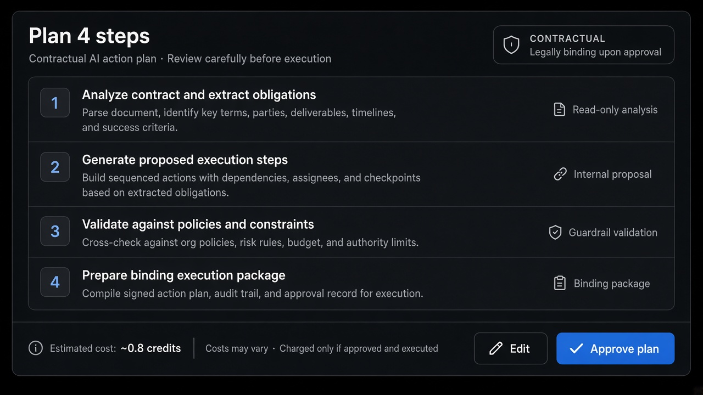

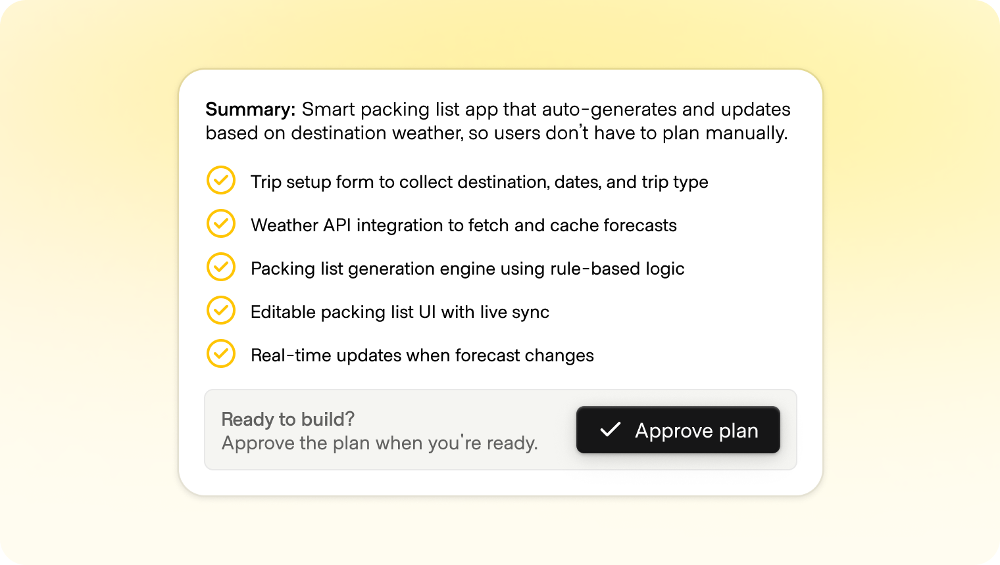

---

<!-- shapeof-captures:start -->
**Shape of AI captures** · [source](https://www.shapeof.ai/patterns/action-plan)


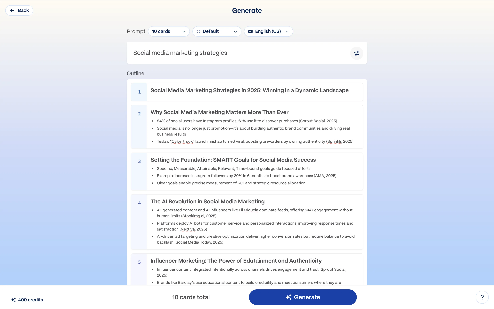

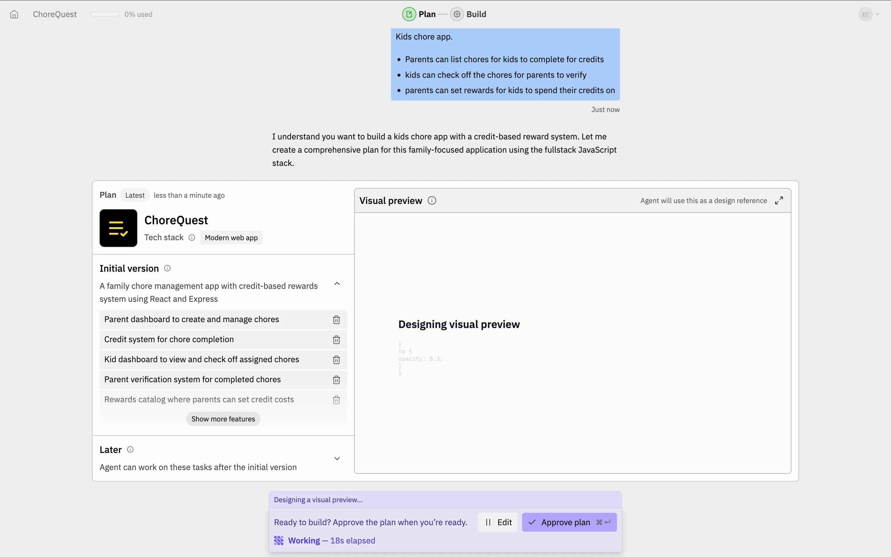

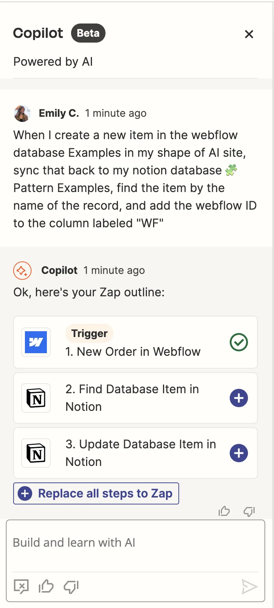

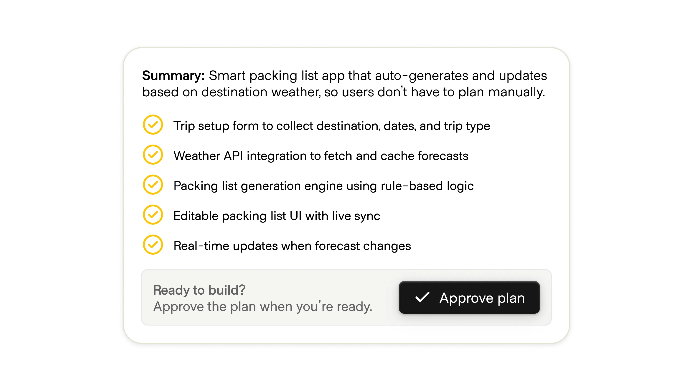

<!-- shapeof-captures:end -->

<!-- aidesign-captures:start -->
**AI Design Guide** · [Agentic UX Patterns](https://www.aidesign.guide/agentic-ux-patterns)


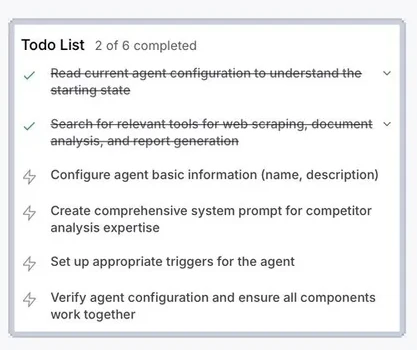

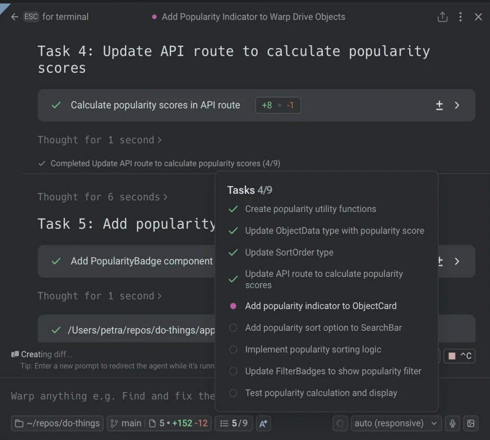

<!-- aidesign-captures:end -->

<!-- saasframe-expand:start -->
**SaaSFrame AI captures** (expanded) · [saasframe.io](https://www.saasframe.io/patterns)


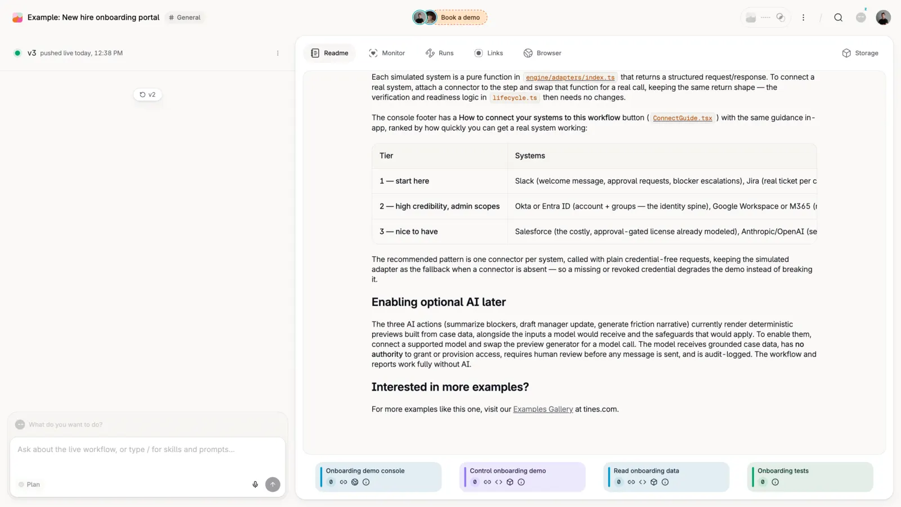

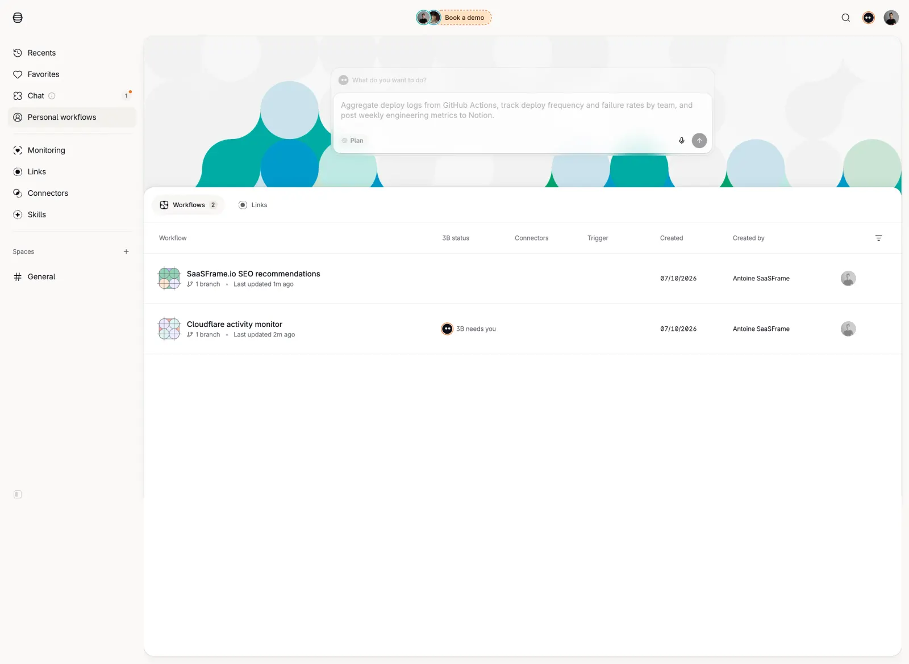

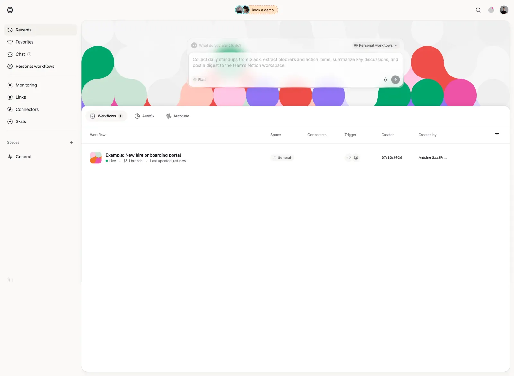

<!-- saasframe-expand:end -->


## Source references (external)


## Purpose

Show the agent’s intended steps **before** committing compute or side effects. Two modes:

| Mode | Behavior |
|------|----------|
| **Advisory** | Plan visible in Stream of Thought; no hard gate |
| **Contractual** | User must Approve / Edit / Regenerate before run (Replit, Devin, Chronicle-style) |

## When to use

- High compute (research agents, app/slide generation, multi-tool chains)
- Ambiguous prompts where wrong interpretation is expensive

## Anatomy

1. Skimmable numbered steps (edit in place)  
2. Cost / scope / permissions summary  
3. Approve · Edit · Regenerate · Skip (power users)  
4. After start → morph into `streaming-thought-state` with fidelity checks  

## Do / Don't

**Do:** keep skimmable; allow step-level edit; update plan if execution diverges.  
**Don't:** vanity walls of text; silent deviation from the approved plan.

## Snippet

```tsx
type PlanStep = { id: string; label: string };

export function ActionPlan({
  steps,
  estimate,
  contractual,
  onApprove,
  onEdit,
}: {
  steps: PlanStep[];
  estimate: string;
  contractual: boolean;
  onApprove: () => void;
  onEdit: (id: string) => void;
}) {
  return (
    <section className="max-w-mandate rounded-panel border border-hairline bg-surface-raised">
      <header className="flex items-center justify-between border-b border-hairline px-panel py-control-2">
        <h2 className="text-sm font-medium text-ink">Plan · {steps.length} steps</h2>
        <span className="rounded-control bg-accent-muted px-dense-2 py-px text-2xs text-accent-ink">
          {contractual ? "contractual" : "advisory"}
        </span>
      </header>
      <ol className="px-panel py-control">
        {steps.map((s, i) => (
          <li key={s.id} className="flex gap-control py-dense text-xs text-ink">
            <span className="w-4 text-ink-faint">{i + 1}</span>
            <button type="button" onClick={() => onEdit(s.id)} className="flex-1 text-left hover:text-accent-ink">
              {s.label}
            </button>
          </li>
        ))}
      </ol>
      <footer className="flex items-center justify-between border-t border-hairline px-panel py-control">
        <span className="font-mono text-2xs text-ink-muted">{estimate}</span>
        {contractual && (
          <button type="button" onClick={onApprove} className="rounded-control bg-accent px-panel py-control-2 text-xs text-accent-ink">
            Approve plan <kbd className="ml-dense opacity-70">⌘↵</kbd>
          </button>
        )}
      </footer>
    </section>
  );
}
```
