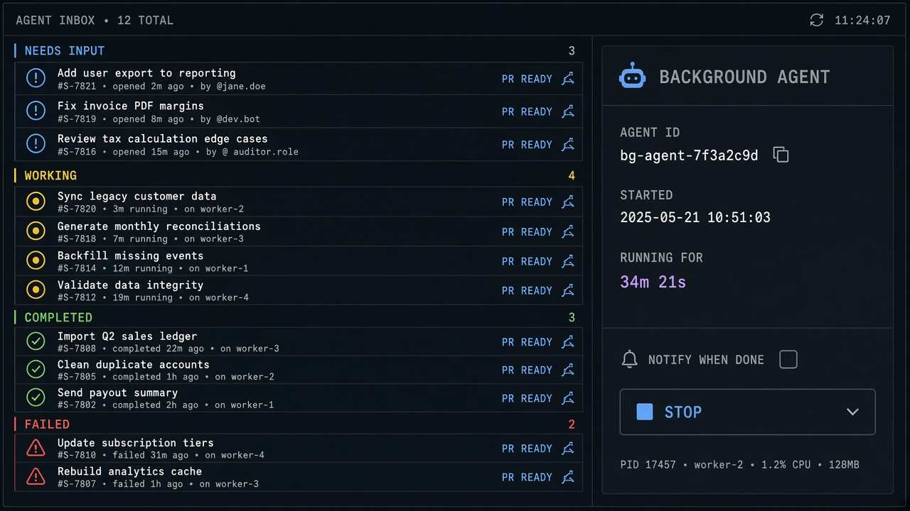

# Agent Inbox

**ID:** `agent-inbox`  
**Sources:** AI Design Guide · Claude Code agent view · Warp agents  
**Related:** `background-agent`, `clarify-before-act`, `human-handoff`



---

## Purpose

Dispatcher for **parallel agent sessions** grouped by status: Needs input · Working · Completed · Failed — human answers whichever is blocked.

## Status tokens

Use the same words/colors in inbox, notification, and session header.

## Snippet

```tsx
type AgentStatus = "needs_input" | "working" | "completed" | "failed";

export function AgentInbox({
  items,
  onOpen,
}: {
  items: { id: string; title: string; status: AgentStatus; meta?: string }[];
  onOpen: (id: string) => void;
}) {
  const color: Record<AgentStatus, string> = {
    needs_input: "text-warn",
    working: "text-accent-ink",
    completed: "text-ok",
    failed: "text-danger",
  };
  return (
    <ul className="divide-y divide-hairline rounded-panel border border-hairline bg-surface">
      {items.map((a) => (
        <li key={a.id}>
          <button
            type="button"
            onClick={() => onOpen(a.id)}
            className="flex w-full items-center gap-control px-panel py-control text-left text-xs"
          >
            <span className={`font-mono text-2xs uppercase ${color[a.status]}`}>
              {a.status.replace("_", " ")}
            </span>
            <span className="min-w-0 flex-1 truncate text-ink">{a.title}</span>
            {a.meta && <span className="font-mono text-2xs text-ink-faint">{a.meta}</span>}
          </button>
        </li>
      ))}
    </ul>
  );
}
```
