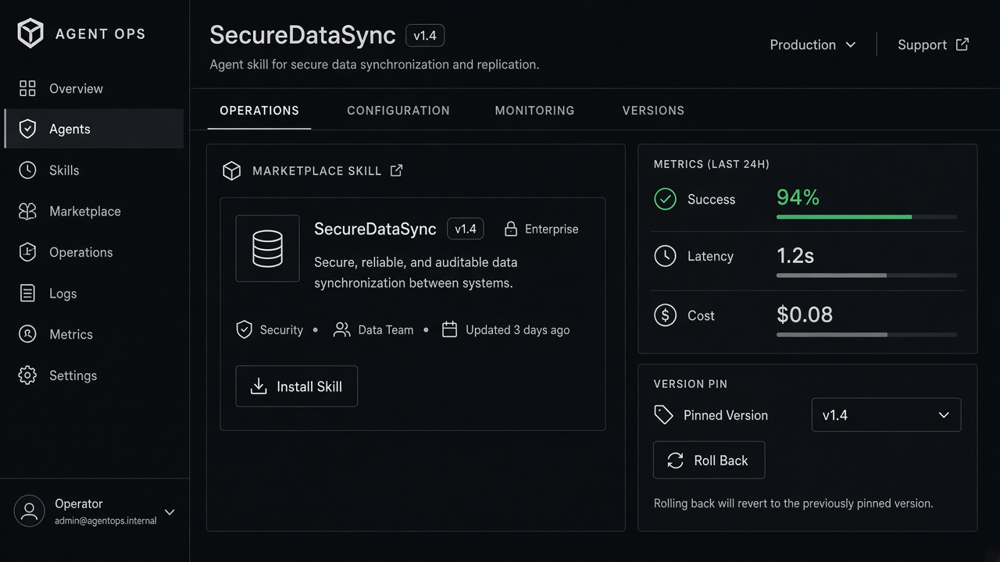

# Agent Marketplace

**ID:** `agent-marketplace`  
**Playground:** [agent-marketplace](https://aiuxplayground.com/pattern/agent-marketplace)  **Related:** connectors, autonomy-budget, disclosure

---



## Purpose

Browse and install third-party agents/skills with capability, cost, and permission previews before enable.

## When to use

Third-party agents/skills are installable.

## When not to use

Single first-party agent.

## Anatomy

Card · caps · permissions · Install

## Do / Don't

**Do:** Show scopes and cost before enable.  
**Don't:** Install with silent write permissions.

## Snippet

```tsx
export function AgentMarketplaceCard({ name, blurb, onInstall }: { name: string; blurb: string; onInstall: () => void }) {
  return (
    <article className="rounded-panel border border-hairline bg-surface p-panel">
      <h3 className="text-xs font-medium text-ink">{name}</h3>
      <p className="mt-dense text-2xs text-ink-muted">{blurb}</p>
      <button type="button" onClick={onInstall} className="mt-control rounded-control bg-accent px-control py-dense text-2xs text-accent-ink">Install</button>
    </article>
  );
}
```
