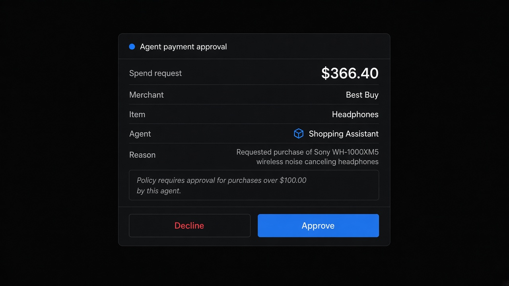

# Agent Payment

**ID:** `agent-payment`  
**Playground:** [agent-payment-approval](https://aiuxplayground.com/pattern/agent-payment-approval) · spending-limit · merchant-of-record · virtual-card · activity-log  
**Related:** `mandate-approval-card`, `autonomy-budget`, `cost-estimates`

---



## Purpose

Gate agent spend: **one-charge approval**, standing **spending limits**, named **merchant of record**, scoped **virtual card**, and an **activity log**. Money moves only after an explicit human gate.

## When to use

Gate agent spend: **one-charge approval**, standing **spending limits**, named **merchant of record**, scoped **virtual card**, and an **activity log**.

## When not to use

Skip when a denser core kit pattern already covers the job (see Related).

## Anatomy

1) Trigger 2) Dense primary surface 3) Confirm / dismiss

## Do / Don't

**Do:** Keep Linear/Raycast density; keyboard where actions exist; reuse kit tokens.  
**Don't:** Don't invent parallel chrome; don't hide irreversible effects.

## Snippet

```tsx
export function AgentPaymentApproval({
  amount,
  merchant,
  item,
  expiresIn,
  onApprove,
  onDecline,
}: {
  amount: string;
  merchant: string;
  item: string;
  expiresIn?: string;
  onApprove: () => void;
  onDecline: () => void;
}) {
  return (
    <section className="max-w-mandate rounded-panel border border-hairline-strong bg-surface-raised">
      <header className="border-b border-hairline px-panel py-control-2">
        <p className="text-2xs uppercase tracking-wide text-ink-faint">Spend request</p>
        <p className="text-sm font-medium text-ink">{amount}</p>
        <p className="text-xs text-ink-muted">
          {merchant} · {item}
          {expiresIn ? ` · ${expiresIn}` : ""}
        </p>
      </header>
      <footer className="flex justify-end gap-control px-panel py-control">
        <button type="button" onClick={onDecline} className="text-xs text-ink-muted">
          Decline
        </button>
        <button
          type="button"
          onClick={onApprove}
          className="rounded-control bg-accent px-panel py-control-2 text-xs text-accent-ink"
        >
          Approve
        </button>
      </footer>
    </section>
  );
}
```
