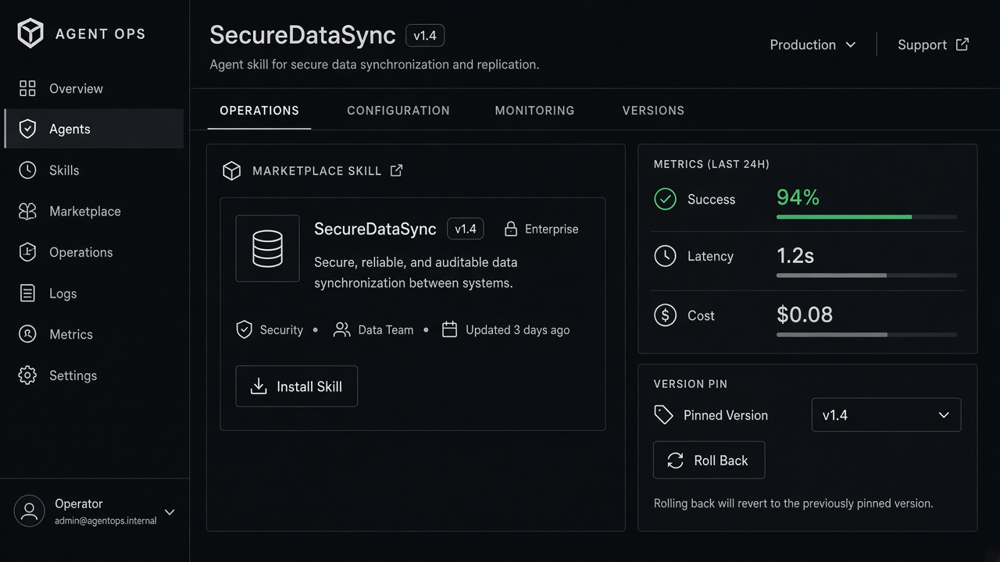

# Agent Performance Metrics

**ID:** `agent-performance-metrics`  
**Playground:** [agent-performance-metrics](https://aiuxplayground.com/pattern/agent-performance-metrics)  **Related:** autonomy-budget, footprints, rate-limit-meter

---



## Purpose

Show success rate, latency, cost, and failure reasons for agent runs so operators can tune autonomy.

## Snippet

```tsx
export function AgentMetrics({ success, latency, cost }: { success: string; latency: string; cost: string }) {
  return (
    <dl className="grid grid-cols-3 gap-control rounded-panel border border-hairline bg-surface p-panel text-2xs">
      <div><dt className="text-ink-faint">Success</dt><dd className="font-mono text-ink">{success}</dd></div>
      <div><dt className="text-ink-faint">Latency</dt><dd className="font-mono text-ink">{latency}</dd></div>
      <div><dt className="text-ink-faint">Cost</dt><dd className="font-mono text-ink">{cost}</dd></div>
    </dl>
  );
}
```
