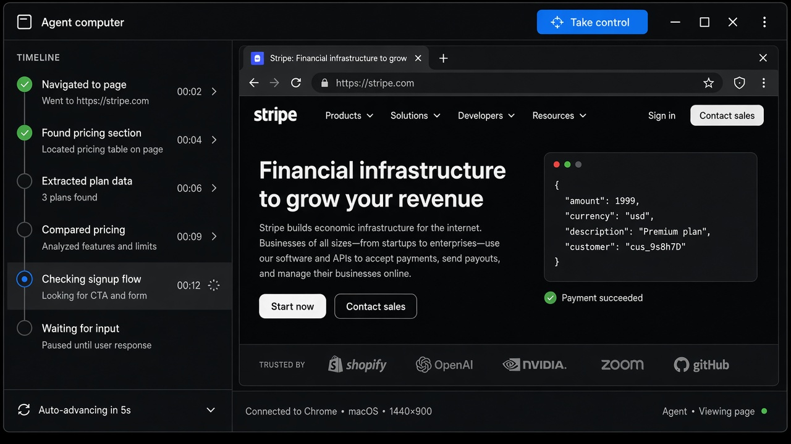
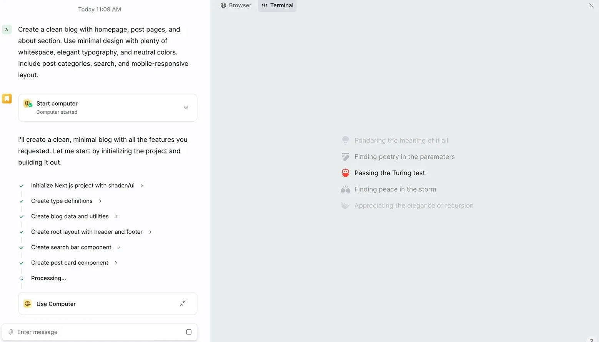
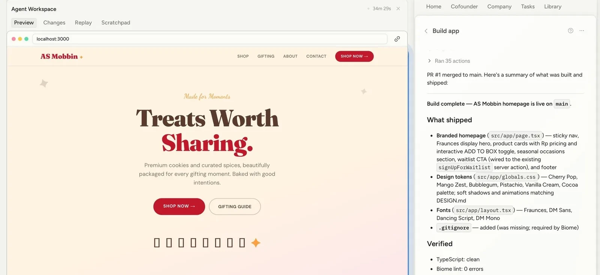
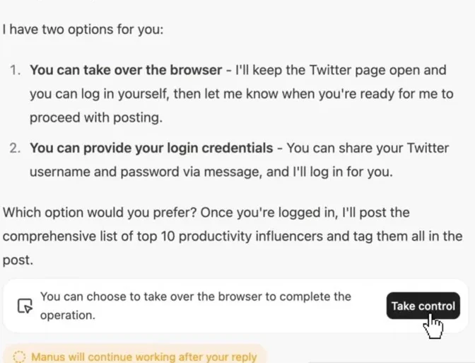
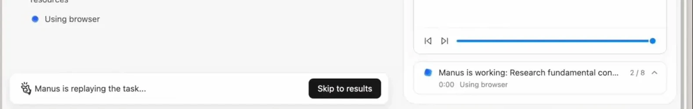
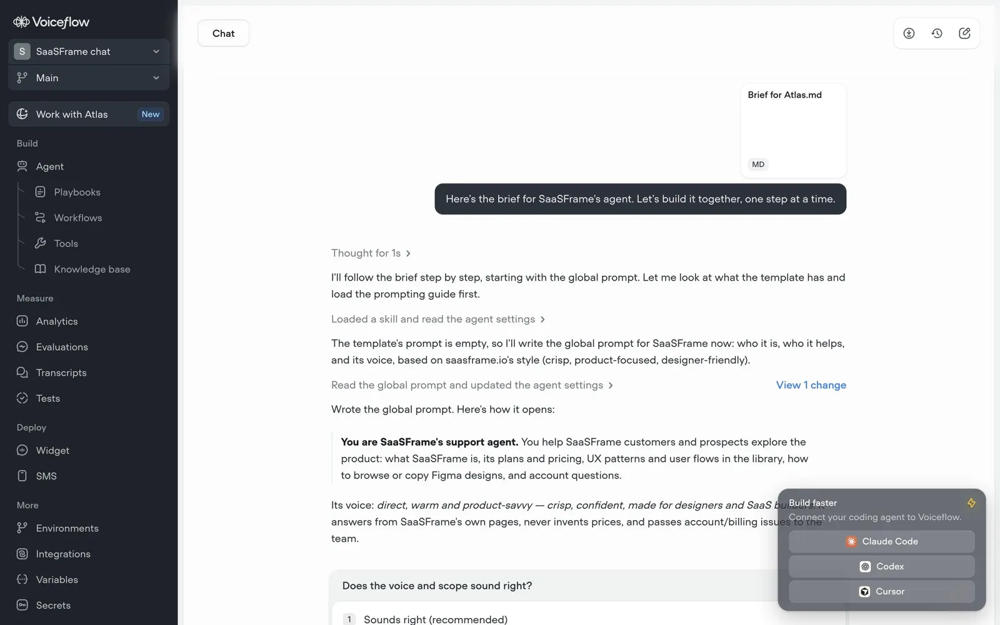

# Agent Takeover

**ID:** `agent-takeover`  
**Sources:** AI Design Guide · Manus / Operator / Comet  
**Related:** `dual-speed-layout`, `mandate-approval-card`, `controls`



---

<!-- aidesign-captures:start -->
**AI Design Guide** · [Agentic UX Patterns](https://www.aidesign.guide/agentic-ux-patterns)









<!-- aidesign-captures:end -->


## Source references (external)


## Purpose

User watches the agent’s **remote browser/computer** and can **Take control** (login, CAPTCHA, payment), then hand control back.

## Do / Don't

**Do:** live pane + Take control / Hand back; pause agent on takeover.  
**Don't:** silent credential capture; continue agent while user types in the same session without pause.

## Snippet

```tsx
export function AgentTakeoverBar({
  controlling,
  onTakeControl,
  onHandBack,
}: {
  controlling: boolean;
  onTakeControl: () => void;
  onHandBack: () => void;
}) {
  return (
    <div className="flex h-8 items-center gap-control border-b border-hairline bg-surface px-panel text-2xs">
      <span className="text-ink-muted">{controlling ? "You control the browser" : "Agent computer"}</span>
      <button
        type="button"
        onClick={controlling ? onHandBack : onTakeControl}
        className="ml-auto rounded-control bg-accent-muted px-control py-dense text-accent-ink"
      >
        {controlling ? "Hand back" : "Take control"}
      </button>
    </div>
  );
}
```
