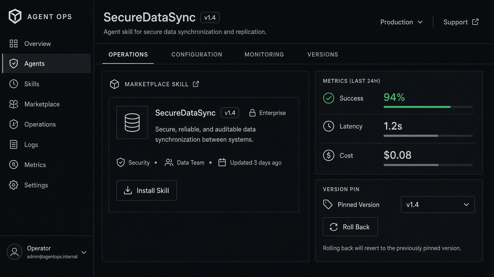

# Agent Versioning

**ID:** `agent-versioning`  
**Playground:** [agent-versioning](https://aiuxplayground.com/pattern/agent-versioning)  **Related:** footprints, checkpoints-restore

---



## Purpose

Pin, compare, and roll back agent/prompt/tool configs so runs stay reproducible.

## When to use

Pin, compare, and roll back agent/prompt/tool configs so runs stay reproducible.

## When not to use

Skip when a denser core kit pattern already covers the job (see Related).

## Anatomy

1) Trigger 2) Dense primary surface 3) Confirm / dismiss

## Do / Don't

**Do:** Keep Linear/Raycast density; keyboard where actions exist; reuse kit tokens.  
**Don't:** Don't invent parallel chrome; don't hide irreversible effects.

## Snippet

```tsx
export function AgentVersionPin({ version, onRollback }: { version: string; onRollback: () => void }) {
  return (
    <div className="flex items-center gap-control text-2xs">
      <span className="font-mono text-ink-muted">{version}</span>
      <button type="button" onClick={onRollback} className="text-accent-ink hover:underline">Roll back</button>
    </div>
  );
}
```
