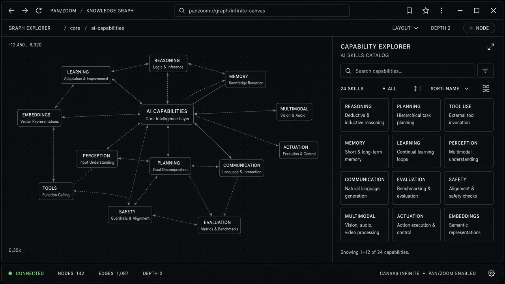

# AI Capability Explorer

**ID:** `ai-capability-explorer`  
**Playground:** [ai-capability-explorer](https://aiuxplayground.com/pattern/ai-capability-explorer)  **Related:** onboarding-first-value, suggestions, disclosure

---



## Purpose

Interactive map of what the AI can do (modes, tools, limits) for onboarding and discovery.

## When to use

Interactive map of what the AI can do (modes, tools, limits) for onboarding and discovery.

## When not to use

Skip when a denser core kit pattern already covers the job (see Related).

## Anatomy

1) Trigger 2) Dense primary surface 3) Confirm / dismiss

## Do / Don't

**Do:** Keep Linear/Raycast density; keyboard where actions exist; reuse kit tokens.  
**Don't:** Don't invent parallel chrome; don't hide irreversible effects.

## Snippet

```tsx
export function CapabilityExplorer({ items, onPick }: { items: { id: string; label: string }[]; onPick: (id: string) => void }) {
  return (
    <ul className="grid grid-cols-2 gap-control">
      {items.map((i) => (
        <li key={i.id}><button type="button" onClick={() => onPick(i.id)} className="w-full rounded-panel border border-hairline px-control py-panel text-left text-xs text-ink hover:border-hairline-strong">{i.label}</button></li>
      ))}
    </ul>
  );
}
```
