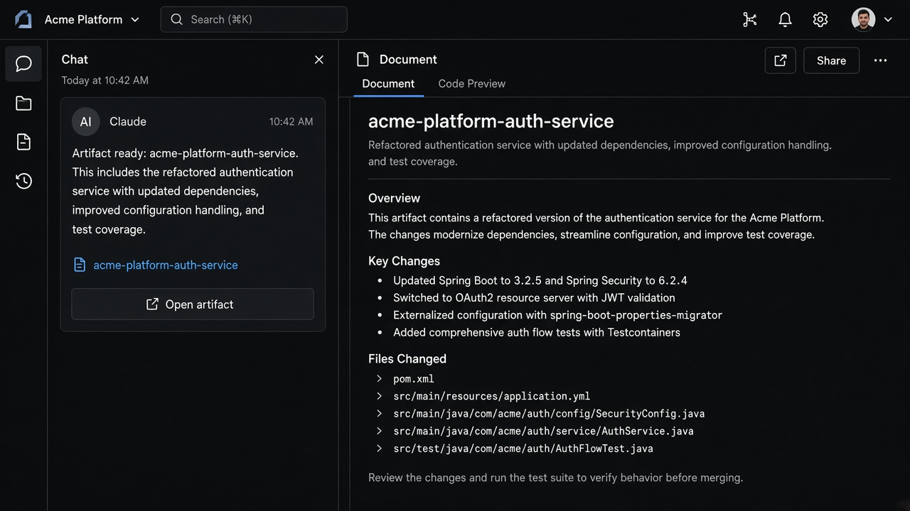

# Artifact Pane

**ID:** `artifact-pane`  
**Teardowns:** [Output & artifacts](https://aiuxplayground.com/teardowns/compare/output-artifacts-refinement) · Claude split-pane · ChatGPT writing blocks · Gemini Workspace export  
**Related:** `dual-speed-layout`, `inline-action`, `response-versions`, `citations`



---

## Purpose

Graduate a deliverable (doc, code, interactive UI, report) out of the message bubble into a **dedicated pane** users can edit, run, version, and ship — while chat remains the reasoning trail.

## When to use

- Code, documents, decks, calculators, generative UI that will be reused  
- Agent runs that produce files / deliverables (Manus-style)

## When not to use

- Short Q&A prose (keep in-thread)  
- One-off research answers better as tabbed reports (`citations` + export)

## Product bets (from teardowns)

| Copy | Pattern |
|------|---------|
| Claude | Announce in-thread → open split pane |
| ChatGPT | Stay in-thread until writing block / share link |
| Perplexity | Tabbed report + PDF/MD/DOCX export |
| Gemini | Structured sections → Docs / Sheets / Maps handoff |

## Anatomy

1. In-thread announcement (“Artifact ready”)  
2. Split pane: title · tabs (Code / Preview / Diff) · overflow (Export / Open external)  
3. Chat column stays scroll-independent  

## Snippet

```tsx
export function ArtifactPane({
  title,
  tabs,
  activeTab,
  onTab,
  children,
}: {
  title: string;
  tabs: { id: string; label: string }[];
  activeTab: string;
  onTab: (id: string) => void;
  children: React.ReactNode;
}) {
  return (
    <section className="flex h-full min-w-0 flex-col border-l border-hairline bg-canvas">
      <header className="flex h-10 items-center gap-control border-b border-hairline px-panel">
        <h2 className="truncate text-xs font-medium text-ink">{title}</h2>
        <div className="ml-auto flex gap-dense">
          {tabs.map((t) => (
            <button
              key={t.id}
              type="button"
              onClick={() => onTab(t.id)}
              className={`rounded-control px-control py-dense text-2xs ${
                activeTab === t.id ? "bg-accent-muted text-accent-ink" : "text-ink-muted"
              }`}
            >
              {t.label}
            </button>
          ))}
        </div>
      </header>
      <div className="min-h-0 flex-1 overflow-auto p-panel">{children}</div>
    </section>
  );
}
```
