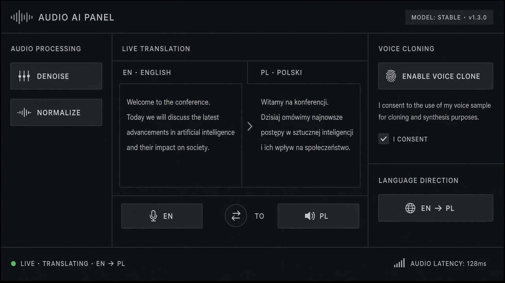

# Audio Enhancement

**ID:** `audio-enhancement`  
**Playground:** [audio-enhancement](https://aiuxplayground.com/pattern/audio-enhancement)  **Related:** voice-transcript, multimodal

---



## Purpose

Controls to denoise, normalize, or enhance uploaded/recorded audio before AI processing.

## When to use

Controls to denoise, normalize, or enhance uploaded/recorded audio before AI processing.

## When not to use

Skip when a denser core kit pattern already covers the job (see Related).

## Anatomy

1) Trigger 2) Dense primary surface 3) Confirm / dismiss

## Do / Don't

**Do:** Keep Linear/Raycast density; keyboard where actions exist; reuse kit tokens.  
**Don't:** Don't invent parallel chrome; don't hide irreversible effects.

## Snippet

```tsx
export function AudioEnhancement({ onEnhance }: { onEnhance: (preset: string) => void }) {
  return (
    <div className="flex gap-dense">
      {["Denoise", "Normalize", "Boost voice"].map((p) => (
        <button key={p} type="button" onClick={() => onEnhance(p)} className="rounded-control border border-hairline px-control py-dense text-2xs text-ink-muted hover:text-ink">{p}</button>
      ))}
    </div>
  );
}
```
