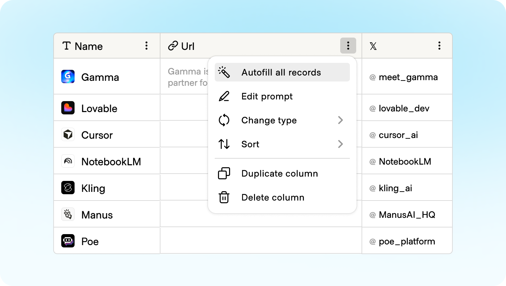
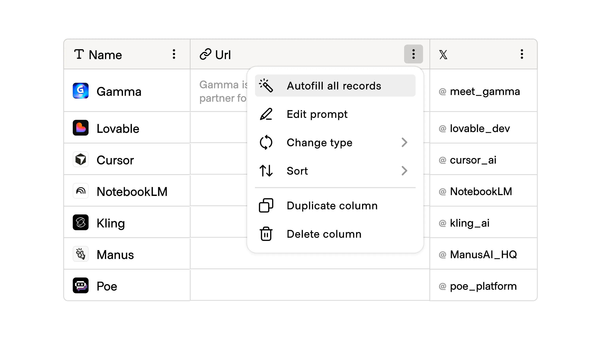
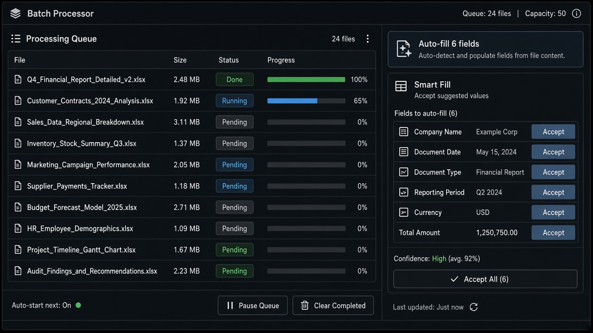

# Auto Fill

**ID:** `auto-fill`  
**Shape of AI:** https://www.shapeof.ai/  **Related:** smart-fill, clarify-before-act

---

<!-- shapeof-captures:start -->
**Shape of AI captures** · [source](https://www.shapeof.ai/patterns/auto-fill)






<!-- shapeof-captures:end -->



## Purpose

Extend one prompt across multiple fields/inputs at once (Shape of AI).

## When to use

One intent maps to many fields.

## When not to use

Single-field prompts.

## Anatomy

Banner count · preview diffs · Accept per field / all

## Do / Don't

**Do:** Per-field accept; show source of fill.  
**Don't:** Silent overwrite of user-typed values.

## Snippet

```tsx
export function AutoFillBanner({ count, onFill }: { count: number; onFill: () => void }) {
  return <button type="button" onClick={onFill} className="text-2xs text-accent-ink">Auto-fill {count} fields</button>;
}
```
