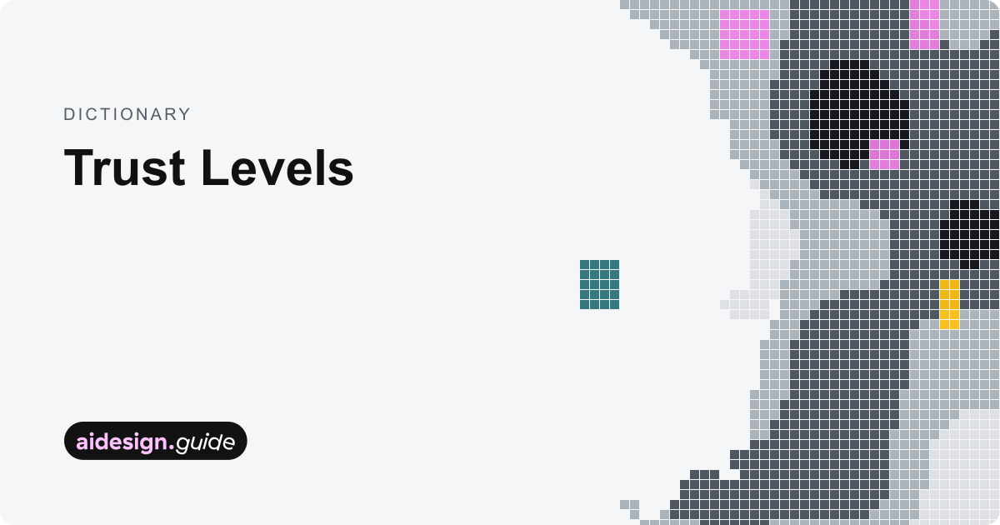
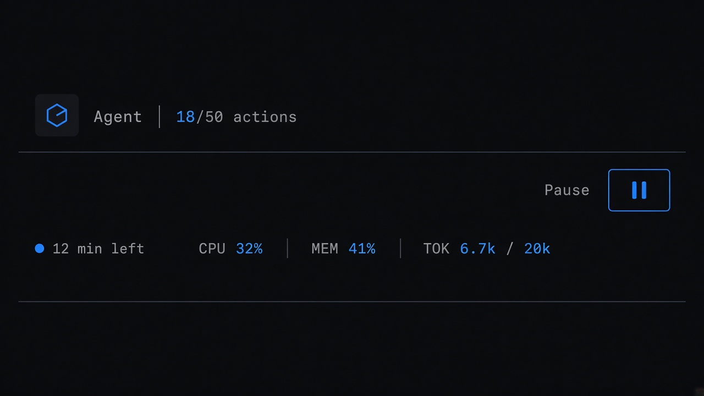
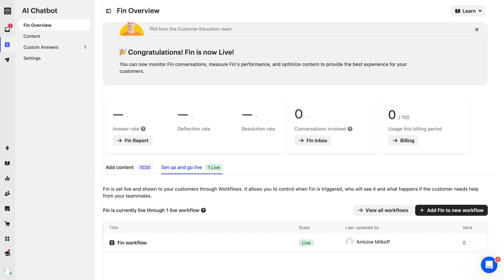

# Autonomy Budget

**ID:** `autonomy-budget`  
**Playground:** Autonomy Budgets · Hard Budget Ceilings · Running Meters · Suggest/Confirm/Execute  
**Teardowns:** agent runs (Manus) · HITL permissions (Perplexity)  
**Related:** `mandate-approval-card`, `cost-estimates`, `controls`, `action-plan`

---

<!-- aidesign-p1:start -->
**AI Design Guide · P1 resources** · [resources](https://www.aidesign.guide/resources) · anti-patterns gallery is login-gated



<!-- aidesign-p1:end -->




## Source references (external)


## Purpose

Bound unattended agent work by **actions, time, and spend**. Surface live meters; stop at cap; escalate to `mandate-approval-card` when a step exceeds the remaining budget or risk tier.

## Autonomy modes

| Mode | Behavior |
|------|----------|
| Suggest | Propose only |
| Confirm | Draft + human gate |
| Execute | Run within budget; pause at ceiling |

## When to use

Bound unattended agent work by **actions, time, and spend**.

## When not to use

Skip when a denser core kit pattern already covers the job (see Related).

## Anatomy

1) Trigger 2) Dense primary surface 3) Confirm / dismiss

## Do / Don't

**Do:** Keep Linear/Raycast density; keyboard where actions exist; reuse kit tokens.  
**Don't:** Don't invent parallel chrome; don't hide irreversible effects.

## Snippet

```tsx
export function AutonomyBudgetBar({
  used,
  cap,
  unit = "actions",
  eta,
  onPause,
}: {
  used: number;
  cap: number;
  unit?: string;
  eta?: string;
  onPause: () => void;
}) {
  const over = used >= cap;
  return (
    <div className="flex h-8 items-center gap-control border border-hairline bg-surface px-panel text-2xs">
      <span className="text-ink-muted">Agent running</span>
      <span className={`font-mono tabular-nums ${over ? "text-warn" : "text-ink"}`}>
        {used}/{cap} {unit}
      </span>
      {eta && <span className="text-ink-faint">{eta}</span>}
      <button type="button" onClick={onPause} className="ml-auto text-ink-muted hover:text-danger">
        Pause
      </button>
    </div>
  );
}
```
