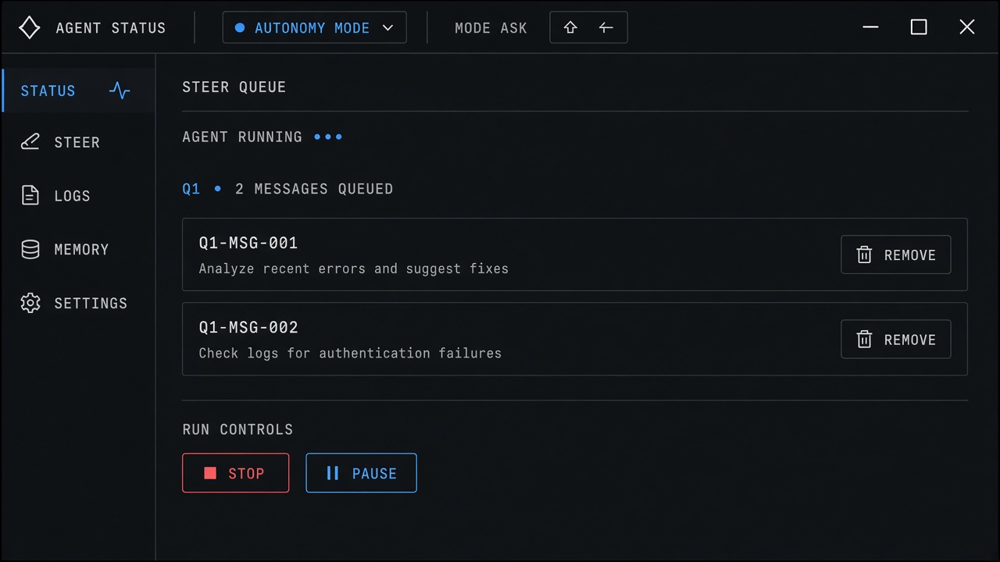
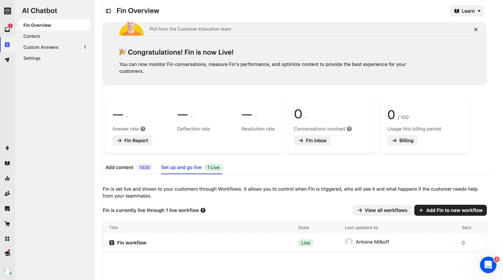

# Autonomy Modes

**ID:** `autonomy-modes`  
**Sources:** AI Design Guide · Claude Code Shift+Tab · Cursor Ask/Agent/Plan  
**Related:** `autonomy-budget`, `scoped-approval`, `action-plan`



---


## Source references (external)


## Purpose

Always-visible mode for how much the agent may do: **Plan** (read-only) · **Ask / accept edits** · **Auto** — cycled by shortcut, labeled in the status bar.

## Modes

| Mode | Agent may |
|------|-----------|
| `plan` | Read, propose plan — no writes |
| `ask` | Propose edits; human accepts |
| `auto` | Act within budget / scoped allows |

## Snippet

```tsx
export type AutonomyMode = "plan" | "ask" | "auto";

export function AutonomyModeBadge({
  mode,
  onCycle,
}: {
  mode: AutonomyMode;
  onCycle: () => void;
}) {
  return (
    <button
      type="button"
      onClick={onCycle}
      className="inline-flex items-center gap-dense rounded-control border border-hairline bg-surface px-control py-dense font-mono text-2xs text-ink"
      title="Cycle autonomy (⇧Tab)"
    >
      <span className="text-ink-faint">mode</span>
      {mode}
      <kbd className="text-ink-faint">⇧Tab</kbd>
    </button>
  );
}
```
