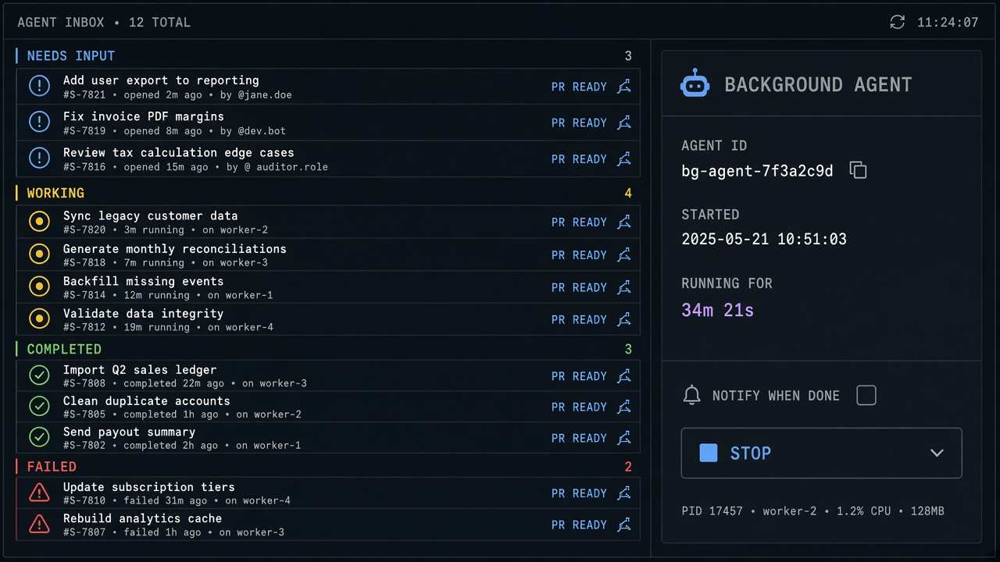
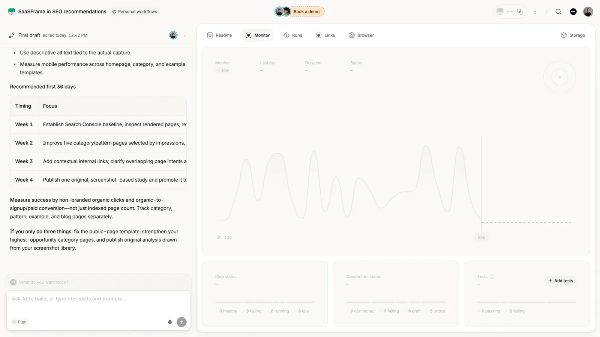

# Background Agent

**ID:** `background-agent`  
**Sources:** AI Design Guide · Devin / Cursor cloud agents · Codex  
**Related:** `agent-inbox`, `smart-diff`, `shared-session`, `controls`



---


## Source references (external)


## Purpose

Fire a task that runs **remotely** while the user multitasks. Session card shows status (e.g. PR ready), worklog, changes, notify-when-done.

## Anatomy

1. Status pill + elapsed  
2. Tabs: Worklog / Changes / PR / Desktop  
3. Notify opt-in · Open · Stop

## Snippet

```tsx
export function BackgroundAgentCard({
  title,
  status,
  elapsed,
  filesChanged,
  notify,
  onNotify,
  onOpen,
  onStop,
}: {
  title: string;
  status: string;
  elapsed: string;
  filesChanged?: number;
  notify: boolean;
  onNotify: (v: boolean) => void;
  onOpen: () => void;
  onStop: () => void;
}) {
  return (
    <section className="rounded-panel border border-hairline bg-surface-raised p-panel">
      <div className="flex items-center gap-control">
        <h2 className="min-w-0 flex-1 truncate text-xs font-medium text-ink">{title}</h2>
        <span className="font-mono text-2xs text-ok">{status}</span>
      </div>
      <p className="mt-dense font-mono text-2xs text-ink-faint">
        {elapsed}
        {filesChanged != null ? ` · ${filesChanged} files` : ""}
      </p>
      <label className="mt-control flex items-center gap-dense text-2xs text-ink-muted">
        <input type="checkbox" checked={notify} onChange={(e) => onNotify(e.target.checked)} />
        Notify when done
      </label>
      <div className="mt-control flex justify-end gap-control">
        <button type="button" onClick={onStop} className="text-xs text-danger">
          Stop
        </button>
        <button
          type="button"
          onClick={onOpen}
          className="rounded-control bg-accent px-panel py-control-2 text-xs text-accent-ink"
        >
          Open
        </button>
      </div>
    </section>
  );
}
```
