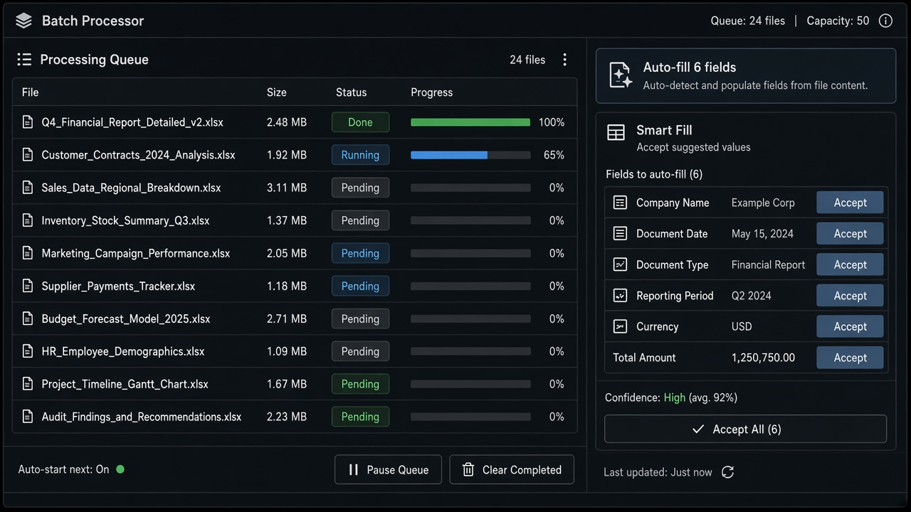

# Batch Input Processing

**ID:** `batch-input-processing`  
**Playground:** [batch-input-processing](https://aiuxplayground.com/pattern/batch-input-processing)  **Related:** controls, rate-limit-meter, autonomy-budget

---



## Purpose

Queue many files/rows for the same AI job with per-item status and aggregate cancel.

## When to use

Queue many files/rows for the same AI job with per-item status and aggregate cancel.

## When not to use

Skip when a denser core kit pattern already covers the job (see Related).

## Anatomy

1) Trigger 2) Dense primary surface 3) Confirm / dismiss

## Do / Don't

**Do:** Keep Linear/Raycast density; keyboard where actions exist; reuse kit tokens.  
**Don't:** Don't invent parallel chrome; don't hide irreversible effects.

## Snippet

```tsx
export function BatchQueue({ items }: { items: { id: string; name: string; status: string }[] }) {
  return (
    <ul className="divide-y divide-hairline rounded-panel border border-hairline bg-surface">
      {items.map((i) => (
        <li key={i.id} className="flex justify-between px-panel py-control text-xs"><span className="truncate text-ink">{i.name}</span><span className="font-mono text-2xs text-ink-faint">{i.status}</span></li>
      ))}
    </ul>
  );
}
```
