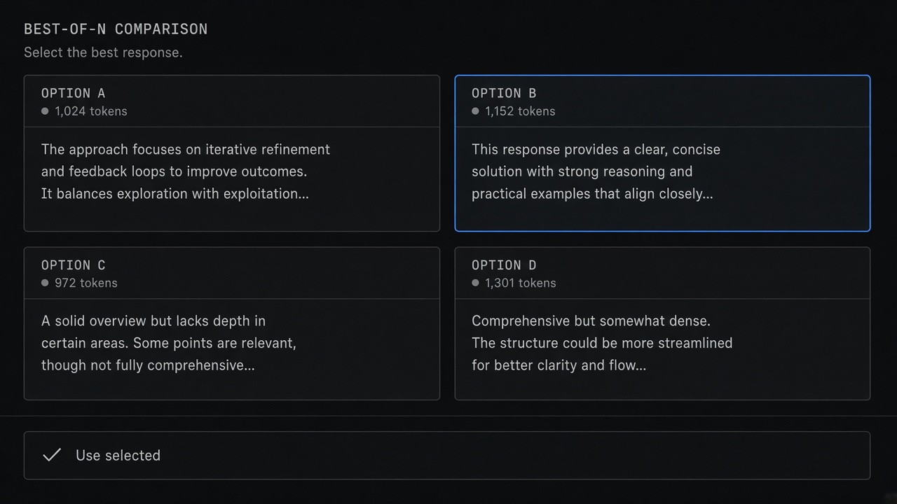
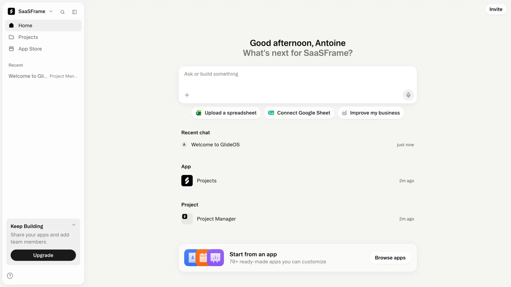

# Best of N

**ID:** `best-of-n`  
**Sources:** AI Design Guide · Google Stitch / Linktree / Codex variations  
**Related:** `response-versions`, `variations`, `generative-ui`



---


## Source references (external)


## Purpose

Generate **N parallel attempts** and pick one in a comparison grid — not a chat stack. Control count + diversity (Refine / Explore / Reimagine).

## Snippet

```tsx
export function BestOfNGrid({
  options,
  selected,
  onSelect,
  onConfirm,
}: {
  options: { id: string; label: string; preview: string }[];
  selected?: string;
  onSelect: (id: string) => void;
  onConfirm: () => void;
}) {
  return (
    <section className="space-y-control">
      <ul className="grid grid-cols-2 gap-control">
        {options.map((o) => (
          <li key={o.id}>
            <button
              type="button"
              onClick={() => onSelect(o.id)}
              className={`h-full w-full rounded-panel border px-control py-panel text-left ${
                selected === o.id ? "border-accent bg-accent-muted" : "border-hairline bg-surface"
              }`}
            >
              <span className="block text-xs font-medium text-ink">{o.label}</span>
              <span className="mt-dense block text-2xs text-ink-faint line-clamp-3">{o.preview}</span>
            </button>
          </li>
        ))}
      </ul>
      <button
        type="button"
        disabled={!selected}
        onClick={onConfirm}
        className="rounded-control bg-accent px-panel py-control-2 text-xs text-accent-ink disabled:opacity-40"
      >
        Use selected
      </button>
    </section>
  );
}
```
