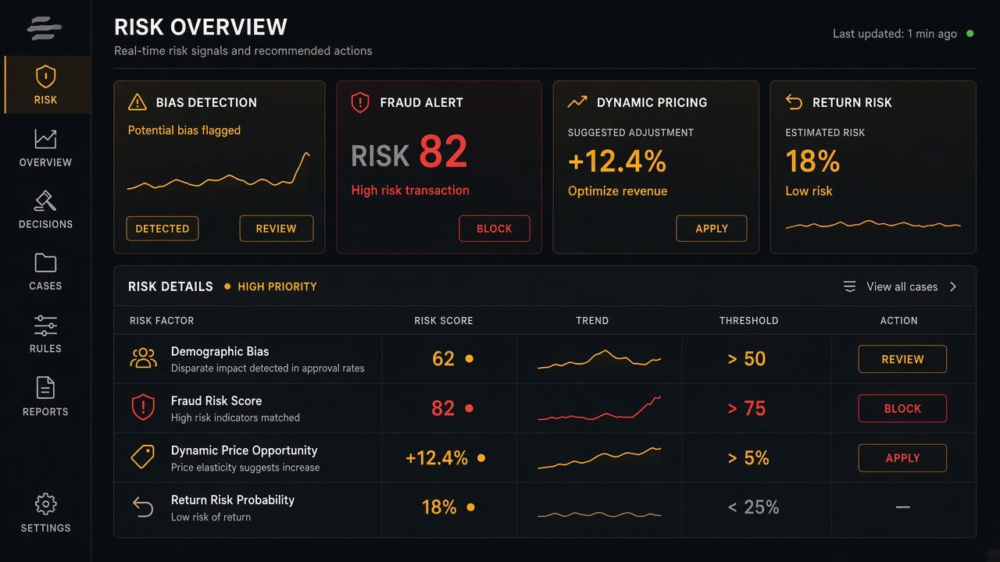

# Bias Detection

**ID:** `bias-detection`  
**Playground:** [bias-detection](https://aiuxplayground.com/pattern/bias-detection)  **Related:** disclosure, failure-disclosure, feedback

---



## Purpose

Surface potential bias/fairness flags on outputs with explainable cues and remediation actions.

## Snippet

```tsx
export function BiasFlag({ note, onReview }: { note: string; onReview: () => void }) {
  return (
    <div className="flex items-start gap-control rounded-control border border-warn/40 bg-warn-muted px-control py-dense text-2xs text-warn">
      <span className="flex-1">{note}</span>
      <button type="button" onClick={onReview} className="underline">Review</button>
    </div>
  );
}
```
