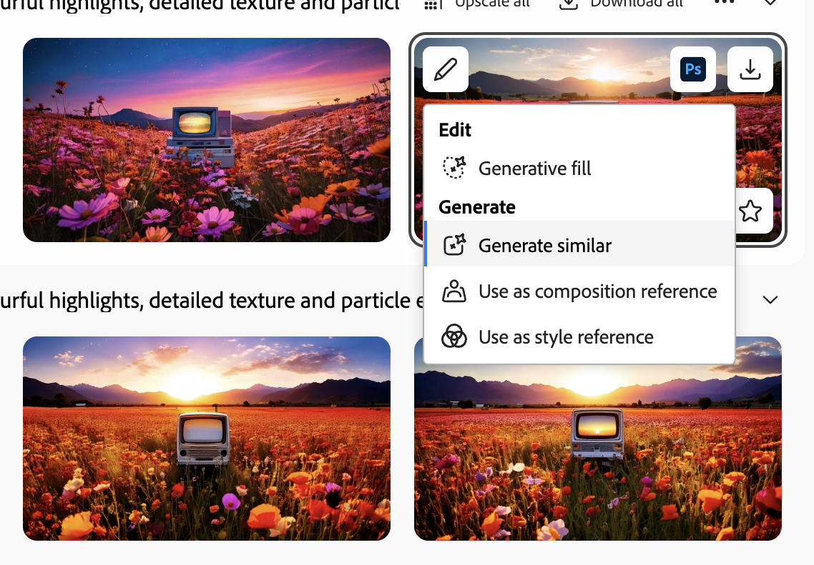
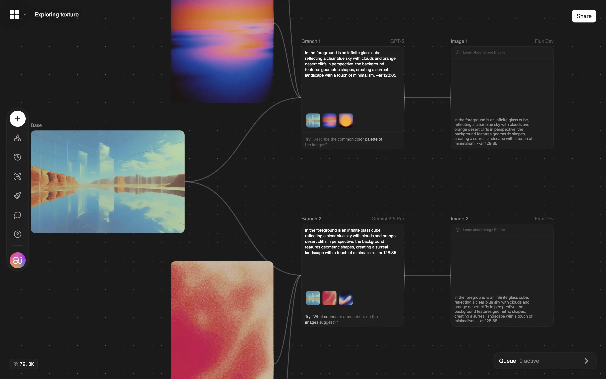
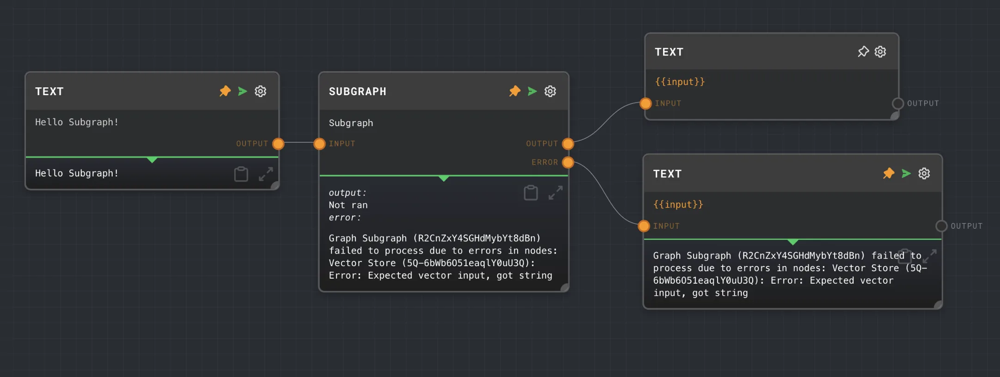
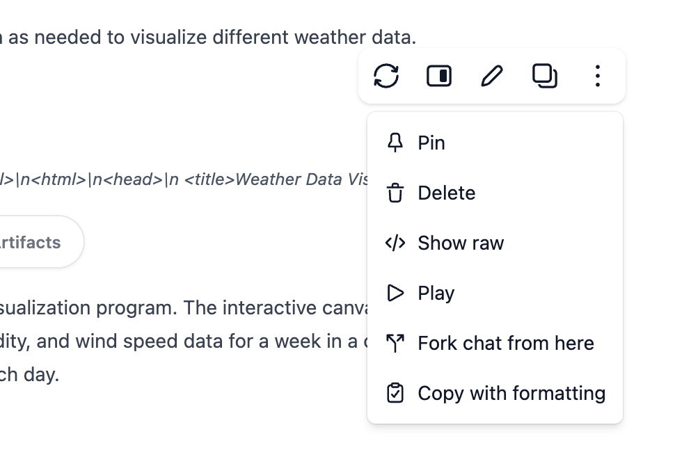
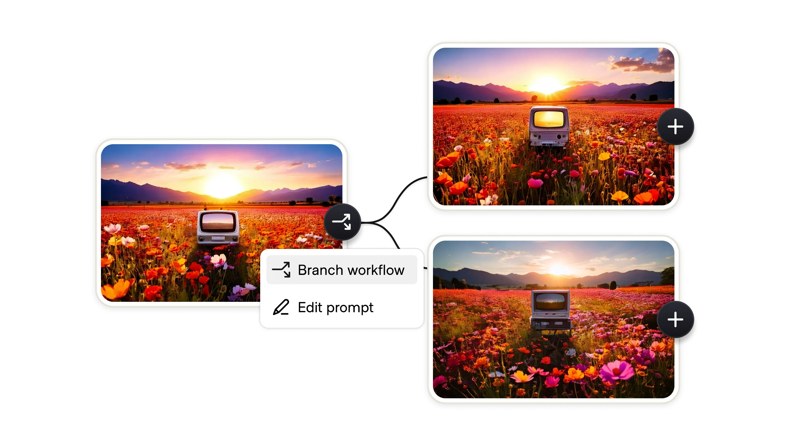
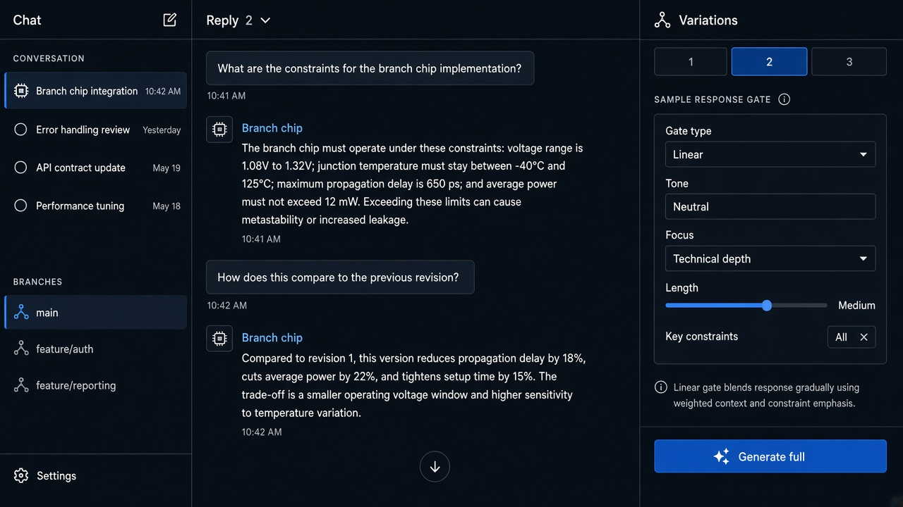

# Branches

**ID:** `branches`  
**Shape of AI:** https://www.shapeof.ai/pattern-types/governors  **Related:** footprints, response-versions, thread-branch

---

<!-- shapeof-captures:start -->
**Shape of AI captures** · [source](https://www.shapeof.ai/patterns/branches)













<!-- shapeof-captures:end -->



## Purpose

Iterative prompting with retained footprints back to the original (Shape of AI Governors).

## When to use

Explore alternate paths without losing the trunk.

## When not to use

Linear FAQ bots.

## Anatomy

Branch chip · tree / list · jump to node

## Do / Don't

**Do:** Keep footprints; label branch intent.  
**Don't:** Fork silently on every regenerate.

## Snippet

```tsx
export function BranchChip({ label, onOpen }: { label: string; onOpen: () => void }) {
  return <button type="button" onClick={onOpen} className="rounded-control border border-hairline px-control py-dense text-2xs text-ink-muted">Branch · {label}</button>;
}
```
