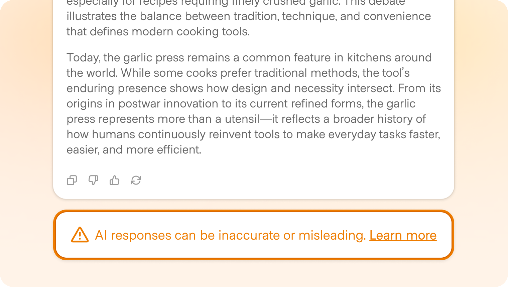
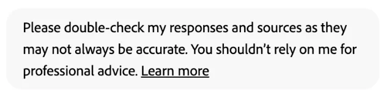
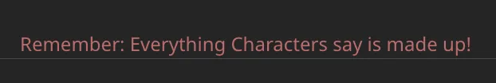
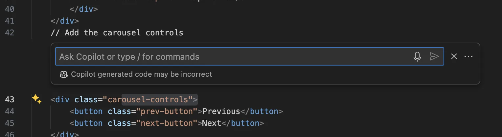
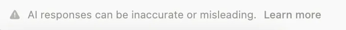
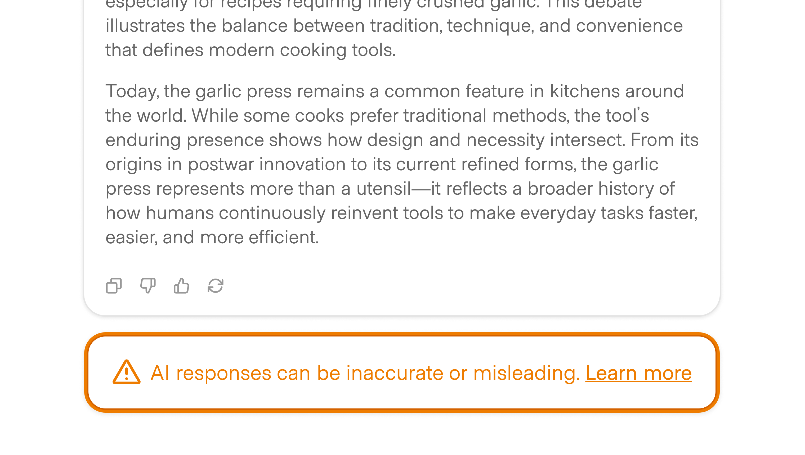
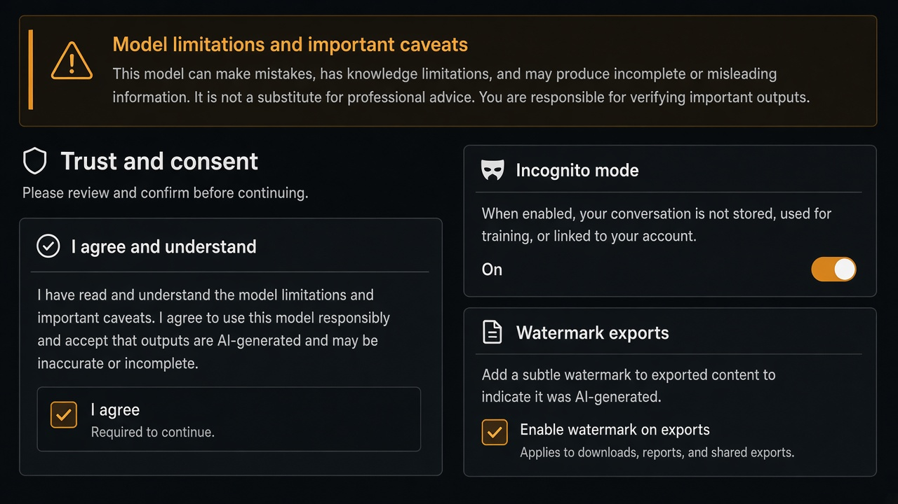

# Caveat

**ID:** `caveat`  
**Shape of AI:** https://www.shapeof.ai/pattern-types/trust-builders  **Related:** disclosure, failure-disclosure

---

<!-- shapeof-captures:start -->
**Shape of AI captures** · [source](https://www.shapeof.ai/patterns/caveat)














<!-- shapeof-captures:end -->



## Purpose

Inform users about model/tech shortcomings or risks inline.

## When to use

Known model/domain limits affect trust.

## When not to use

Every casual message.

## Anatomy

Inline banner · link to details · dismiss optional

## Do / Don't

**Do:** Specific, actionable caveats.  
**Don't:** Generic legal wallpaper.

## Snippet

```tsx
export function CaveatBanner({ text }: { text: string }) {
  return <p className="rounded-control border border-hairline bg-surface-overlay px-control py-dense text-2xs text-ink-muted">{text}</p>;
}
```
