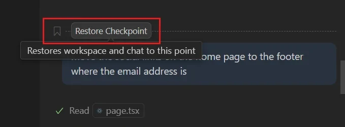
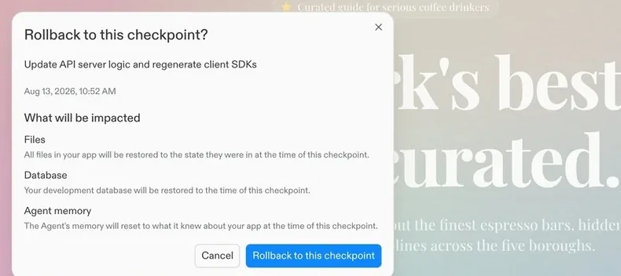
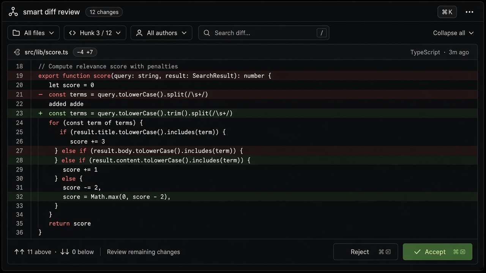
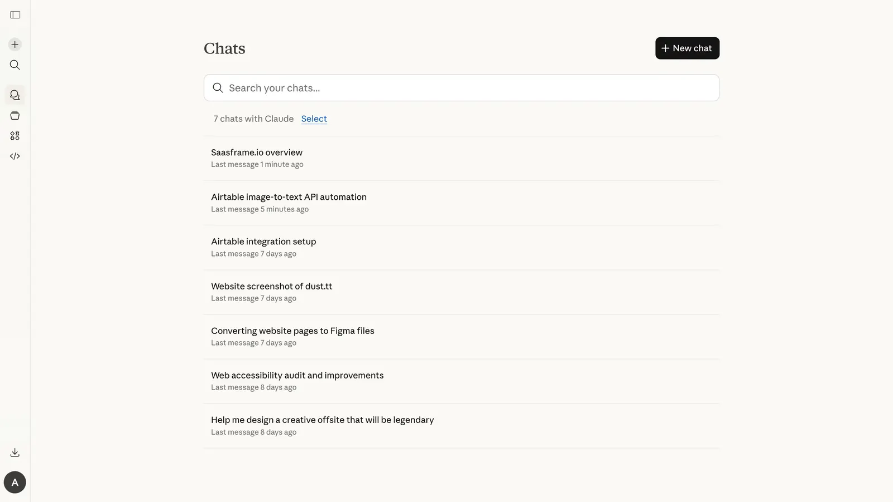

# Checkpoints & Restore

**ID:** `checkpoints-restore`  
**Playground:** [checkpoints-and-restore](https://aiuxplayground.com/pattern/checkpoints-and-restore)  
**Related:** `footprints`, `mandate-approval-card`, `autonomy-budget`, `smart-diff`

---

<!-- aidesign-captures:start -->
**AI Design Guide** · [Agentic UX Patterns](https://www.aidesign.guide/agentic-ux-patterns)





<!-- aidesign-captures:end -->




## Source references (external)


## Purpose

Named snapshots before destructive agent steps. One-click **Restore here** with a clear label of what state returns. Pairs with reversibility marking on high-blast-radius tools.

## When to use

Named snapshots before destructive agent steps.

## When not to use

Skip when a denser core kit pattern already covers the job (see Related).

## Anatomy

1) Trigger 2) Dense primary surface 3) Confirm / dismiss

## Do / Don't

**Do:** Keep Linear/Raycast density; keyboard where actions exist; reuse kit tokens.  
**Don't:** Don't invent parallel chrome; don't hide irreversible effects.

## Snippet

```tsx
type Checkpoint = { id: string; label: string; at: string };

export function CheckpointList({
  items,
  onRestore,
}: {
  items: Checkpoint[];
  onRestore: (id: string) => void;
}) {
  return (
    <ul className="divide-y divide-hairline rounded-panel border border-hairline bg-surface">
      {items.map((c) => (
        <li key={c.id} className="flex items-center gap-control px-panel py-control text-xs">
          <span className="font-mono text-2xs text-ink-faint">{c.at}</span>
          <span className="min-w-0 flex-1 truncate text-ink">{c.label}</span>
          <button
            type="button"
            onClick={() => onRestore(c.id)}
            className="shrink-0 text-2xs text-accent-ink hover:underline"
          >
            Restore
          </button>
        </li>
      ))}
    </ul>
  );
}
```
