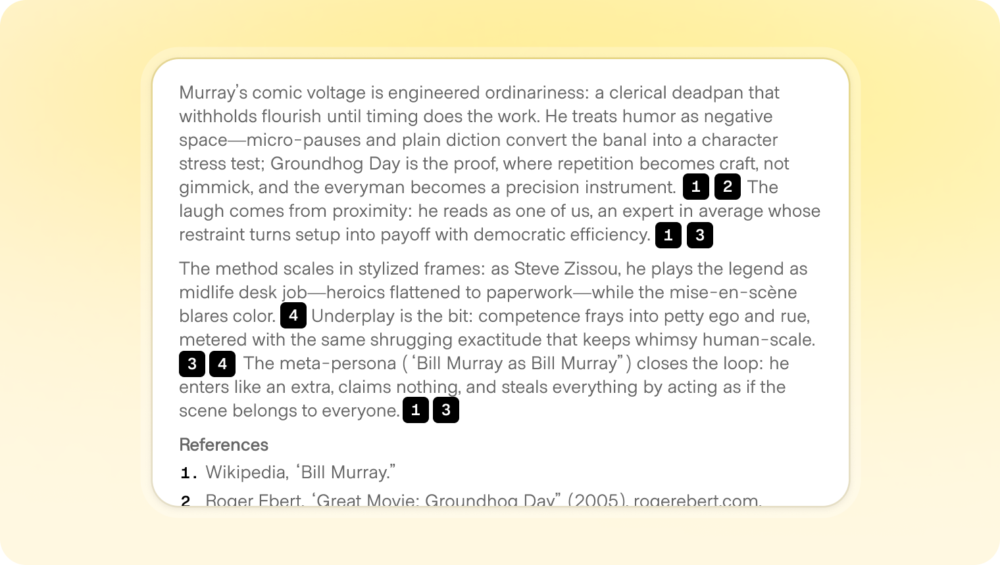

# Citations

**ID:** `citations` · **Shape of AI:** Governors · [source](https://www.shapeof.ai/patterns/citations)  
**Related:** `connectors`, `footprints`, `disclosure`




---

## Purpose

Ground claims in sources (PDF, web, DB, transcript). Support verify-in-place (hover quote) and explore (panel with metadata).

## Forms

| Form | Use |
|------|-----|
| Inline chips `[n]` | Sentence-level claims |
| Quote preview on hover | Fast verify without leaving answer |
| Multi-source panel | Search / research aggregation |
| End links | Lightweight transparency |

## Do / Don't

**Do:** deep-link to passage/timestamp; show favicon + title; mark missing sources explicitly.  
**Don't:** fake citations; overwhelm with full URLs inline; hide broken refs.

## When to use

Ground claims in sources (PDF, web, DB, transcript).

## When not to use

Skip when a denser core kit pattern already covers the job (see Related).

## Anatomy

1) Trigger 2) Dense primary surface 3) Confirm / dismiss

## Do / Don't

**Do:** Keep Linear/Raycast density; keyboard where actions exist; reuse kit tokens.  
**Don't:** Don't invent parallel chrome; don't hide irreversible effects.

## Snippet

```tsx
export function CitationChip({
  n,
  title,
  quote,
}: {
  n: number;
  title: string;
  quote?: string;
}) {
  return (
    <span className="group relative inline-flex">
      <button
        type="button"
        className="mx-px rounded-control bg-accent-muted px-dense py-px font-mono text-2xs text-accent-ink"
        aria-label={`Source ${n}: ${title}`}
      >
        {n}
      </button>
      {quote && (
        <span className="pointer-events-none absolute bottom-full left-0 z-10 mb-dense hidden w-64 rounded-control border border-hairline bg-surface-overlay p-control text-2xs text-ink-muted shadow-bar group-hover:block">
          <span className="mb-dense block font-medium text-ink">{title}</span>
          “{quote}”
        </span>
      )}
    </span>
  );
}
```
