# Clarify Before Act

**ID:** `clarify-before-act`  
**Teardowns:** [Human in the loop](https://aiuxplayground.com/teardowns/compare/human-in-the-loop)  
**Related:** `mandate-approval-card`, `connectors`, `action-plan`

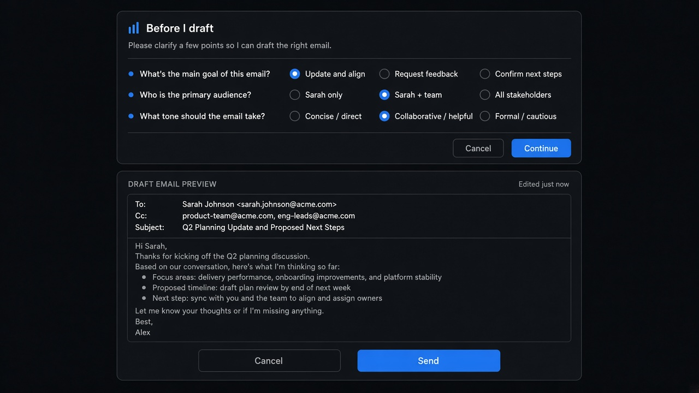

---

<!-- playground-captures:start -->
**AI UX Playground teardowns** · [hub](https://aiuxplayground.com/teardowns)

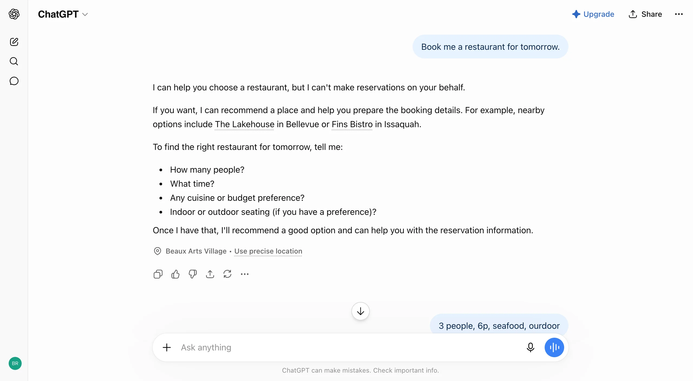

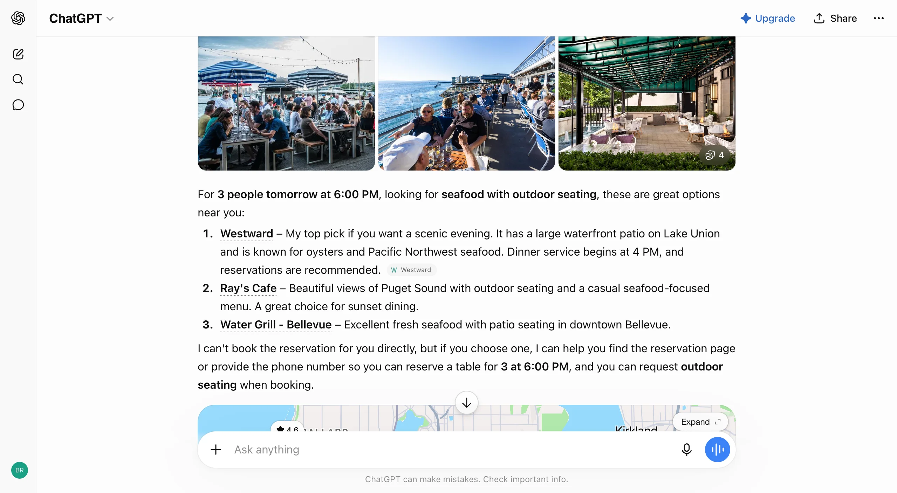

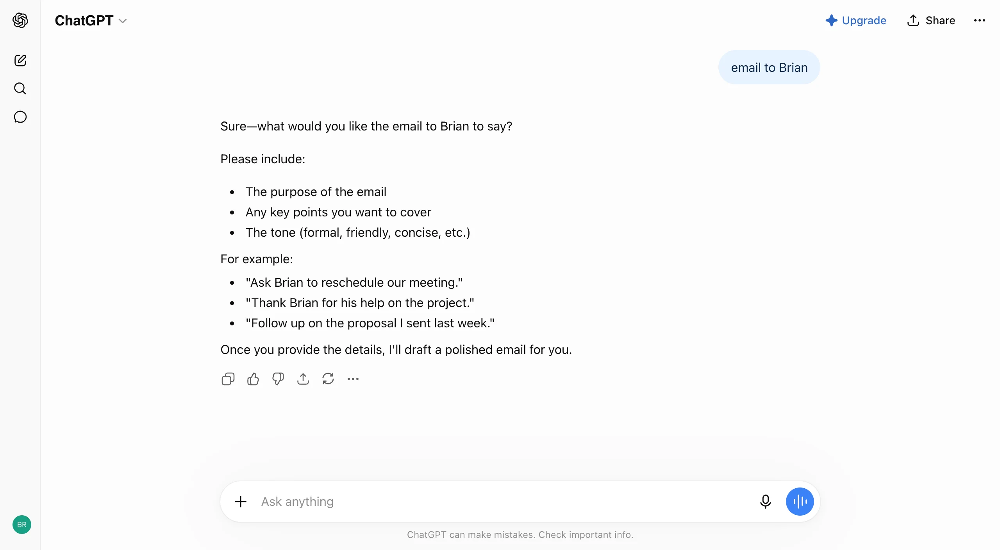

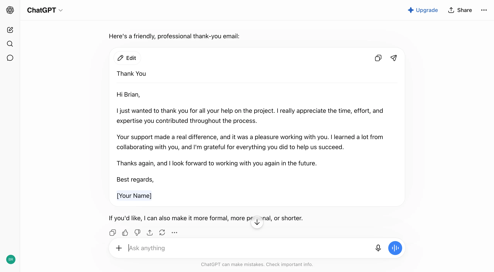

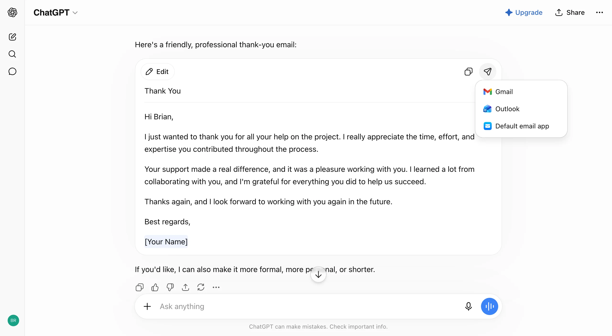

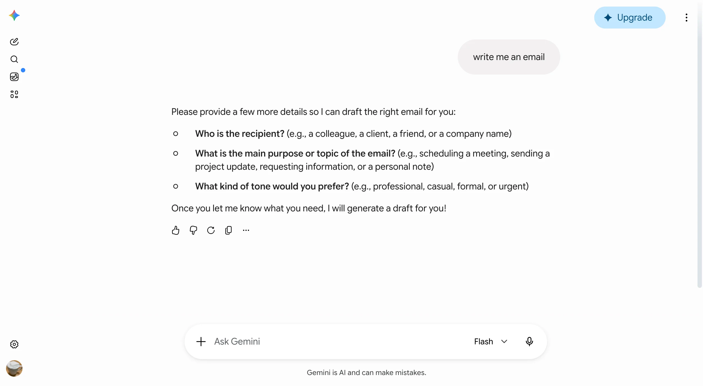

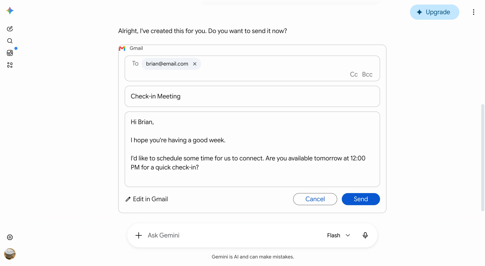

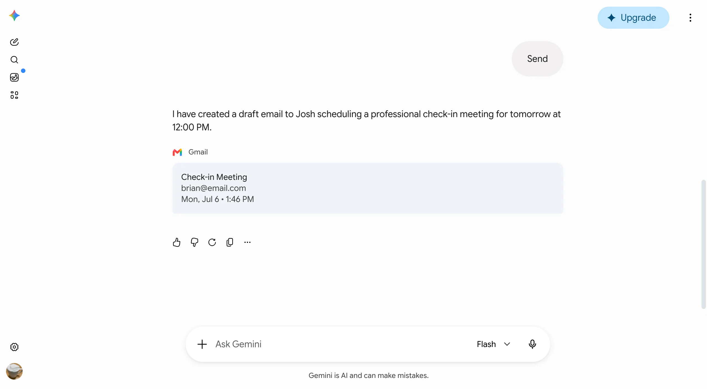

<!-- playground-captures:end -->


## Source references (external)

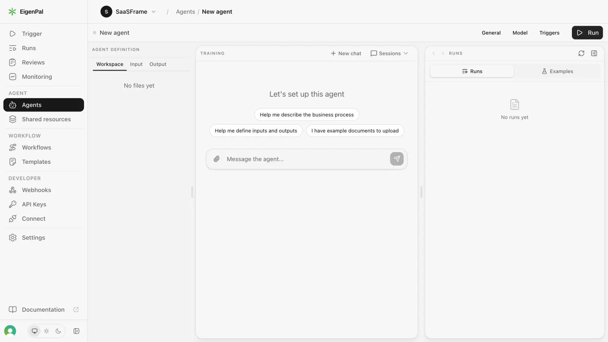
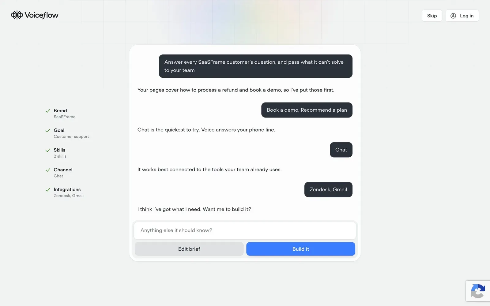

### Source notes

- Agent setup and Atlas-style onboarding briefs are clarify gates before tools run.

## Purpose

When the agent cannot (or should not) act yet: **state the limit**, ask a **tight questionnaire**, then either draft → approve (`mandate-approval-card`) or **hand off** to a trusted external app — never fake a completed action.

## Three gates (copy rules)

| Approach | When | Gate |
|----------|------|------|
| ChatGPT clarify → handoff | Product cannot execute | Inline Qs → link / phone / mail app |
| Gemini draft → Send | Destination app owns Send | Native draft card; Cancel ≡ Send weight |
| Perplexity permissions | Standing tool access | Per-tool Allow read vs write **before** run |

## Do / Don't

**Do:** smallest set of questions; editable draft; honest “I can’t complete X”.  
**Don't:** imply booking/payment done; auto-send; one vague “Continue?”.

## When to use

When the agent cannot (or should not) act yet: **state the limit**, ask a **tight questionnaire**, then either draft → approve (`mandate-approval-card`) or **hand off** to a trusted external app — never fake a completed action.

## When not to use

Skip when a denser core kit pattern already covers the job (see Related).

## Anatomy

1) Trigger 2) Dense primary surface 3) Confirm / dismiss

## Do / Don't

**Do:** Keep Linear/Raycast density; keyboard where actions exist; reuse kit tokens.  
**Don't:** Don't invent parallel chrome; don't hide irreversible effects.

## Snippet

```tsx
import { useState } from "react";

export function ClarifyBeforeAct({
  limit,
  questions,
  onContinue,
  onCancel,
}: {
  limit: string;
  questions: { id: string; prompt: string; options: string[] }[];
  onContinue: (answers: Record<string, string>) => void;
  onCancel: () => void;
}) {
  const [answers, setAnswers] = useState<Record<string, string>>({});
  const ready = questions.every((q) => answers[q.id]);

  return (
    <section className="max-w-mandate rounded-panel border border-hairline bg-surface-raised">
      <header className="border-b border-hairline px-panel py-control-2">
        <h2 className="text-sm font-medium text-ink">Before I act</h2>
        <p className="mt-dense text-xs text-ink-muted">{limit}</p>
      </header>
      <ul className="space-y-control px-panel py-panel">
        {questions.map((q) => (
          <li key={q.id}>
            <p className="mb-dense text-xs text-ink">{q.prompt}</p>
            <div className="flex flex-wrap gap-dense">
              {q.options.map((o) => (
                <button
                  key={o}
                  type="button"
                  onClick={() => setAnswers((a) => ({ ...a, [q.id]: o }))}
                  className={`rounded-control border px-control py-dense text-2xs ${
                    answers[q.id] === o
                      ? "border-accent bg-accent-muted text-accent-ink"
                      : "border-hairline text-ink-muted"
                  }`}
                >
                  {o}
                </button>
              ))}
            </div>
          </li>
        ))}
      </ul>
      <footer className="flex justify-end gap-control border-t border-hairline px-panel py-control">
        <button type="button" onClick={onCancel} className="text-xs text-ink-muted">
          Cancel
        </button>
        <button
          type="button"
          disabled={!ready}
          onClick={() => onContinue(answers)}
          className="rounded-control bg-accent px-panel py-control-2 text-xs text-accent-ink disabled:opacity-40"
        >
          Continue
        </button>
      </footer>
    </section>
  );
}
```
