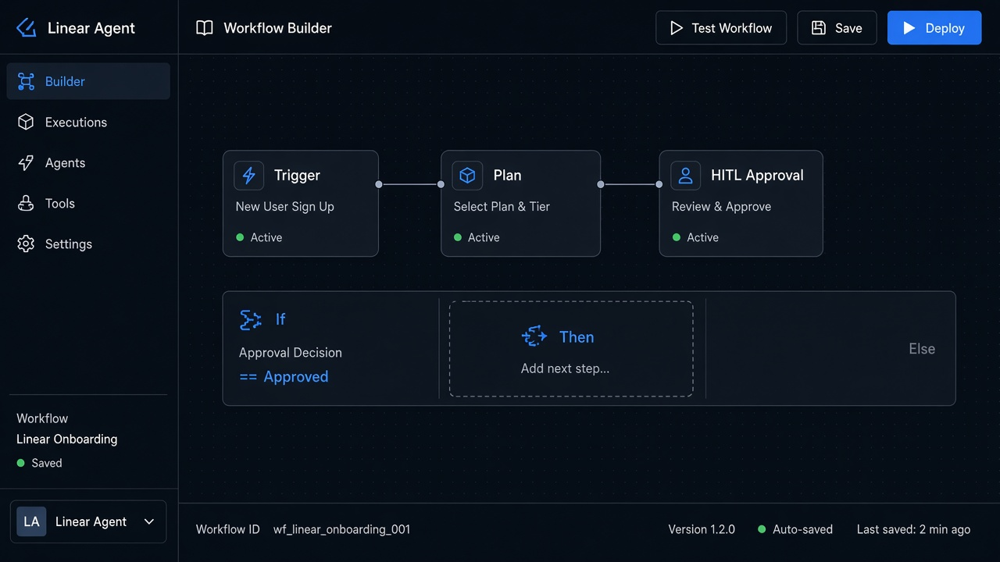

# Conditional Logic

**ID:** `conditional-logic`  
**Playground:** [conditional-logic](https://aiuxplayground.com/pattern/conditional-logic)  **Related:** action-plan, workflow-builder

---



## Purpose

Visual if/then branches in agent workflows so users can inspect and edit decision rules.

## When to use

Visual if/then branches in agent workflows so users can inspect and edit decision rules.

## When not to use

Skip when a denser core kit pattern already covers the job (see Related).

## Anatomy

1) Trigger 2) Dense primary surface 3) Confirm / dismiss

## Do / Don't

**Do:** Keep Linear/Raycast density; keyboard where actions exist; reuse kit tokens.  
**Don't:** Don't invent parallel chrome; don't hide irreversible effects.

## Snippet

```tsx
export function ConditionRow({ when, then }: { when: string; then: string }) {
  return (
    <div className="flex gap-control rounded-control border border-hairline px-control py-dense font-mono text-2xs text-ink-muted">
      <span>if {when}</span><span className="text-ink-faint">→</span><span>{then}</span>
    </div>
  );
}
```
