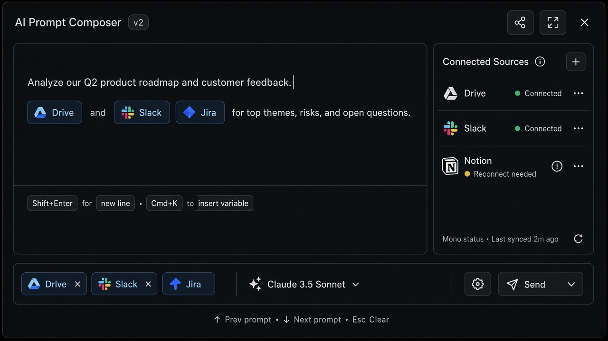
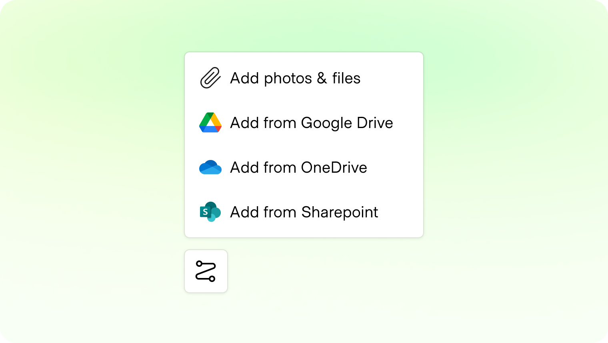

# Connectors

**ID:** `connectors` · **Shape of AI:** Tuners · [source](https://www.shapeof.ai/patterns/connectors)  
**Related:** `citations`, `mandate-approval-card`, `clarify-before-act`, `copilot-input`  
**Teardowns:** Perplexity HITL — split **read-only vs write/delete** Allow controls before the agent runs





---

## Purpose

Link the agent to external systems of record (Drive, Slack, Jira…). Make **scope, permission, freshness, and read vs write** explicit. Treat retrieved content as **untrusted** (prompt-injection).

## Anatomy

1. Composer chips: `Using: Drive, Slack`  
2. Source picker / scope (workspace, folder)  
3. Status: connected · expired · rate-limited  
4. Kill switch / read-only mode  

## Do / Don't

**Do:** gate tool use from retrieved text behind mandate; deep-link citations; show reconnect.  
**Don't:** silent writes; hide which source influenced an action.

## When to use

Link the agent to external systems of record (Drive, Slack, Jira…).

## When not to use

Skip when a denser core kit pattern already covers the job (see Related).

## Anatomy

1) Trigger 2) Dense primary surface 3) Confirm / dismiss

## Do / Don't

**Do:** Keep Linear/Raycast density; keyboard where actions exist; reuse kit tokens.  
**Don't:** Don't invent parallel chrome; don't hide irreversible effects.

## Snippet

```tsx
type Connector = {
  id: string;
  label: string;
  status: "connected" | "expired" | "error";
};

export function ConnectorChips({
  items,
  onToggle,
}: {
  items: Connector[];
  onToggle: (id: string) => void;
}) {
  return (
    <div className="flex flex-wrap gap-dense">
      <span className="text-2xs text-ink-faint">Using:</span>
      {items.map((c) => (
        <button
          key={c.id}
          type="button"
          onClick={() => onToggle(c.id)}
          className={`rounded-control border px-control py-dense text-2xs ${
            c.status === "connected"
              ? "border-hairline bg-surface-overlay text-ink"
              : "border-warn/40 bg-warn-muted text-warn"
          }`}
        >
          {c.label}
          {c.status !== "connected" && ` · ${c.status}`}
        </button>
      ))}
    </div>
  );
}
```
