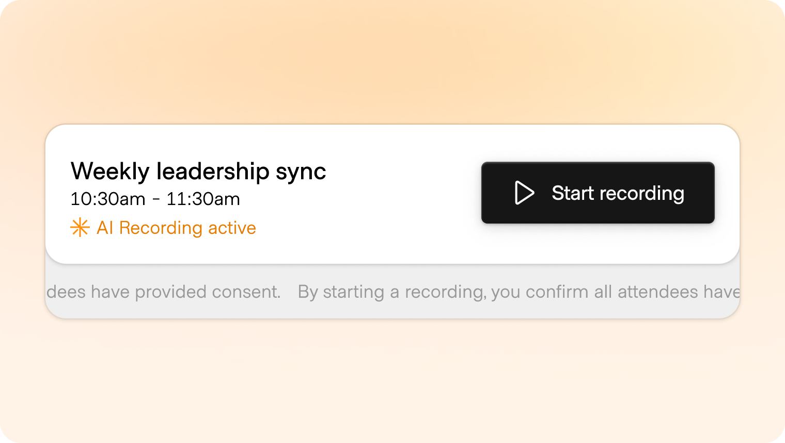
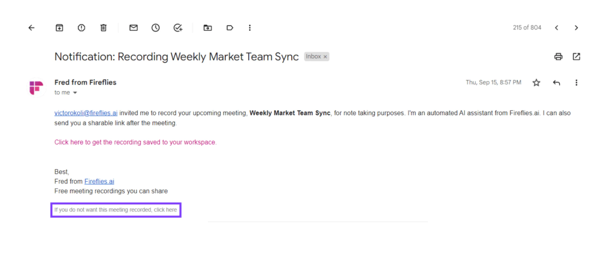
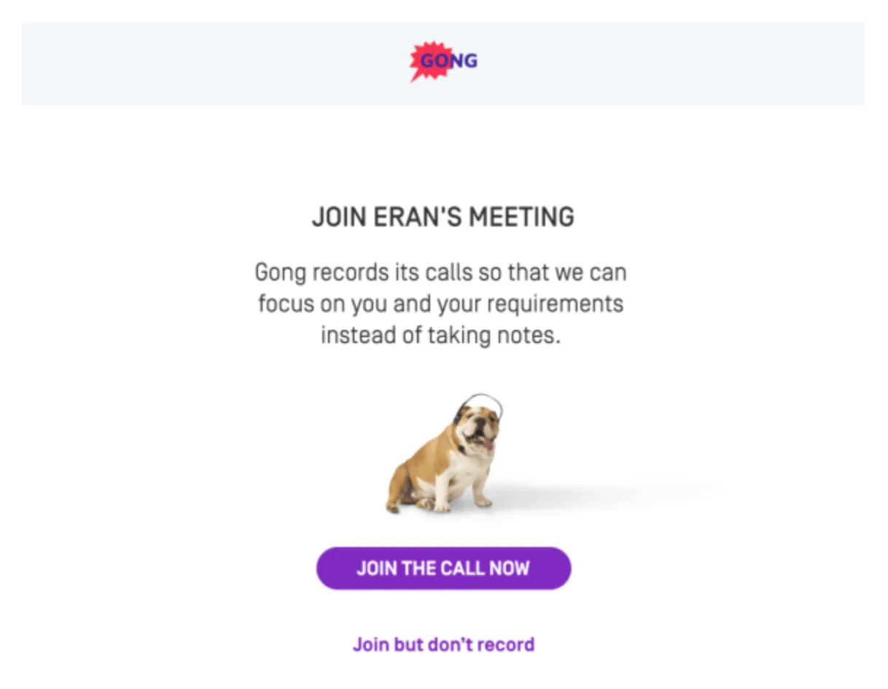
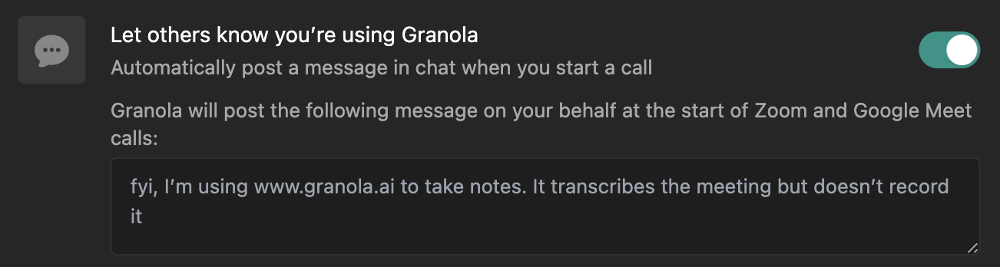
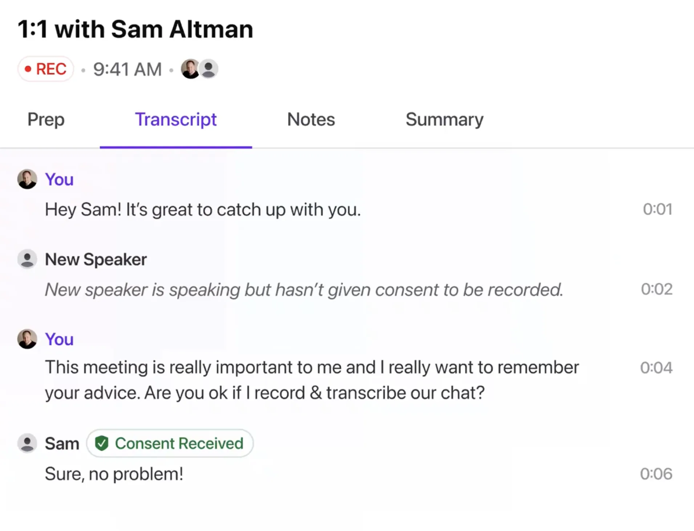
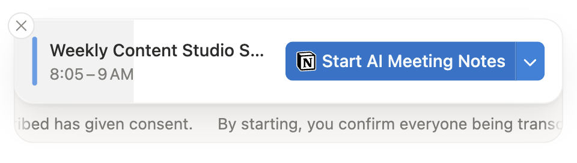
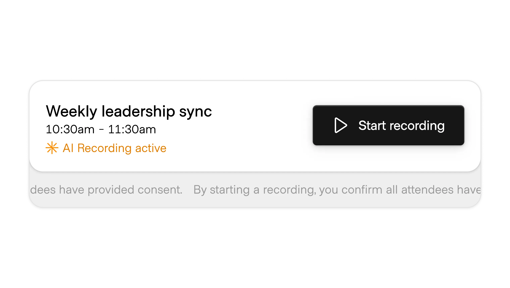
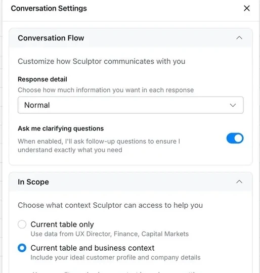
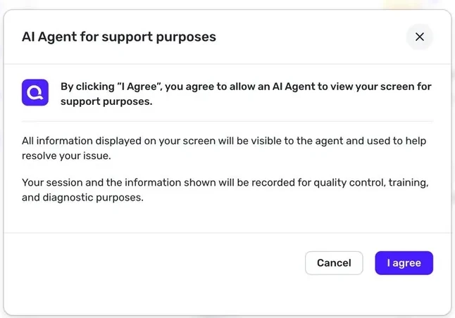
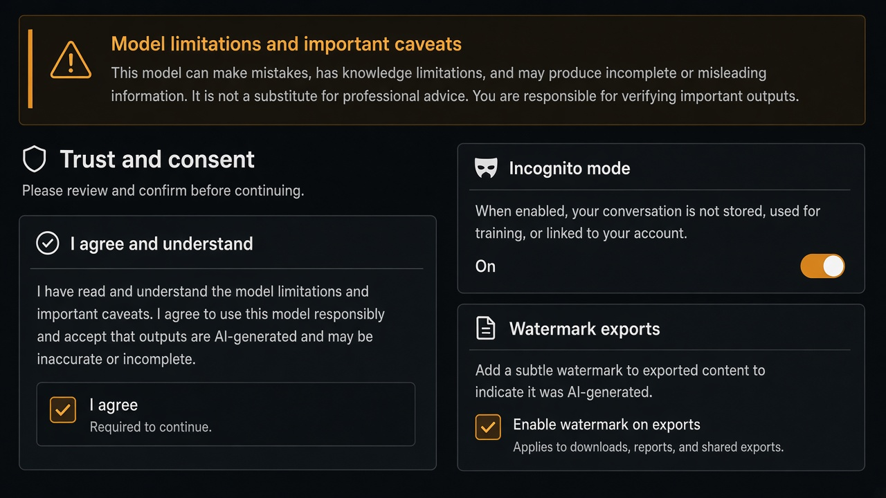

# Consent

**ID:** `consent`  
**Shape of AI:** https://www.shapeof.ai/pattern-types/trust-builders  **Related:** disclosure, voice-cloning, connectors

---

<!-- shapeof-captures:start -->
**Shape of AI captures** · [source](https://www.shapeof.ai/patterns/consent)
















<!-- shapeof-captures:end -->

<!-- aidesign-captures:start -->
**AI Design Guide** · [Agentic UX Patterns](https://www.aidesign.guide/agentic-ux-patterns)





<!-- aidesign-captures:end -->




## Purpose

Capture informed permission before recording, training, or processing others’ data.

## When to use

Recording, training, or third-party data capture.

## When not to use

Ordinary prompt sends already covered by ToS.

## Anatomy

Plain-language ask · Agree · decline path

## Do / Don't

**Do:** Name what is stored and for how long.  
**Don't:** Pre-checked consent buried in settings.

## Snippet

```tsx
export function ConsentGate({ text, onAccept }: { text: string; onAccept: () => void }) {
  return (
    <div className="rounded-panel border border-hairline p-panel text-xs">
      <p className="text-ink-muted">{text}</p>
      <button type="button" onClick={onAccept} className="mt-control rounded-control bg-accent px-panel py-control-2 text-accent-ink">I agree</button>
    </div>
  );
}
```
