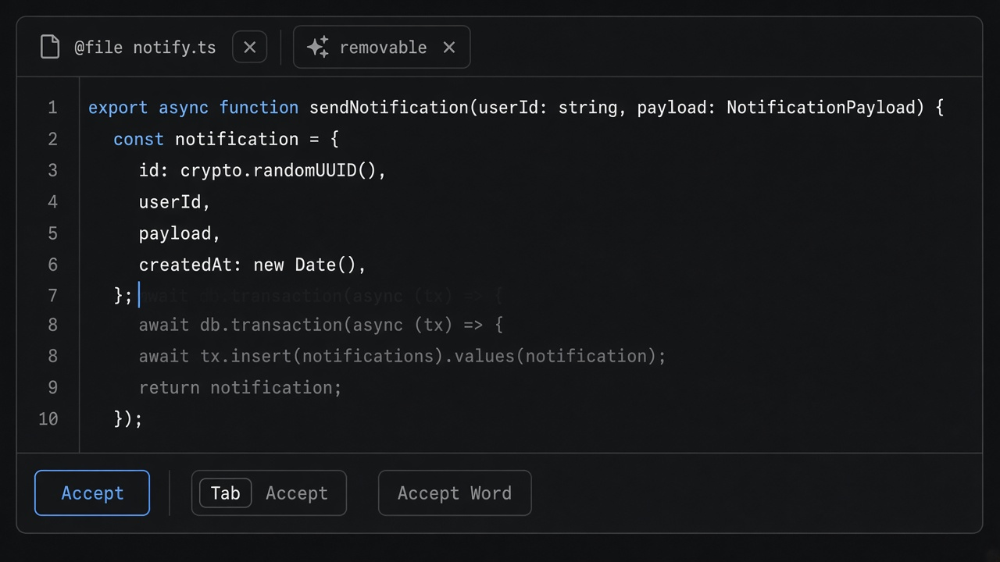
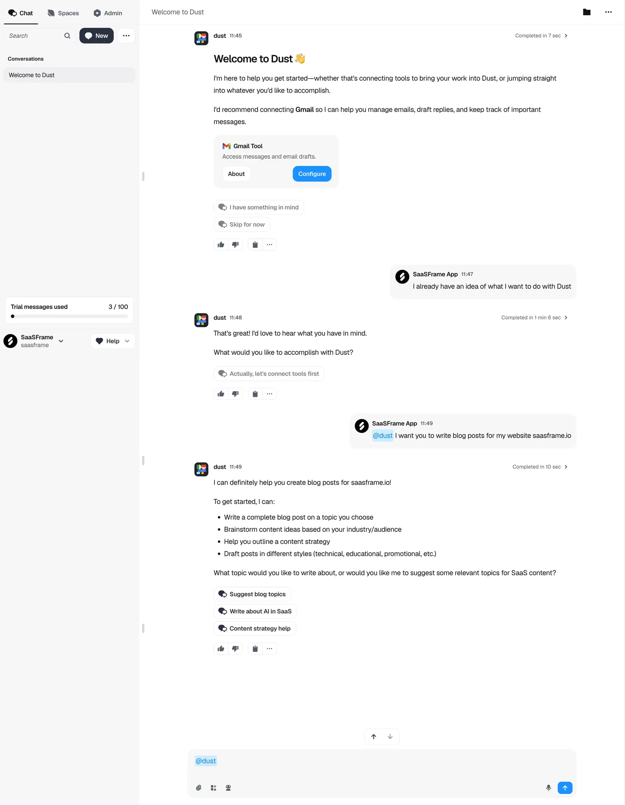

# Context Chip

**ID:** `context-chip`  
**Sources:** AI Design Guide · Fabric / Notion / CopilotKit shared state  
**Related:** `connectors`, `copilot-input`, `copilot-surface`



---


## Source references (external)


## Purpose

Show **exactly what the assistant can see** (file, selection, attachments) as removable chips — kills “does it know about this?” doubt.

## Snippet

```tsx
export function ContextChipRow({
  items,
  onRemove,
}: {
  items: { id: string; label: string; kind?: string }[];
  onRemove: (id: string) => void;
}) {
  if (items.length === 0) return null;
  return (
    <div className="flex flex-wrap items-center gap-dense">
      <span className="text-2xs text-ink-faint">Context</span>
      {items.map((c) => (
        <span
          key={c.id}
          className="inline-flex items-center gap-dense rounded-control border border-hairline bg-surface-overlay px-control py-dense text-2xs text-ink"
        >
          {c.kind && <span className="font-mono text-ink-faint">{c.kind}</span>}
          {c.label}
          <button type="button" onClick={() => onRemove(c.id)} className="text-ink-faint" aria-label={`Remove ${c.label}`}>
            ×
          </button>
        </span>
      ))}
    </div>
  );
}
```
