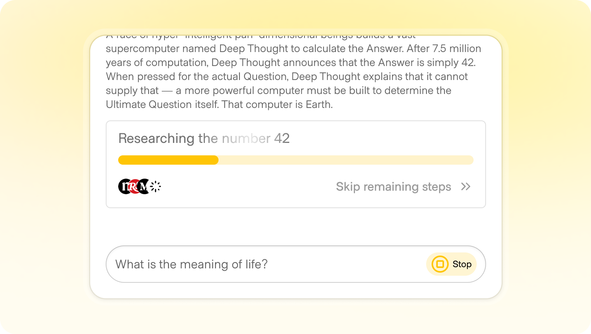

# Controls

**ID:** `controls` · **Shape of AI:** Governors · [source](https://www.shapeof.ai/patterns/controls)  
**Related:** `streaming-thought-state`, `action-plan`, `cost-estimates`



---

## Purpose

Keep the human in the driver’s seat during generation: **Stop**, **Pause/Resume**, **Queue** next tasks without canceling current work (Cursor / Replit pattern).

## Anatomy

| Control | Semantics |
|---------|-----------|
| Stop | Abort; work may be partial/lost |
| Pause | Freeze progress; resumable |
| Queue | Append tasks to plan while running |
| Fast-forward / continue | Confirm long chains |

## Do / Don't

**Do:** fixed Stop position; graceful pause; queue editable.  
**Don't:** hide Stop during stream; regenerate by overwriting without versioning.

## When to use

Keep the human in the driver’s seat during generation: **Stop**, **Pause/Resume**, **Queue** next tasks without canceling current work (Cursor / Replit pattern).

## When not to use

Skip when a denser core kit pattern already covers the job (see Related).

## Anatomy

1) Trigger 2) Dense primary surface 3) Confirm / dismiss

## Do / Don't

**Do:** Keep Linear/Raycast density; keyboard where actions exist; reuse kit tokens.  
**Don't:** Don't invent parallel chrome; don't hide irreversible effects.

## Snippet

```tsx
export function RunControls({
  running,
  paused,
  queueCount,
  onStop,
  onPause,
  onResume,
}: {
  running: boolean;
  paused: boolean;
  queueCount: number;
  onStop: () => void;
  onPause: () => void;
  onResume: () => void;
}) {
  if (!running && !paused) return null;
  return (
    <div className="flex items-center gap-dense-2">
      <button type="button" onClick={onStop} className="rounded-control px-control py-dense text-2xs text-danger hover:bg-danger-muted">
        Stop
      </button>
      <button
        type="button"
        onClick={paused ? onResume : onPause}
        className="rounded-control px-control py-dense text-2xs text-ink-muted hover:bg-surface-overlay"
      >
        {paused ? "Resume" : "Pause"}
      </button>
      {queueCount > 0 && (
        <span className="font-mono text-2xs text-ink-faint">queue {queueCount}</span>
      )}
    </div>
  );
}
```
