# Copilot Input — Intent / Command Bar

**ID:** `copilot-input`  
**Family:** Wayfinders · Prompt actions · Tuners ([shapeof.ai](https://www.shapeof.ai/))  
**Maps to:** Open input · Initial CTA · Modes · Model management · Attachments  
**Inspired by:** Raycast command bar, Linear `⌘K`, Vercel AI SDK Prompt input  
**Compose with:** `suggestions`, `connectors`, `model-mode-picker`, `cost-estimates`, `controls`  
**Teardowns:** [Design the composer](https://aiuxplayground.com/teardowns/compare/design-the-composer) (ChatGPT calm bar · Claude cost-on-bar · Perplexity mode chips · Gemini Drive-first +)

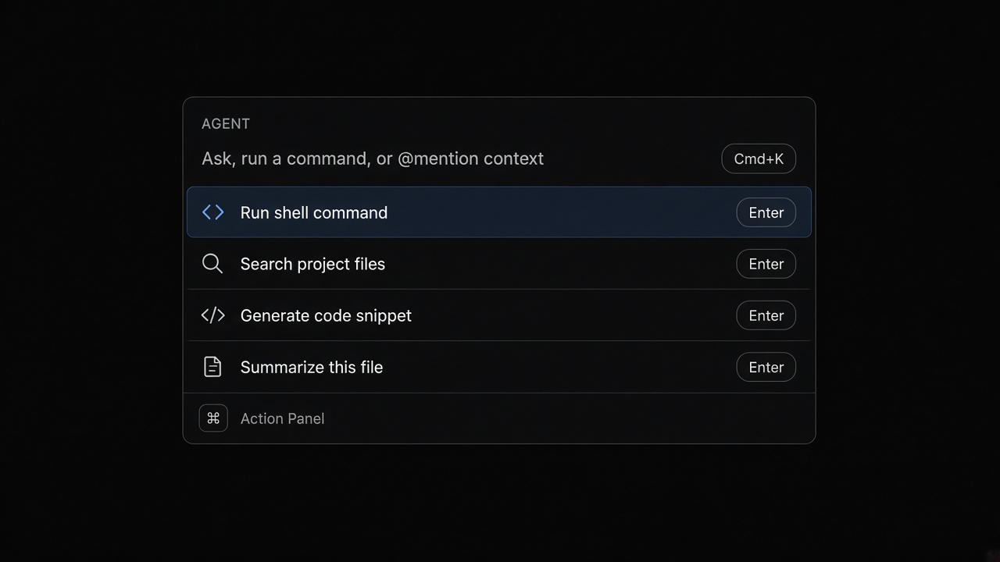

---

<!-- shapeof-captures:start -->
**Shape of AI captures** · [source](https://www.shapeof.ai/patterns/open-input)

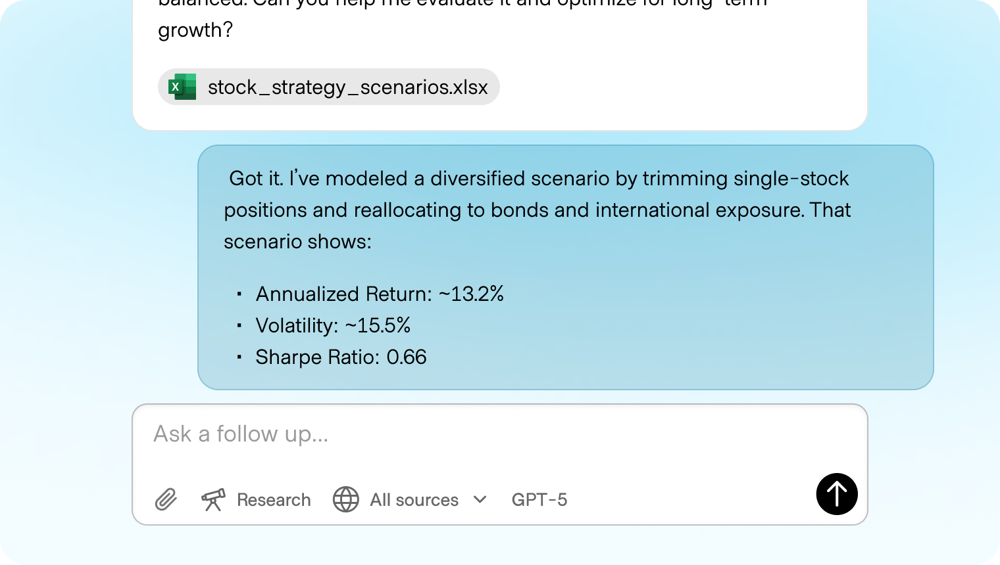


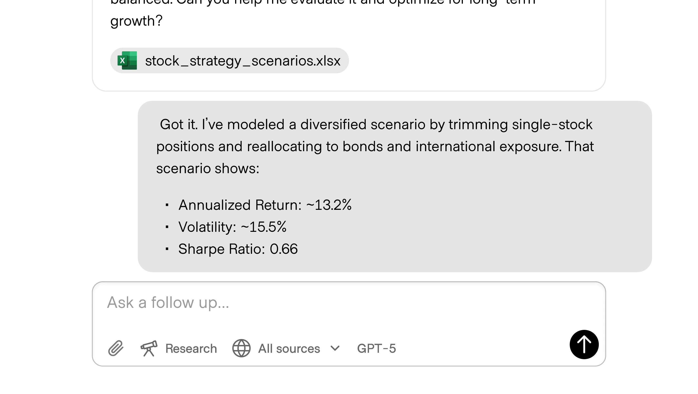

<!-- shapeof-captures:end -->

<!-- playground-captures:start -->
**AI UX Playground teardowns** · [hub](https://aiuxplayground.com/teardowns)

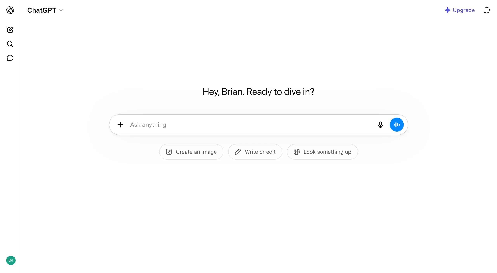

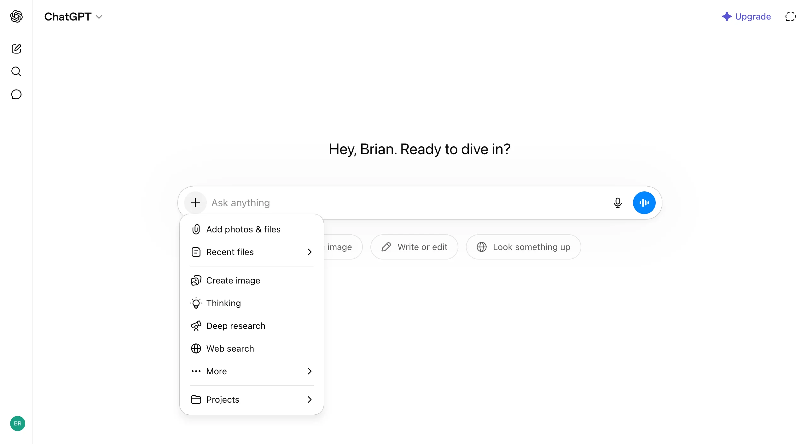

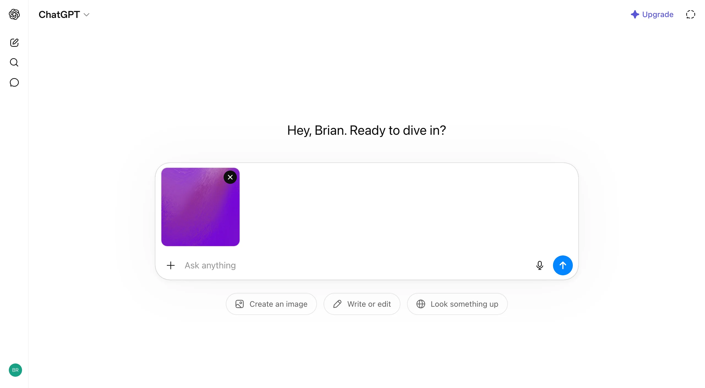

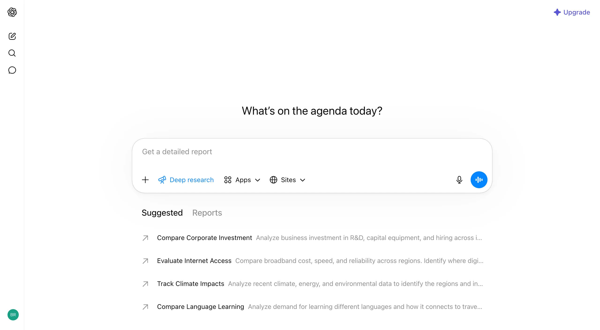

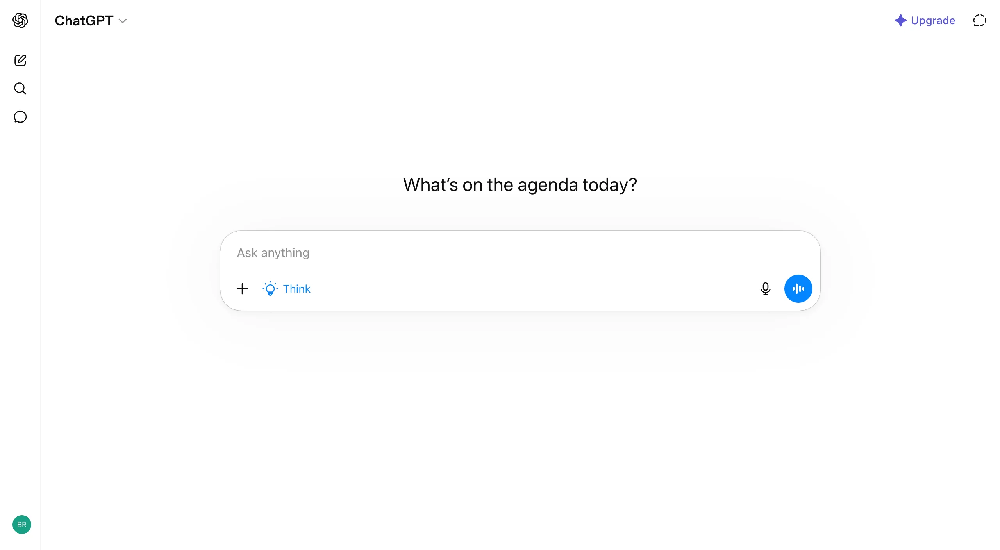

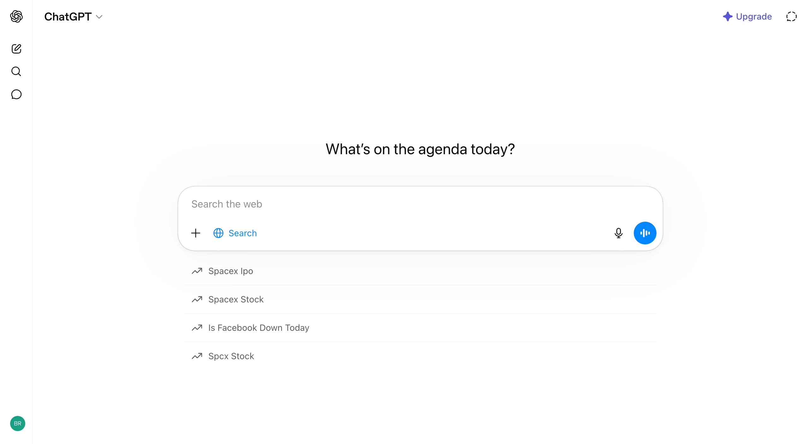

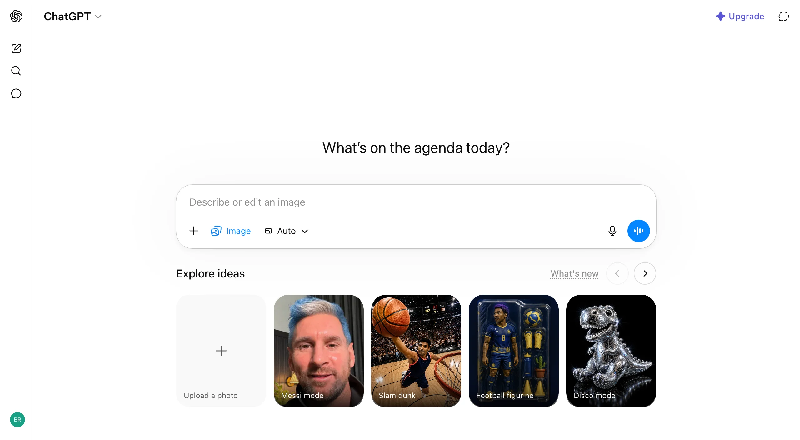

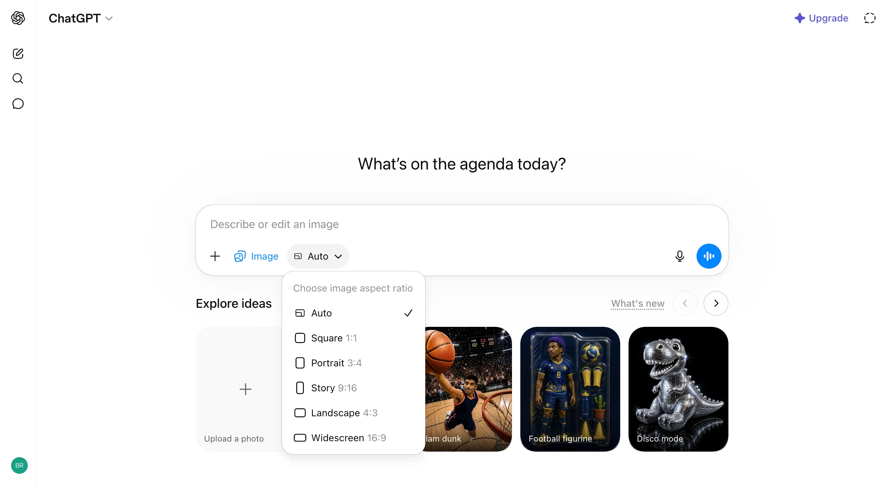

<!-- playground-captures:end -->

<!-- aidesign-captures:start -->
**AI Design Guide** · [Agentic UX Patterns](https://www.aidesign.guide/agentic-ux-patterns)

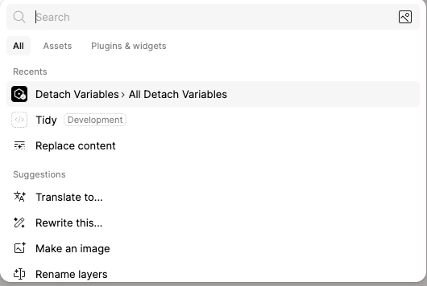

<!-- aidesign-captures:end -->

<!-- aidesign-p1:start -->
**AI Design Guide · P1 resources** · [resources](https://www.aidesign.guide/resources) · anti-patterns gallery is login-gated

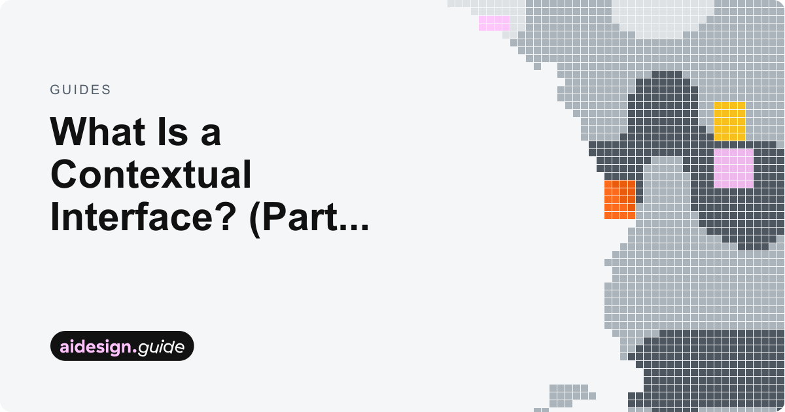

<!-- aidesign-p1:end -->


<!-- saasframe-expand:start -->
**SaaSFrame AI captures** (expanded) · [saasframe.io](https://www.saasframe.io/patterns)

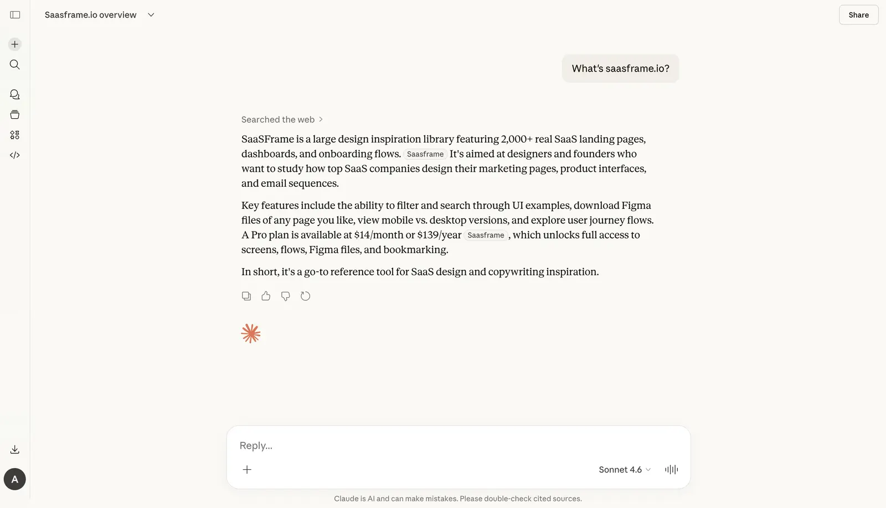


<!-- saasframe-expand:end -->


## Source references (external)

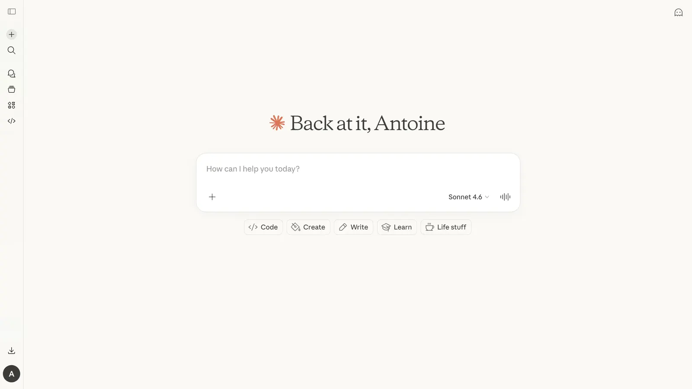


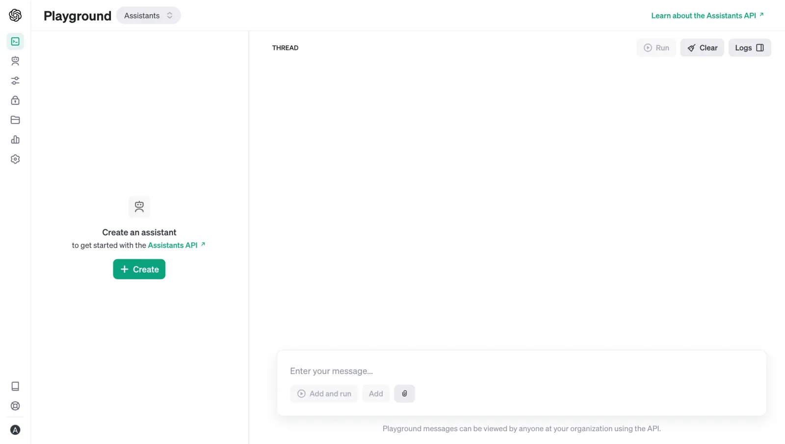
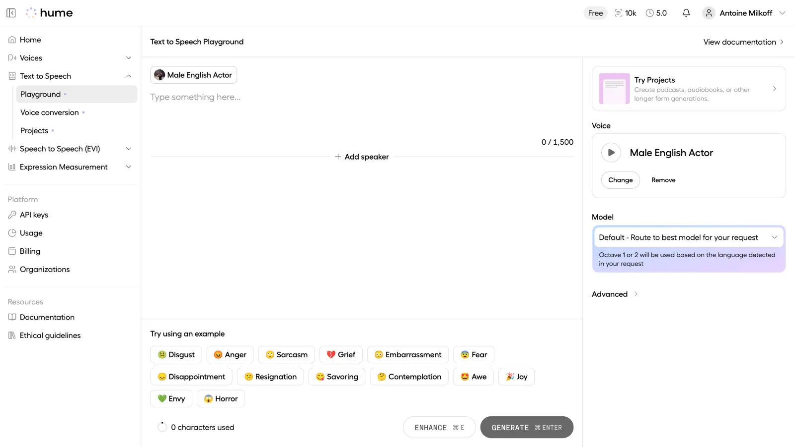
## Purpose

Floating, keyboard-first **intent bar** (and docked chat composer) for launching agent actions: natural language, fuzzy commands, `@` context, `/` slash, removable **scope chips**. Primary path is instant; secondary actions hide behind progressive disclosure (`+` / `⌘K`).

### Composer product bets (playground)

| Bet | Default bar | Power disclosure |
|-----|-------------|------------------|
| Mass-market habit (ChatGPT) | Empty + starter pills | One `+` menu; removable chips |
| Cost visible (Claude) | Starters + model/effort on rail | Web search on by default |
| Research depth (Perplexity) | Mode chips primary | Attach/connectors secondary |
| Ecosystem (Gemini) | Empty pill | Drive on first `+` screen |

## When to use

- Global agent launcher (desktop overlay, in-app palette)
- “Ask the agent to…” from any surface
- Switching model / mode / connectors without leaving flow

## When not to use

- Long-form multi-turn chat composer inside Dual-Speed Layout (use a docked composer there)
- Forms that need many labeled fields (use structured templates, not a free palette)

---

## Anatomy

```
┌─────────────────────────────────────────────────────────┐
│  [mode]  intent query……………………………  [@ctx] [/] [model] │  ← input row (40–44px)
├─────────────────────────────────────────────────────────┤
│  ▶ Preferred action                          ↵          │  ← selected result
│    Secondary match                           ⌘↵         │
│    Slash / command row                       …          │
├─────────────────────────────────────────────────────────┤
│  Action Panel (⌘K) · Copy · Pin · Open in…              │  ← progressive disclosure
└─────────────────────────────────────────────────────────┘
```

1. **Input row** — single field, leading mode glyph, trailing source/model chips  
2. **Results list** — dense rows (28–32px), shortcut badges right-aligned  
3. **Action panel** — secondary ops (`⌘K`), not inline clutter  
4. **Footer meta** — optional: model, latency budget hint, connection status  

---

## States

| State | Behavior |
|-------|----------|
| `idle` | Placeholder with example intents; no results |
| `querying` | Local fuzzy filter &lt;16ms feel; remote suggestions debounce ~120ms |
| `streaming-suggest` | Soft pulse on leading icon; list stable (no layout jump) |
| `empty` | One dense empty row + “Create mandate…” CTA |
| `error` | Inline hairline error, keep query editable |

---

## Interaction

| Key | Action |
|-----|--------|
| `↵` | Run **primary** action on selected row |
| `⌘↵` | Run secondary / “open as chat” |
| `⌘K` | Toggle action panel |
| `↑` `↓` | Move selection |
| `Tab` | Cycle `@` sources or mode |
| `Esc` | Close panel → clear → dismiss bar |

---

## Do / Don't

**Do**
- Keep max width ~640px; center or raycast-anchor under cursor/menubar
- Show shortcut badges on every actionable row
- Separate primary intent from secondary actions

**Don't**
- Inflate into a modal card stack
- Show all actions at once
- Use a full-page hero prompt for power-user agent shells

---

## React + Tailwind snippet

```tsx
import { useMemo, useState } from "react";

type Result = {
  id: string;
  title: string;
  subtitle?: string;
  shortcut?: string;
};

export function CopilotInput({
  results,
  onRun,
}: {
  results: Result[];
  onRun: (id: string) => void;
}) {
  const [q, setQ] = useState("");
  const [active, setActive] = useState(0);
  const [panel, setPanel] = useState(false);

  const filtered = useMemo(() => {
    const n = q.trim().toLowerCase();
    if (!n) return results.slice(0, 8);
    return results.filter((r) => r.title.toLowerCase().includes(n)).slice(0, 8);
  }, [q, results]);

  return (
    <div className="fixed inset-x-0 top-[18%] z-intent mx-auto w-full max-w-intent px-panel">
      <div className="overflow-hidden rounded-overlay bg-surface-overlay shadow-overlay">
        <div className="flex h-11 items-center gap-control border-b border-hairline px-panel">
          <span className="text-2xs font-medium uppercase tracking-wide text-ink-faint">
            Agent
          </span>
          <input
            autoFocus
            value={q}
            onChange={(e) => {
              setQ(e.target.value);
              setActive(0);
            }}
            onKeyDown={(e) => {
              if (e.key === "ArrowDown") {
                e.preventDefault();
                setActive((i) => Math.min(i + 1, filtered.length - 1));
              }
              if (e.key === "ArrowUp") {
                e.preventDefault();
                setActive((i) => Math.max(i - 1, 0));
              }
              if (e.key === "Enter" && filtered[active]) onRun(filtered[active].id);
              if (e.key === "k" && (e.metaKey || e.ctrlKey)) {
                e.preventDefault();
                setPanel((p) => !p);
              }
              if (e.key === "Escape") setQ("");
            }}
            placeholder="Ask, run a command, or @mention context…"
            className="h-full flex-1 bg-transparent text-sm text-ink placeholder:text-ink-faint outline-none"
          />
          <kbd className="rounded-control border border-hairline px-dense-2 py-px text-2xs text-ink-faint">
            ⌘K
          </kbd>
        </div>

        <ul role="listbox" className="max-h-72 overflow-auto py-dense">
          {filtered.map((r, i) => (
            <li key={r.id}>
              <button
                role="option"
                aria-selected={i === active}
                onMouseEnter={() => setActive(i)}
                onClick={() => onRun(r.id)}
                className={`flex w-full items-center gap-control px-panel py-control-2 text-left ${
                  i === active ? "bg-accent-muted text-accent-ink" : "text-ink"
                }`}
              >
                <span className="min-w-0 flex-1 truncate text-sm">{r.title}</span>
                {r.subtitle && (
                  <span className="hidden truncate text-xs text-ink-muted sm:block">
                    {r.subtitle}
                  </span>
                )}
                <kbd className="text-2xs text-ink-faint">{r.shortcut ?? "↵"}</kbd>
              </button>
            </li>
          ))}
        </ul>

        {panel && (
          <div className="border-t border-hairline bg-surface px-panel py-control text-xs text-ink-muted">
            Pin · Copy link · Open as Dual-Speed session · Set model
          </div>
        )}
      </div>
    </div>
  );
}
```

---

## References

- Raycast: primary `↵` vs action panel `⌘K` progressive disclosure  
- Linear: dense command menu, shortcut badges  
- shapeof.ai: Initial CTA, Suggestions, Open input, Connectors, Modes  
- Vercel AI SDK UI: prompt input + attachments patterns  
