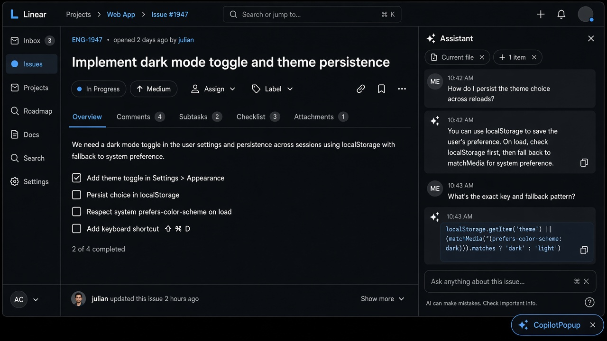
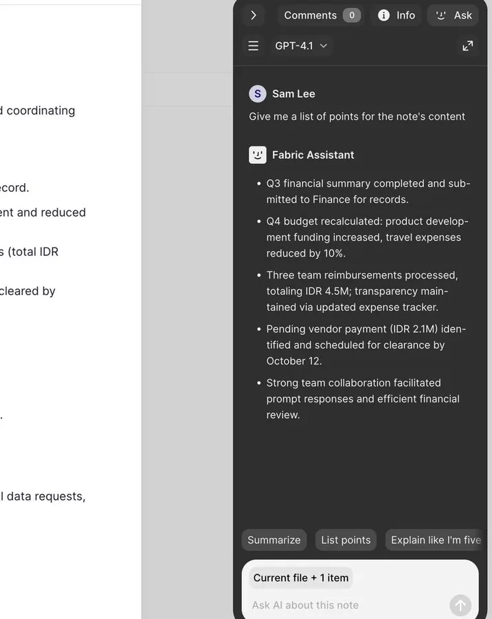
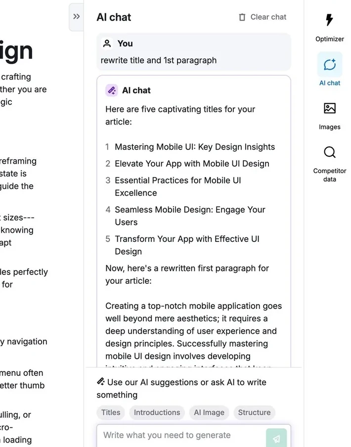
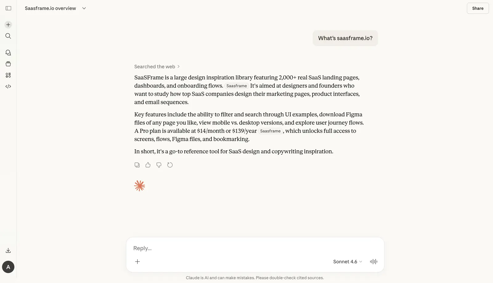
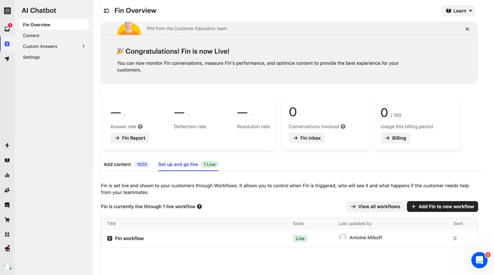
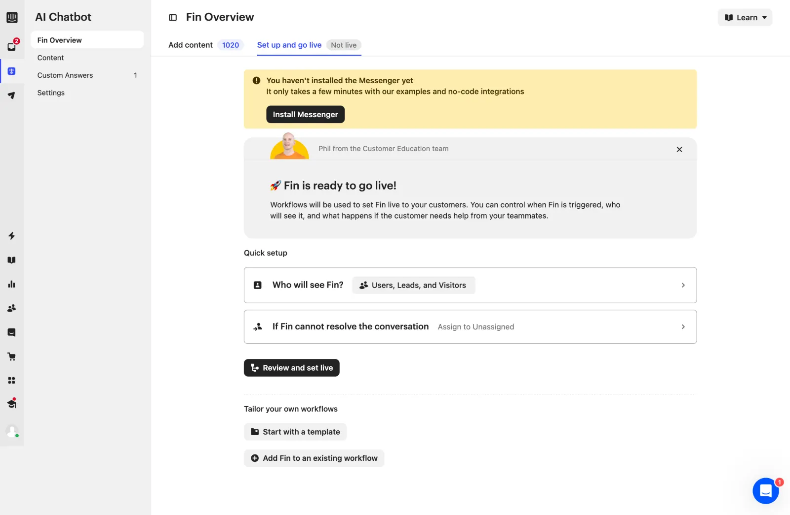
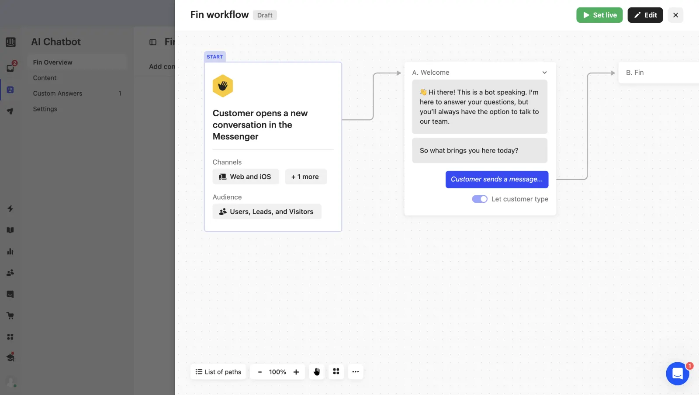
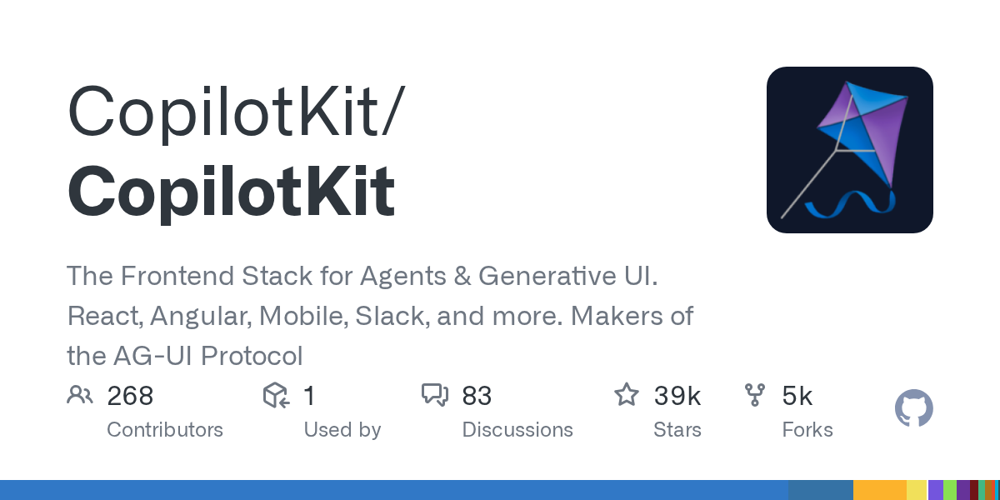
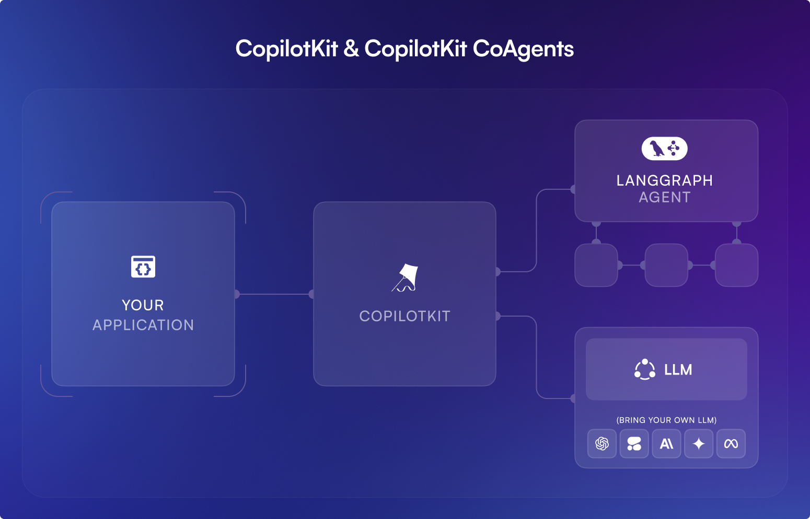
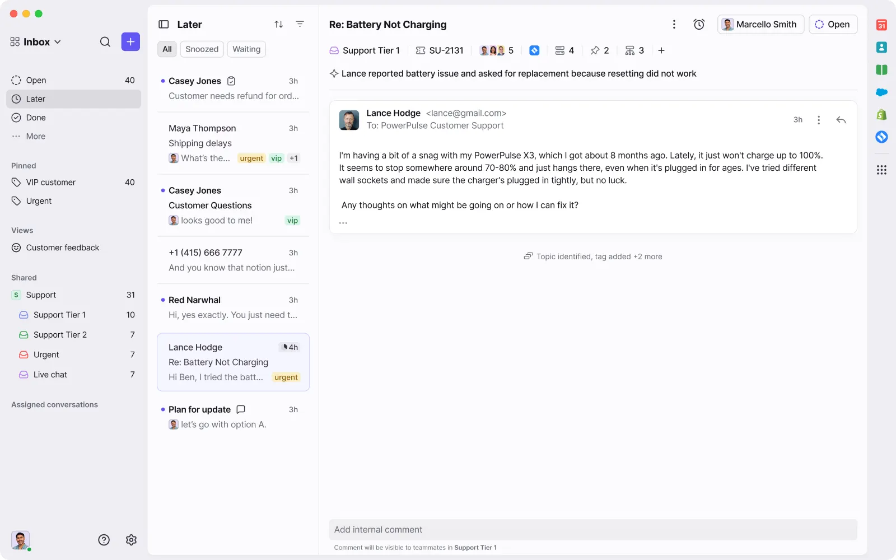

# Copilot Surface

**ID:** `copilot-surface`  
**Sources:** [CopilotKit prebuilt](https://docs.copilotkit.ai/) · AI Design Guide docked panel  
**Related:** `dual-speed-layout`, `copilot-input`, `context-chip`



---

<!-- aidesign-captures:start -->
**AI Design Guide** · [Agentic UX Patterns](https://www.aidesign.guide/agentic-ux-patterns)





<!-- aidesign-captures:end -->

<!-- saasframe-expand:start -->
**SaaSFrame AI captures** (expanded) · [saasframe.io](https://www.saasframe.io/patterns)










<!-- saasframe-expand:end -->

<!-- copilotkit-captures:start -->
**CopilotKit** · [docs.copilotkit.ai](https://docs.copilotkit.ai/)





<!-- copilotkit-captures:end -->


## Source references (external)



## Purpose

Choose **where** the assistant lives: inline chat pane, docked sidebar, or floating popup — same primitives, different chrome. Prefer sidebar/dual-speed for agent work; popup for lightweight help.

## Variants

| Variant | Use |
|---------|-----|
| `chat` | Embedded column / full pane |
| `sidebar` | Collapsible dock beside product |
| `popup` | Overlay bubble — interruptible tasks only |

## Do / Don't

**Do:** show context chip; keyboard toggle; Escape closes popup/sidebar.  
**Don't:** popup for long agent runs; hide Stop; orphan chat from the task.

## Snippet

```tsx
export function CopilotSurfaceShell({
  variant,
  open,
  onOpenChange,
  title = "Assistant",
  children,
}: {
  variant: "chat" | "sidebar" | "popup";
  open: boolean;
  onOpenChange: (o: boolean) => void;
  title?: string;
  children: React.ReactNode;
}) {
  if (variant === "chat") {
    return (
      <section className="flex h-full min-w-0 flex-col border-r border-hairline bg-surface">
        <header className="flex h-10 items-center px-panel text-xs font-medium text-ink-muted">{title}</header>
        <div className="min-h-0 flex-1 overflow-auto p-panel">{children}</div>
      </section>
    );
  }
  if (!open) {
    return (
      <button
        type="button"
        onClick={() => onOpenChange(true)}
        className="fixed bottom-panel right-panel rounded-control border border-hairline bg-surface-raised px-panel py-control text-xs text-ink"
      >
        {title} <kbd className="ml-dense text-ink-faint">⌘J</kbd>
      </button>
    );
  }
  return (
    <aside
      className={`fixed z-40 flex w-80 flex-col border border-hairline bg-surface shadow-bar ${
        variant === "sidebar" ? "inset-y-0 right-0 border-y-0 border-r-0" : "bottom-panel right-panel max-h-[70vh] rounded-panel"
      }`}
    >
      <header className="flex h-10 items-center justify-between border-b border-hairline px-panel">
        <span className="text-xs font-medium text-ink-muted">{title}</span>
        <button type="button" onClick={() => onOpenChange(false)} className="text-2xs text-ink-faint">
          Esc
        </button>
      </header>
      <div className="min-h-0 flex-1 overflow-auto p-panel">{children}</div>
    </aside>
  );
}
```
