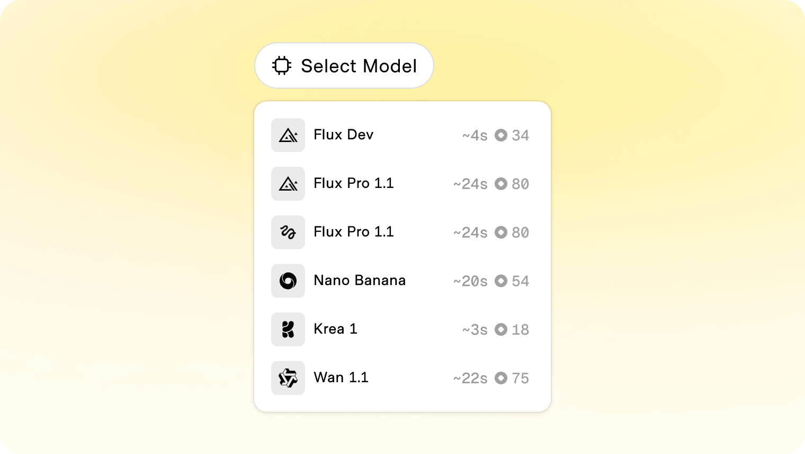
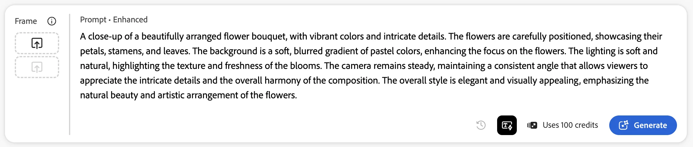
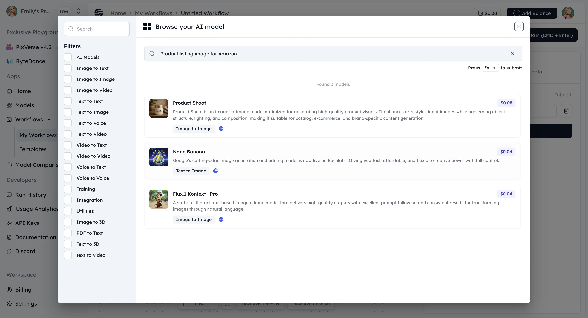
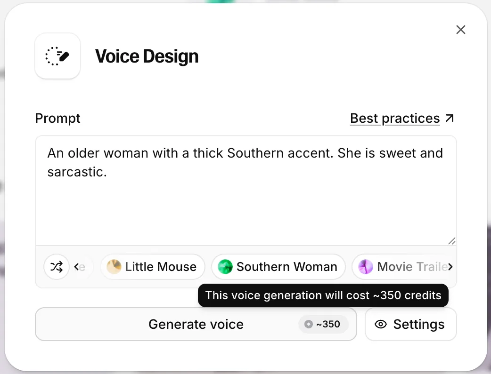
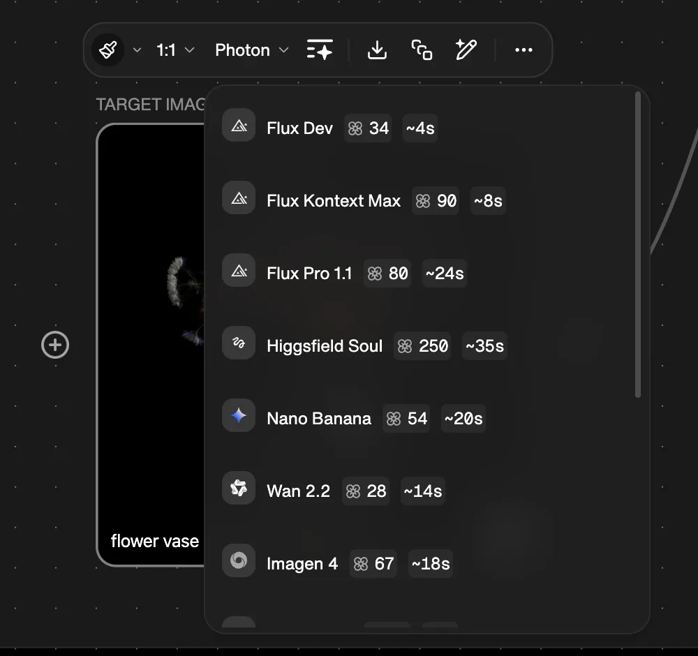
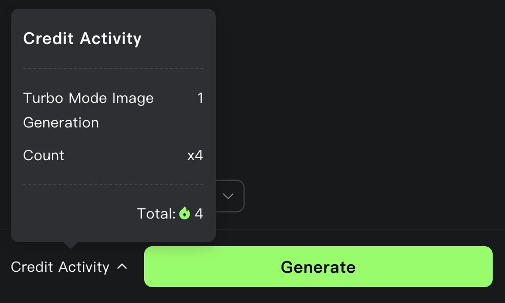
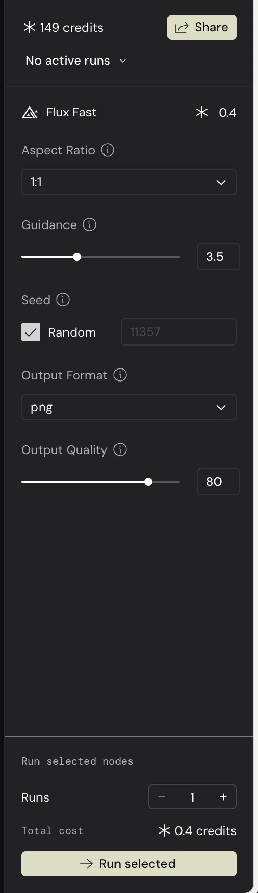
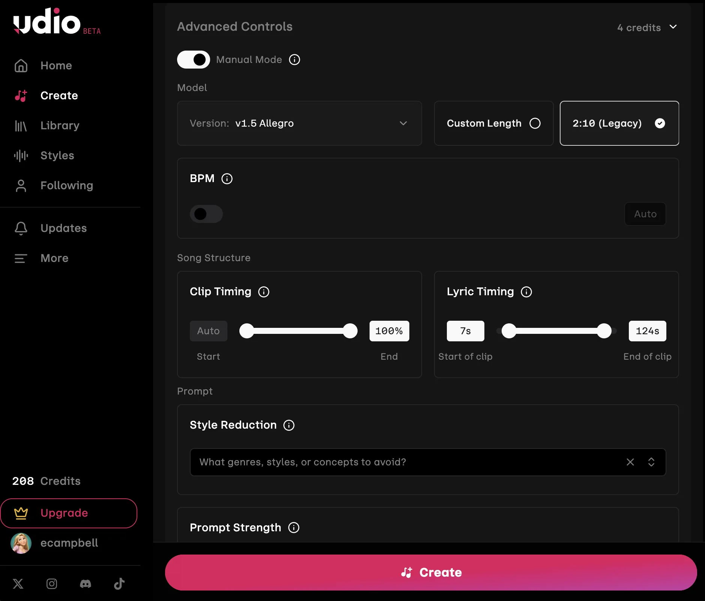
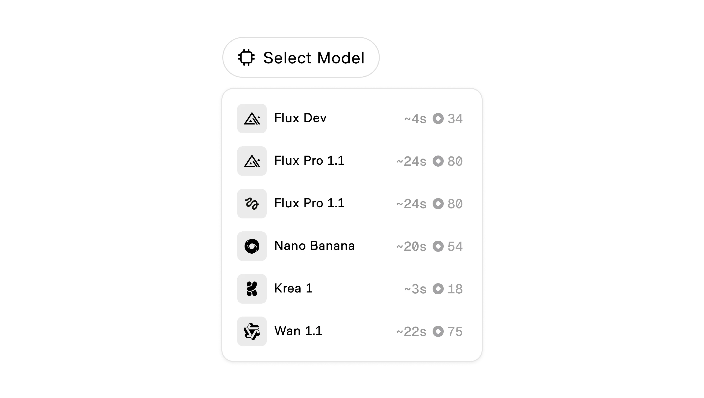

# Cost Estimates

**ID:** `cost-estimates` · **Shape of AI:** Governors · [source](https://www.shapeof.ai/patterns/cost-estimates)  
**Related:** `action-plan`, `mandate-approval-card` (budget slider), `controls`



---

<!-- shapeof-captures:start -->
**Shape of AI captures** · [source](https://www.shapeof.ai/patterns/cost-estimates)


















<!-- shapeof-captures:end -->


## Source references (external)


## Purpose

Show estimated spend **where decisions are made** (prompt, model picker, plan steps). Lift the black box of metered AI usage.

## Drivers to surface

Model · context length · expected output · plan steps · tool loops · draft vs final mode

## Do / Don't

**Do:** explicit unit (credits / $ / tokens); ranges for unknowns; update live while streaming.  
**Don't:** bury estimate in settings; show $ only to non-technical users without credit mapping.

## When to use

Show estimated spend **where decisions are made** (prompt, model picker, plan steps).

## When not to use

Skip when a denser core kit pattern already covers the job (see Related).

## Anatomy

1) Trigger 2) Dense primary surface 3) Confirm / dismiss

## Do / Don't

**Do:** Keep Linear/Raycast density; keyboard where actions exist; reuse kit tokens.  
**Don't:** Don't invent parallel chrome; don't hide irreversible effects.

## Snippet

```tsx
export function CostEstimate({
  label = "Est.",
  low,
  high,
  unit = "credits",
}: {
  label?: string;
  low: number;
  high: number;
  unit?: string;
}) {
  const text = low === high ? `${low} ${unit}` : `${low}–${high} ${unit}`;
  return (
    <span className="inline-flex items-center gap-dense font-mono text-2xs text-ink-muted">
      <span className="text-ink-faint">{label}</span>
      {text}
    </span>
  );
}
```
