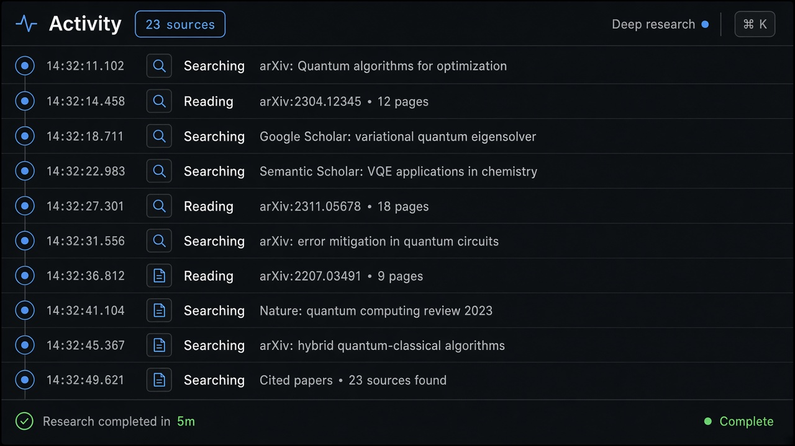
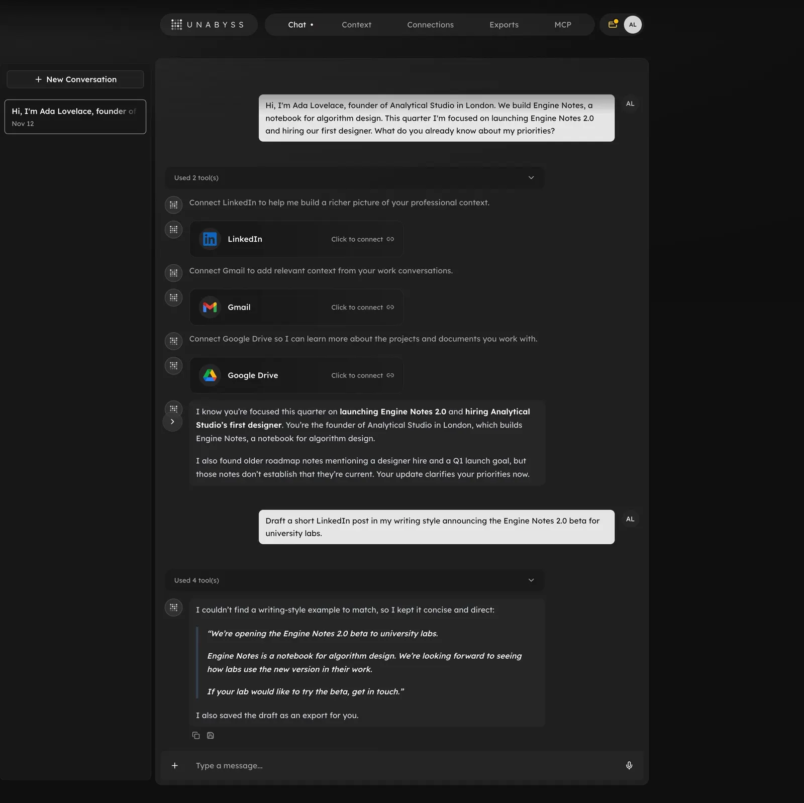

# Deep Research Feed

**ID:** `deep-research-feed`  
**Sources:** AI Design Guide · ChatGPT / Gemini / Perplexity deep research  
**Related:** `streaming-thought-state`, `citations`, `artifact-pane`, `controls`



---


## Source references (external)


## Purpose

Long-running research streams an **Activity timeline** (searches, reads) with source count, then a completion line + report artifact.

## Snippet

```tsx
export function DeepResearchFeed({
  events,
  sourceCount,
  completedIn,
}: {
  events: { id: string; label: string; at?: string }[];
  sourceCount?: number;
  completedIn?: string;
}) {
  return (
    <section className="rounded-panel border border-hairline bg-surface">
      <header className="flex h-8 items-center justify-between border-b border-hairline px-panel text-2xs text-ink-muted">
        <span>Activity</span>
        {sourceCount != null && <span className="font-mono">{sourceCount} sources</span>}
      </header>
      <ol className="max-h-48 overflow-auto px-panel py-control">
        {events.map((e) => (
          <li key={e.id} className="flex gap-control py-dense text-xs text-ink-muted">
            {e.at && <span className="w-10 shrink-0 font-mono text-2xs text-ink-faint">{e.at}</span>}
            <span>{e.label}</span>
          </li>
        ))}
      </ol>
      {completedIn && (
        <p className="border-t border-hairline px-panel py-control font-mono text-2xs text-ok">
          Research completed in {completedIn}
        </p>
      )}
    </section>
  );
}
```
