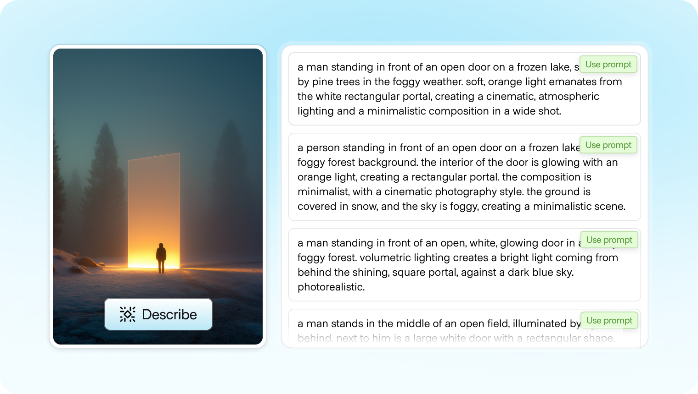
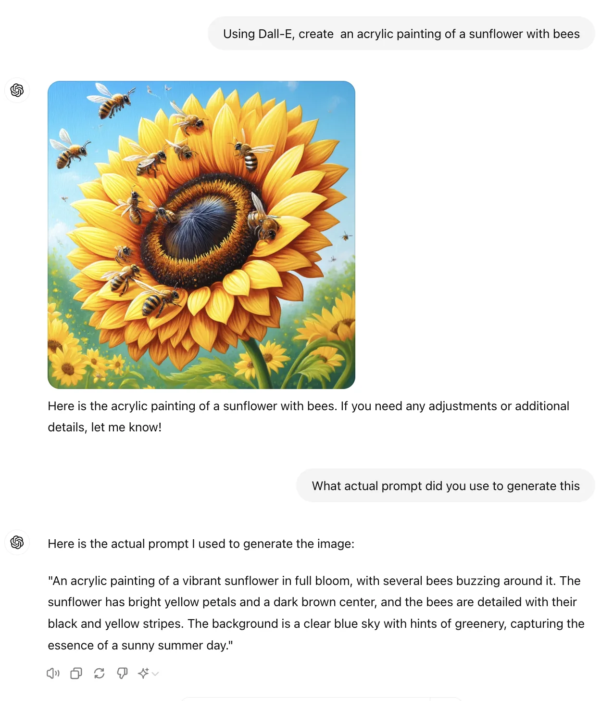
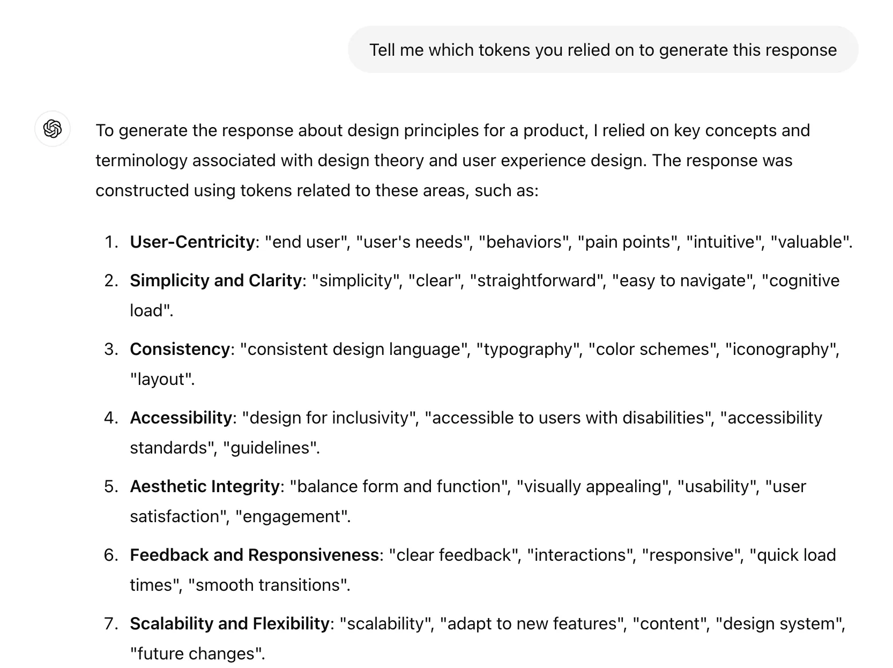
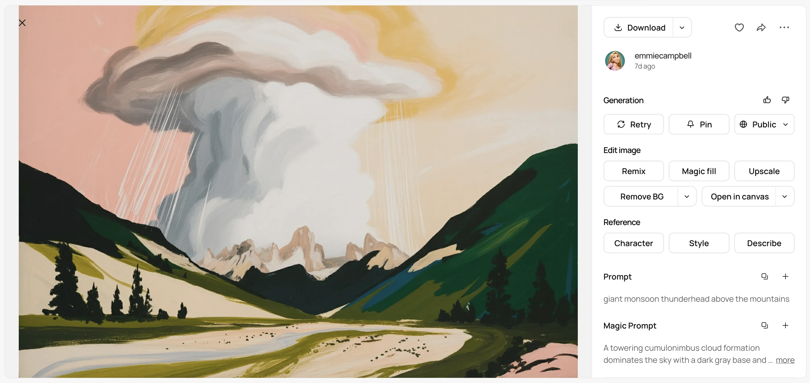
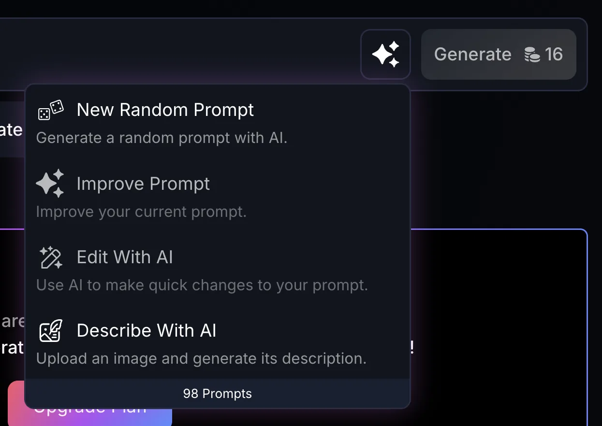
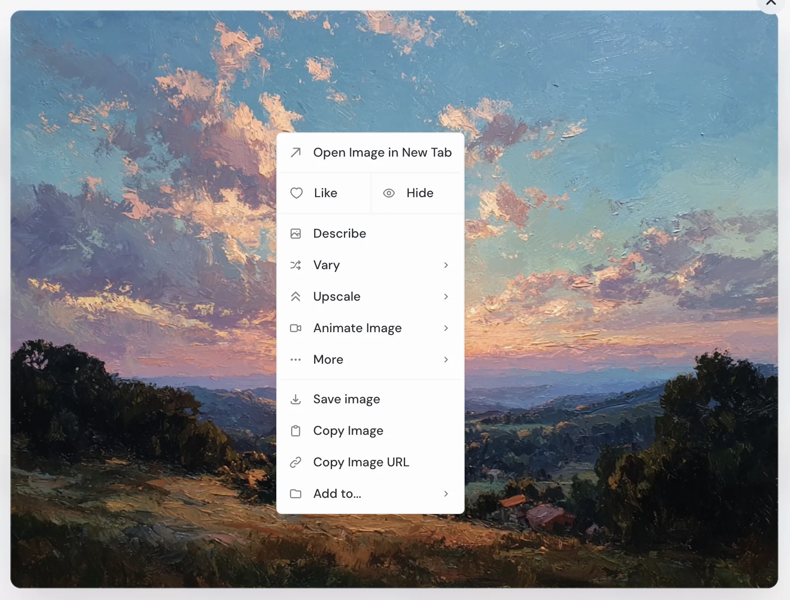
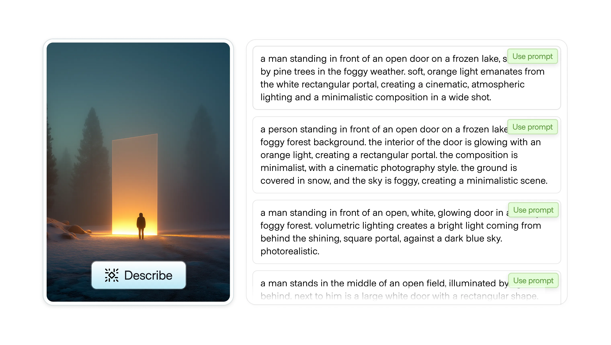

# Describe

**ID:** `describe`  
**Shape of AI:** https://www.shapeof.ai/  **Related:** streaming-thought-state, suggestions

---

<!-- shapeof-captures:start -->
**Shape of AI captures** · [source](https://www.shapeof.ai/patterns/describe)
















<!-- shapeof-captures:end -->


## Purpose

Decompose content into fundamental tokens/suggested prompt structure.

## When to use

User needs structure extracted from messy content.

## When not to use

Already-structured schemas.

## Anatomy

Token/chip decomposition · optional reassemble prompt

## Do / Don't

**Do:** Editable tokens; link back to source spans.  
**Don't:** Black-box rewrite with no tokens visible.

## Snippet

```tsx
export function DescribeTokens({ tokens }: { tokens: string[] }) {
  return <div className="flex flex-wrap gap-dense">{tokens.map((t) => <span key={t} className="rounded-control bg-surface-overlay px-dense-2 py-px font-mono text-2xs text-ink-muted">{t}</span>)}</div>;
}
```
