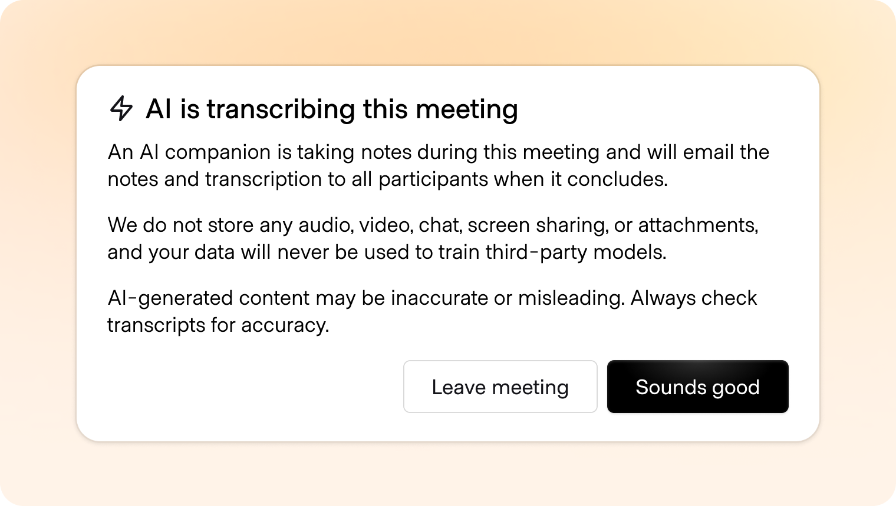

# Disclosure

**ID:** `disclosure` · **Shape of AI:** Trust builders · [source](https://www.shapeof.ai/patterns/disclosure)  
**Related:** `footprints`, identifiers (avatar/name)



---

## Purpose

Label AI actors and AI-authored/edited content so users never mistake bots for humans or synthetic text for human authorship (Fin “AI” badge, iA Writer opacity affordance).

## Forms

- Message sender badge (`AI` / assistant name)  
- Verb chips: `Summarized with AI`, `Rewrote with AI`  
- Synthetic media watermark / platform label  

## Do / Don't

**Do:** name the actor every time; persist badges across human handoff; allow opt-out of AI.  
**Don't:** fake human support; generic sparkle without saying what AI did.

## When to use

Label AI actors and AI-authored/edited content so users never mistake bots for humans or synthetic text for human authorship (Fin “AI” badge, iA Writer opacity affordance).

## When not to use

Skip when a denser core kit pattern already covers the job (see Related).

## Anatomy

1) Trigger 2) Dense primary surface 3) Confirm / dismiss

## Do / Don't

**Do:** Keep Linear/Raycast density; keyboard where actions exist; reuse kit tokens.  
**Don't:** Don't invent parallel chrome; don't hide irreversible effects.

## Snippet

```tsx
export function AiDisclosureBadge({
  verb = "AI",
}: {
  verb?: string;
}) {
  return (
    <span className="inline-flex items-center rounded-control border border-hairline bg-surface-overlay px-dense-2 py-px text-2xs font-medium uppercase tracking-wide text-ink-muted">
      {verb}
    </span>
  );
}
```
