# Dual-Speed Layout — Conversation + Live Execution

**ID:** `dual-speed-layout`  
**Family:** Composition · Governors  
**Maps to:** [Shared vision](https://www.shapeof.ai/patterns/shared-vision) (Operator / Comet-style live oversight)  
**Compose with:** `streaming-thought-state`, `artifact-pane`, `mandate-approval-card`, `citations`, `controls`, `disclosure`  
**Teardowns:** [Output & artifacts](https://aiuxplayground.com/teardowns/compare/output-artifacts-refinement) — Claude artifact split · Manus files/deliverables · Gemini Maps/Workspace handoff

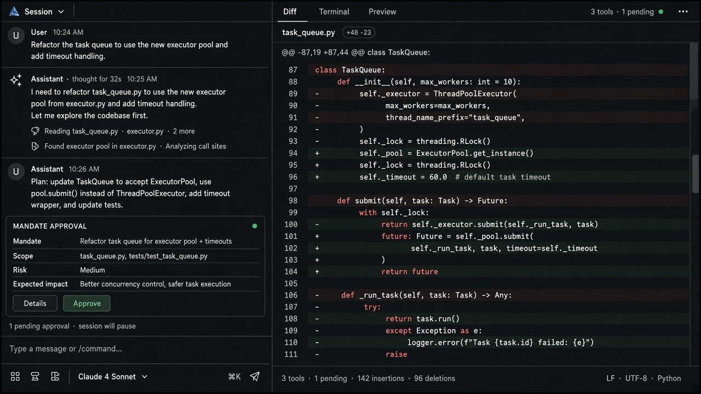

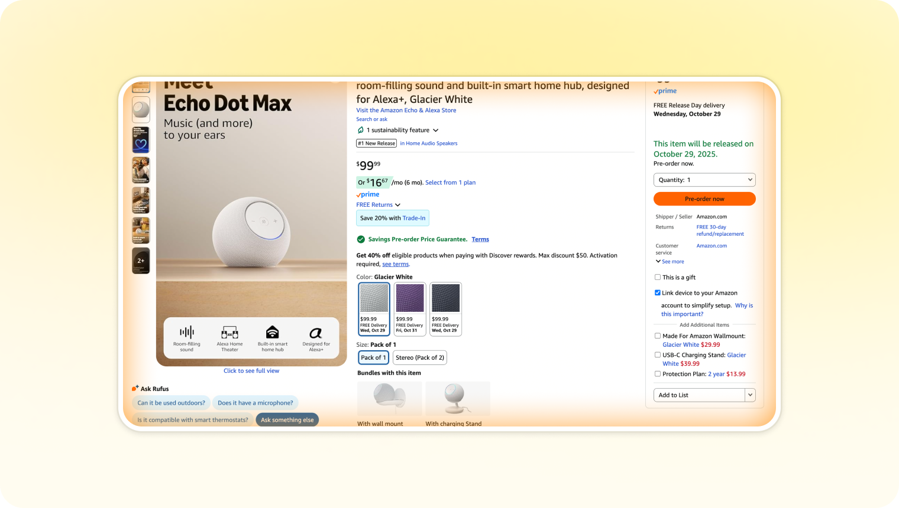

---

<!-- shapeof-captures:start -->
**Shape of AI captures** · [source](https://www.shapeof.ai/patterns/shared-vision)


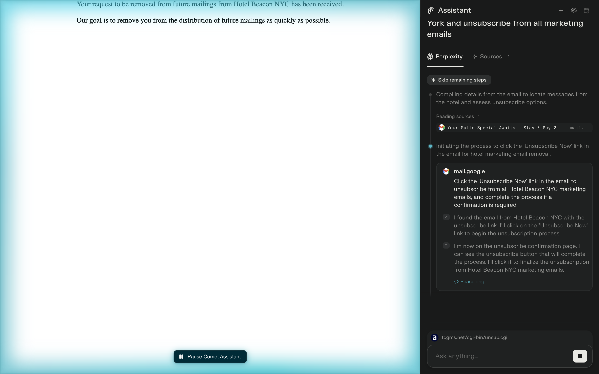

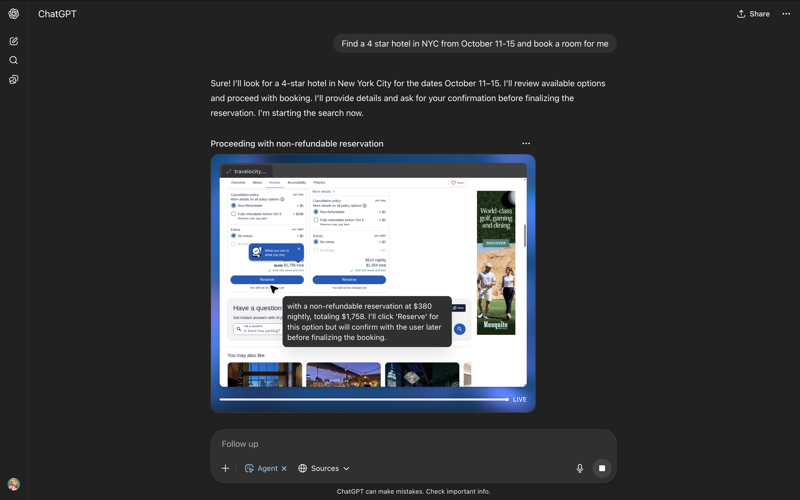

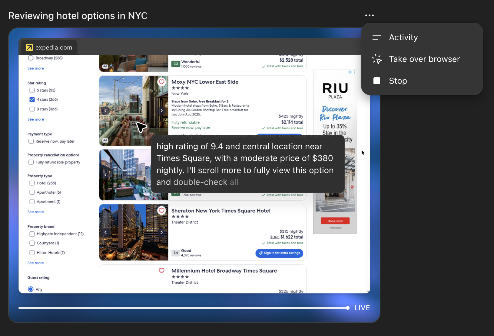


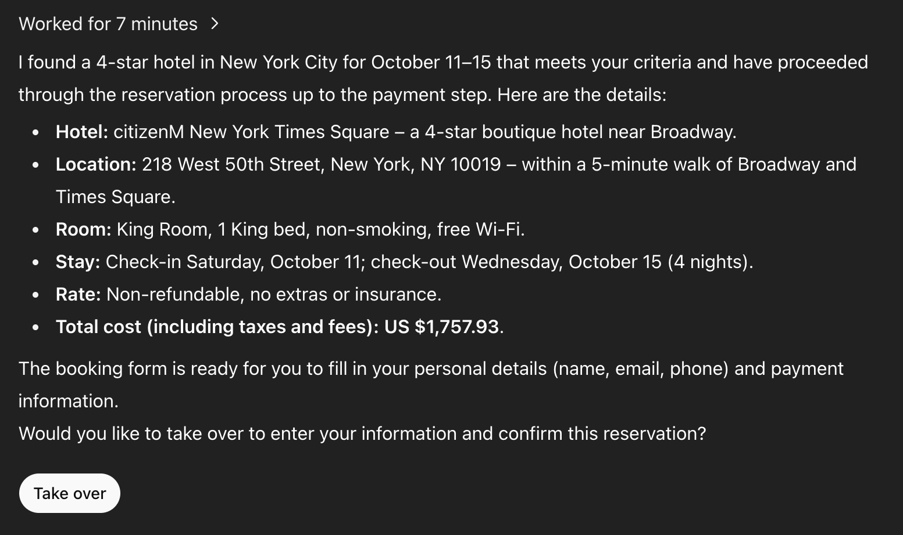

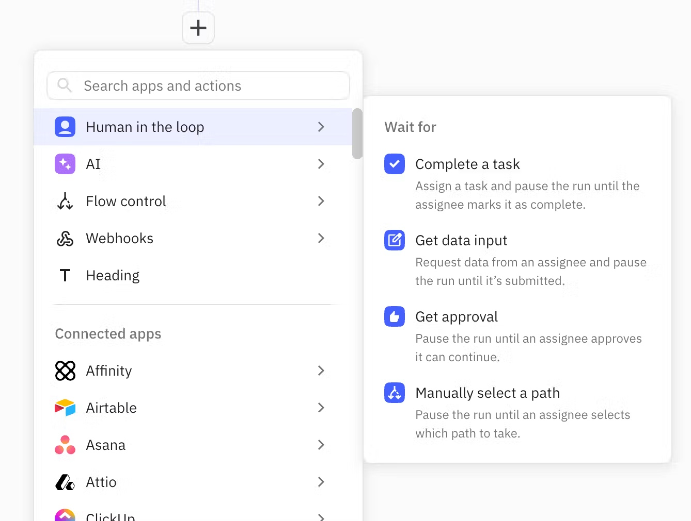

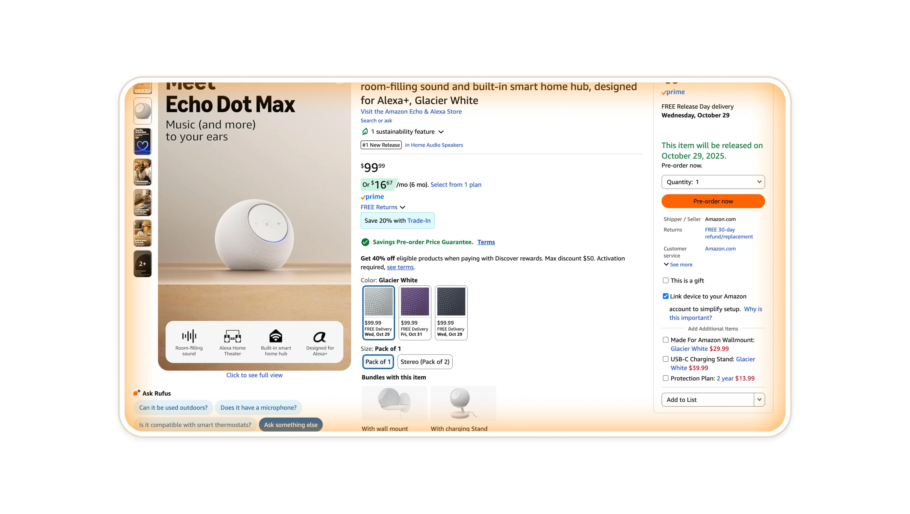

<!-- shapeof-captures:end -->

<!-- aidesign-captures:start -->
**AI Design Guide** · [Agentic UX Patterns](https://www.aidesign.guide/agentic-ux-patterns)

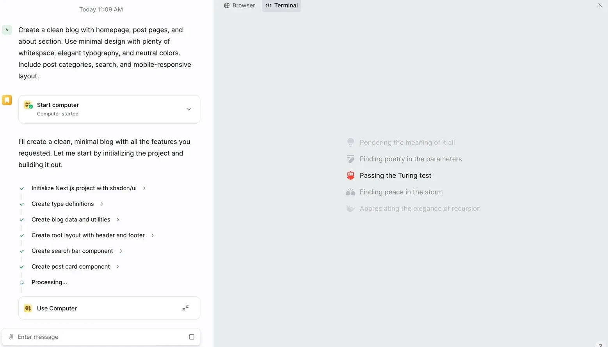

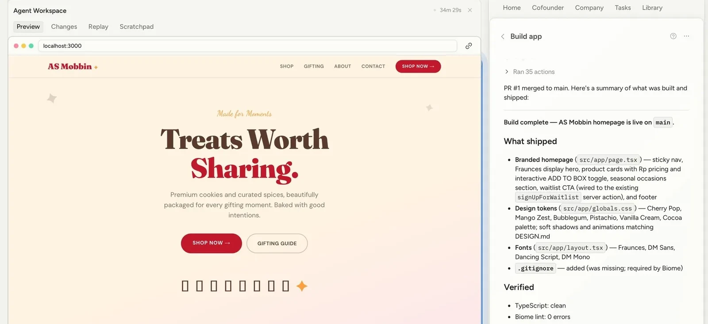

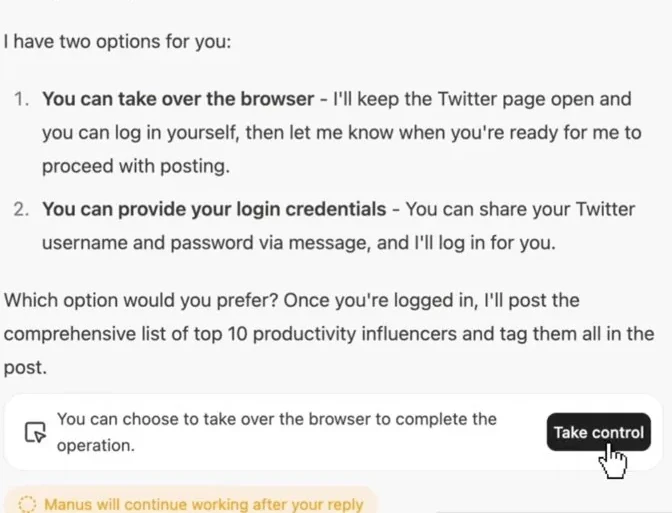

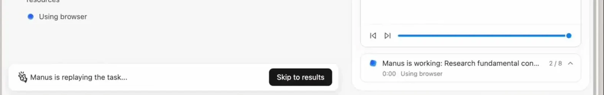

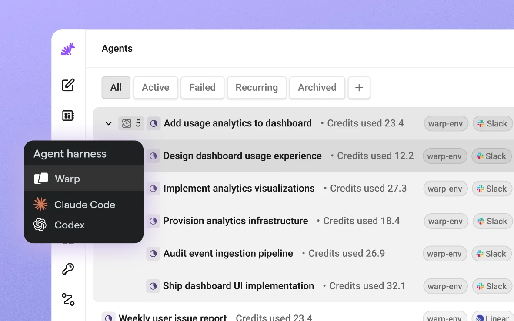

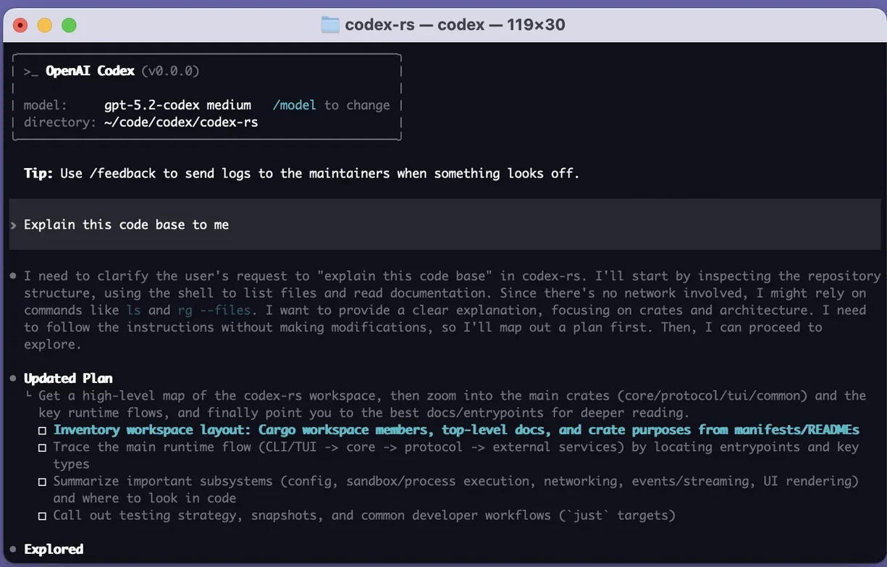

<!-- aidesign-captures:end -->


## Source references (external)

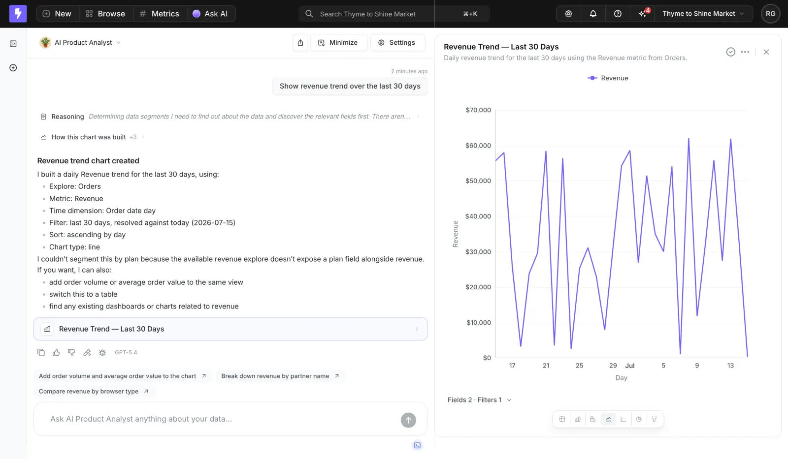

### Source notes (SaaSFrame AI Chat · Lightdash)

- Pair conversation with an inspectable artifact (chart) and state the analysis config (metric, filter, chart type).
- Acknowledge unsupported parts of the request specifically (missing field ≠ silent omit).

## Purpose

Split the agent workspace into two **time scales**:

- **Slow lane (chat):** goals, mandates, narrative, Q&A  
- **Fast lane (execution):** live tools, files, diffs, previews, dashboards  

Humans steer in language; the system shows work as it happens — without burying state inside message bubbles.

## When to use

- Coding / ops / research agents that mutate or inspect artifacts  
- Any session where “what is it doing right now?” matters as much as the reply  

## When not to use

- Single-turn FAQ chatbots  
- Mobile-narrow flows (stack: execution drawer over chat, don’t force 50/50)

---

## Anatomy

```
┌──────────────────────┬──────────────────────────────────┐
│  Chat (slow)         │  Execution (fast)                │
│  ─────────────────   │  tabs: Diff · Terminal · Preview │
│  user                │  ┌────────────────────────────┐  │
│  thought state       │  │  live artifact / stream    │  │
│  mandate card        │  │                            │  │
│  assistant           │  └────────────────────────────┘  │
│  ─────────────────   │  status: 3 tools · 1 pending     │
│  [ composer       ]  │                                  │
└──────────────────────┴──────────────────────────────────┘
```

1. **Chat column** (~360–420px): transcript + Streaming Thought + Mandate cards + composer  
2. **Execution column** (flex): tabbed live surface bound to the active turn  
3. **Cross-links:** clicking a tool step in Thought focuses the matching execution tab  
4. **Responsive:** `&lt;md` → execution as bottom sheet / route; chat remains primary  

---

## States

| State | Behavior |
|-------|----------|
| `idle` | Execution shows empty “Run an agent to populate” |
| `running` | Fast lane streams; chat shows Thought State |
| `awaiting-mandate` | Mandate card sticky in chat; execution may preview pending diff |
| `settled` | Execution pins last artifact; chat scroll stays with latest reply |

---

## Do / Don't

**Do**
- Keep chat readable (message width ~65ch); put dense telemetry in execution  
- Reuse Mandate Approval Card + Streaming Thought State inside the slow lane  
- Preserve scroll independence per pane  

**Don't**
- Nest the live diff inside a chat bubble as the only view  
- Mirror the same content 1:1 in both panes  
- Add dashboard widgets to the first paint — one artifact surface at a time  

---

## React + Tailwind snippet

```tsx
import type { ReactNode } from "react";

export function DualSpeedLayout({
  chat,
  execution,
  executionTabs,
  activeTab,
  onTab,
  status,
}: {
  chat: ReactNode;
  execution: ReactNode;
  executionTabs: { id: string; label: string }[];
  activeTab: string;
  onTab: (id: string) => void;
  status?: string;
}) {
  return (
    <div className="flex h-dvh min-h-0 bg-canvas text-ink">
      {/* Slow lane */}
      <section className="flex w-full max-w-dual-chat shrink-0 flex-col border-r border-hairline bg-surface md:w-[420px]">
        <header className="flex h-10 items-center border-b border-hairline px-panel">
          <h1 className="text-xs font-medium text-ink-muted">Session</h1>
        </header>
        <div className="min-h-0 flex-1 overflow-y-auto px-panel py-panel">{chat}</div>
        {/* Host mounts composer at bottom of `chat` or as sibling */}
      </section>

      {/* Fast lane */}
      <section className="hidden min-w-0 flex-1 flex-col md:flex">
        <div className="flex h-10 items-center gap-dense border-b border-hairline px-panel">
          {executionTabs.map((t) => (
            <button
              key={t.id}
              type="button"
              onClick={() => onTab(t.id)}
              className={`rounded-control px-control py-dense text-xs ${
                activeTab === t.id
                  ? "bg-accent-muted text-accent-ink"
                  : "text-ink-muted hover:text-ink"
              }`}
            >
              {t.label}
            </button>
          ))}
          <span className="ml-auto font-mono text-2xs text-ink-faint">{status}</span>
        </div>
        <div className="min-h-0 flex-1 overflow-auto bg-canvas p-panel">{execution}</div>
      </section>
    </div>
  );
}
```

### Composition with other kit patterns

```tsx
<>
  <StreamingThoughtState ... />
  {interrupt && <MandateApprovalCard ... />}
  {/* assistant markdown */}
</>
```

Mount Thought + Mandate in the **chat** column; bind tool detail panes to **execution** tabs (`Diff`, `Terminal`, `Browser`, `Files`).

---

## References

- Cursor: transcript + diff/terminal dual surface  
- Atrium: agent chat pane with approval cards + artifact drill-in  
- shapeof.ai: Branches / Footprints as durable execution visibility  
- Beamline workspace: conversation column + parts for plan/tools/approvals  
