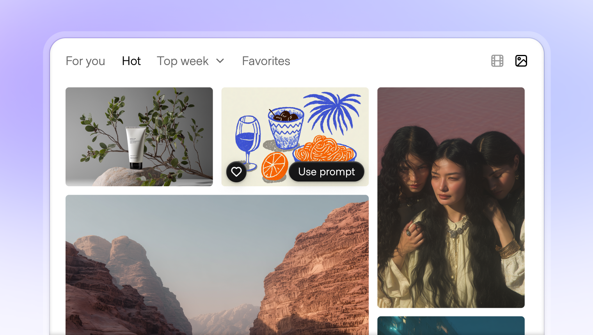
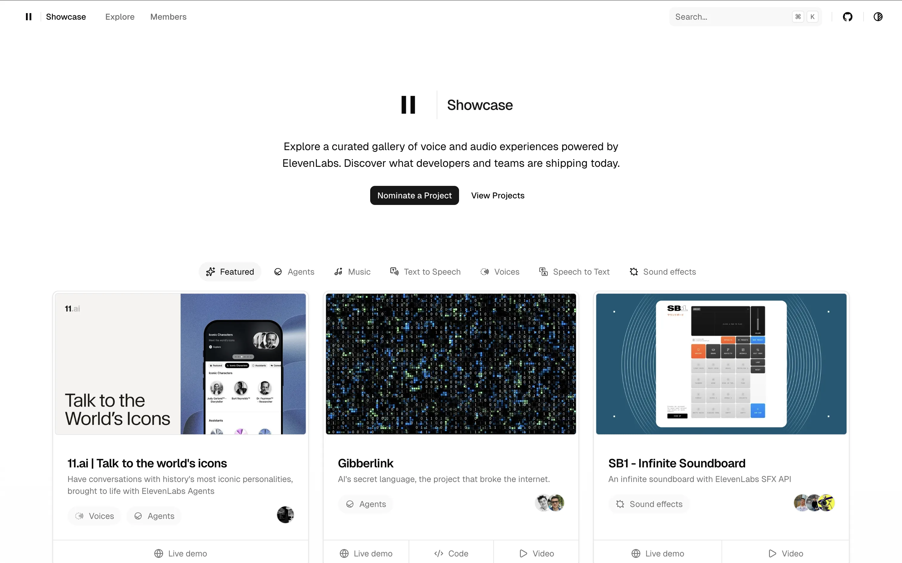
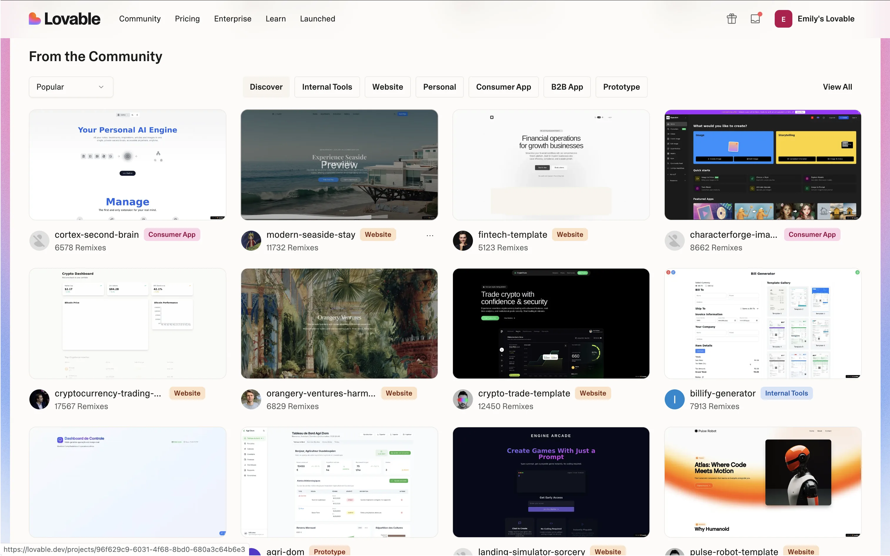
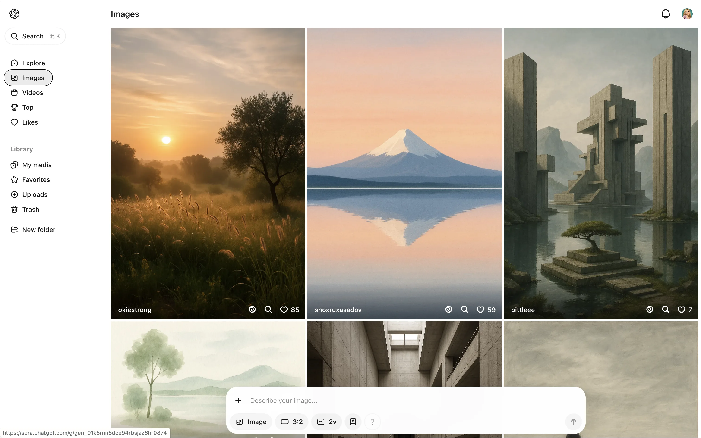
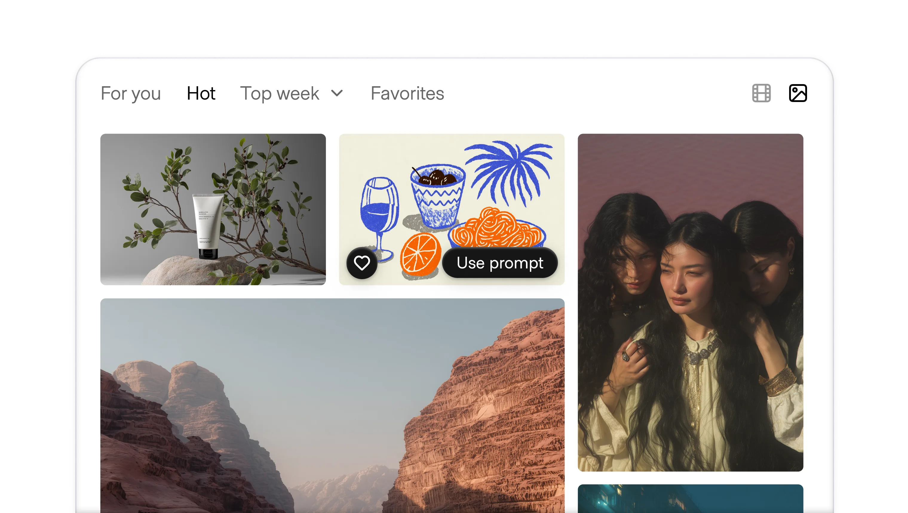
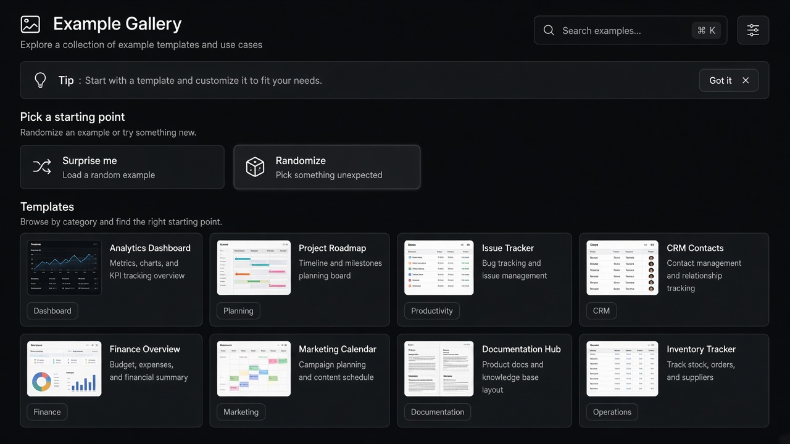

# Example Gallery

**ID:** `example-gallery`  
**Shape of AI:** https://www.shapeof.ai/pattern-types/wayfinders  **Related:** suggestions, onboarding-first-value

---

<!-- shapeof-captures:start -->
**Shape of AI captures** · [source](https://www.shapeof.ai/patterns/gallery)













<!-- shapeof-captures:end -->



## Purpose

Share sample generations, prompts, and parameters to educate and inspire first use.

## When to use

First-run inspiration; show quality bar and prompt shape.

## When not to use

After the user has a clear task.

## Anatomy

Grid of samples · prompt/params peek · Use

## Do / Don't

**Do:** Show prompt + key params on hover; one-click reuse.  
**Don't:** Orphan eye-candy without reusable prompts.

## Snippet

```tsx
export function ExampleGallery({ items, onUse }: { items: { id: string; title: string }[]; onUse: (id: string) => void }) {
  return <div className="grid grid-cols-2 gap-control">{items.map((i) => <button key={i.id} type="button" onClick={() => onUse(i.id)} className="rounded-panel border border-hairline p-panel text-left text-xs text-ink">{i.title}</button>)}</div>;
}
```
