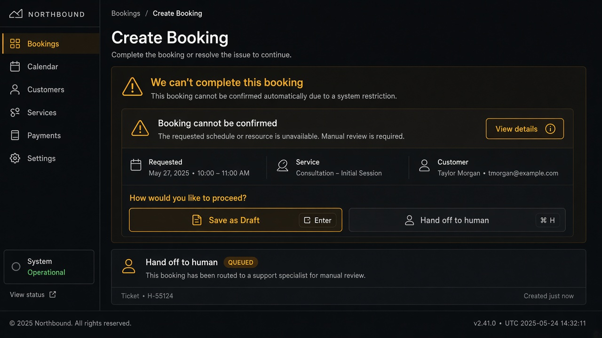
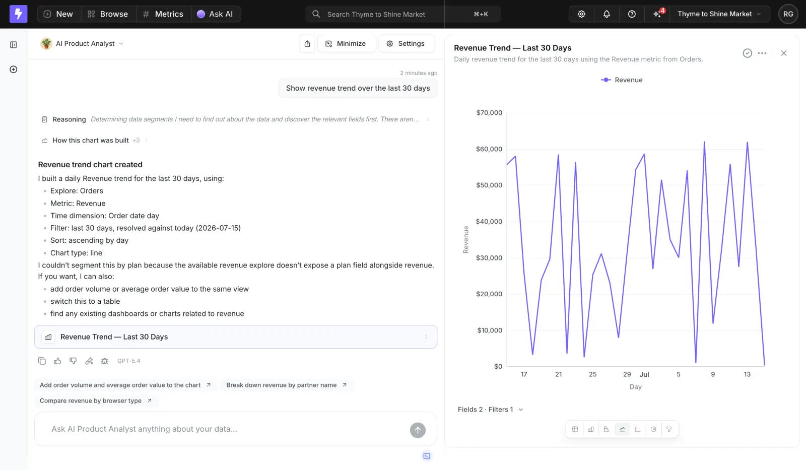

# Failure Disclosure

**ID:** `failure-disclosure`  
**Playground:** [failure-disclosure](https://aiuxplayground.com/pattern/failure-disclosure) · repair-contract · error-recovery-strategies  
**Related:** `clarify-before-act`, `human-handoff`, `controls`

---




## Source references (external)


## Purpose

Say clearly when the system **cannot answer**, a **tool failed**, or an action is out of scope — then offer a concrete next step (draft instead, hand off, retry, narrow query). Never fake success.

## When to use

Say clearly when the system **cannot answer**, a **tool failed**, or an action is out of scope — then offer a concrete next step (draft instead, hand off, retry, narrow query).

## When not to use

Skip when a denser core kit pattern already covers the job (see Related).

## Anatomy

1) Trigger 2) Dense primary surface 3) Confirm / dismiss

## Do / Don't

**Do:** Keep Linear/Raycast density; keyboard where actions exist; reuse kit tokens.  
**Don't:** Don't invent parallel chrome; don't hide irreversible effects.

## Snippet

```tsx
export function FailureDisclosure({
  title,
  detail,
  actions,
}: {
  title: string;
  detail?: string;
  actions: { id: string; label: string; onClick: () => void }[];
}) {
  return (
    <section className="rounded-panel border border-warn/40 bg-warn-muted px-panel py-control-2">
      <h2 className="text-xs font-medium text-warn">{title}</h2>
      {detail && <p className="mt-dense text-xs text-ink-muted">{detail}</p>}
      <div className="mt-control flex flex-wrap gap-dense">
        {actions.map((a) => (
          <button
            key={a.id}
            type="button"
            onClick={a.onClick}
            className="rounded-control border border-hairline bg-surface px-control py-dense text-2xs text-ink"
          >
            {a.label}
          </button>
        ))}
      </div>
    </section>
  );
}
```
