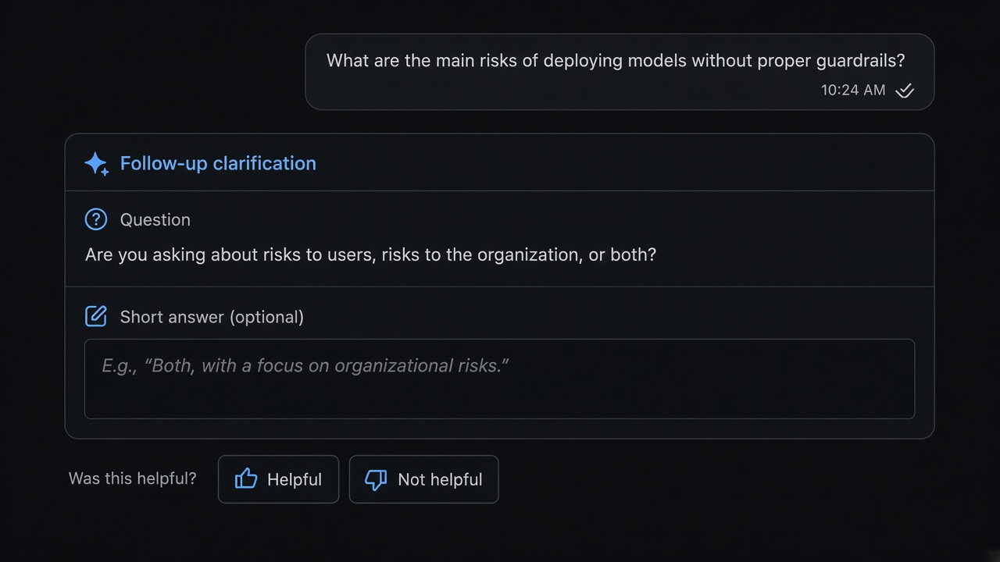
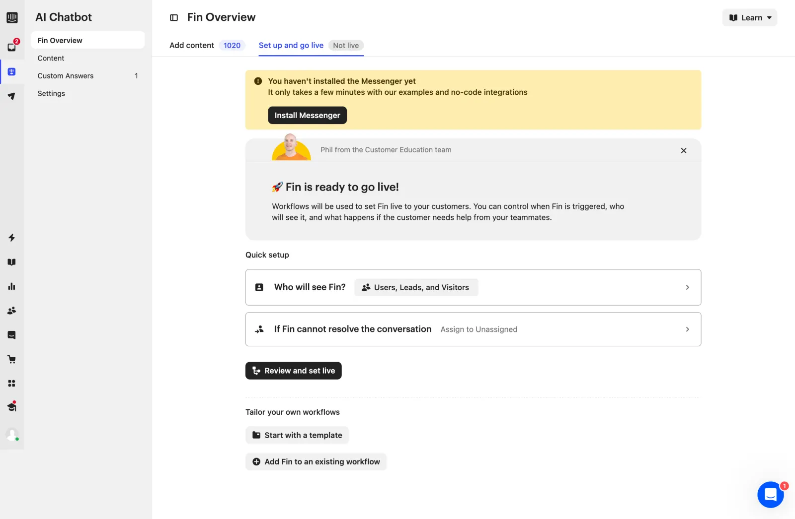

# Feedback

**ID:** `feedback`  
**Playground:** [feedback-loops](https://aiuxplayground.com/pattern/feedback-loops) · message-reactions  
**Related:** `response-versions`, `citations`, `failure-disclosure`

---

<!-- shapeof-captures:start -->
**Shape of AI captures** · [source](https://www.shapeof.ai/patterns/rating)

<!-- shapeof-captures:end -->




## Source references (external)


## Purpose

Tight thumbs / comment capture on AI answers without breaking density. Route negative feedback into repair (`response-versions`, `clarify-before-act`) instead of a dead-end.

## When to use

You need signal on answer quality without leaving the transcript.

## When not to use

Structured eval / annotation queues (use dedicated review tools).

## Anatomy

Helpful / Not helpful · optional one-line comment · routes to repair

## Do / Don't

**Do:** On downvote, offer Regenerate / Clarify next to the control.  
**Don't:** Modal surveys after every message.

## Snippet

```tsx
export function FeedbackRow({
  onUp,
  onDown,
}: {
  onUp: () => void;
  onDown: () => void;
}) {
  return (
    <div className="flex items-center gap-dense text-2xs text-ink-faint">
      <button type="button" onClick={onUp} className="hover:text-ok">
        Helpful
      </button>
      <button type="button" onClick={onDown} className="hover:text-danger">
        Not helpful
      </button>
    </div>
  );
}
```
