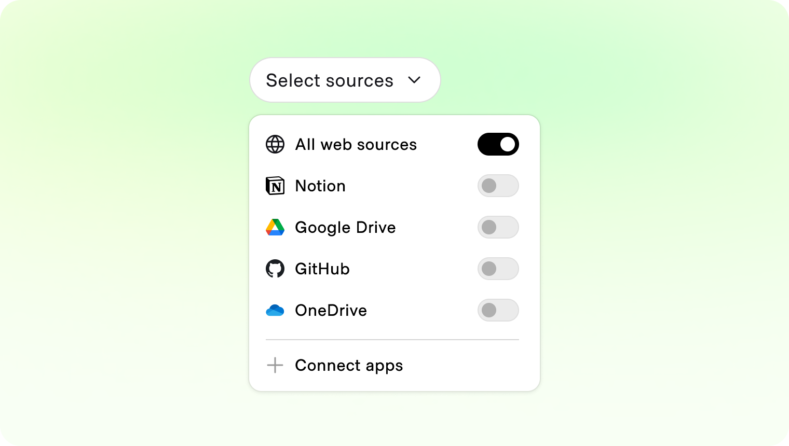
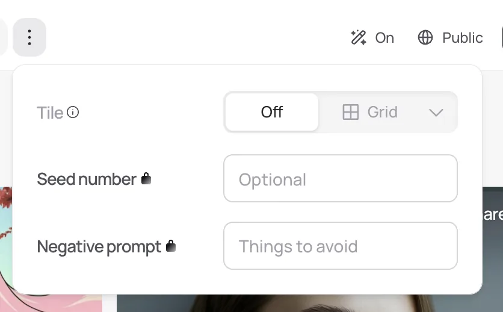
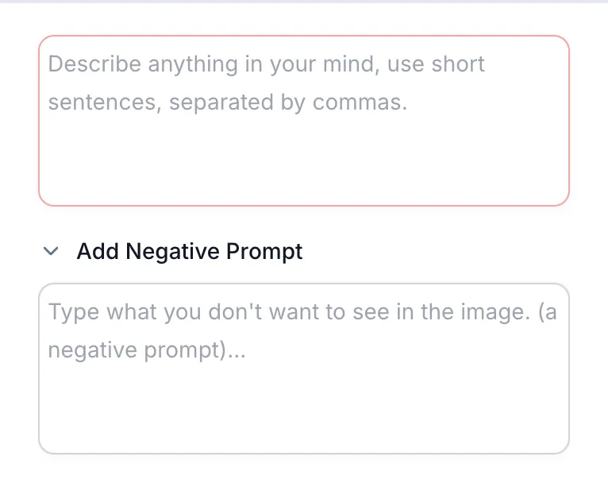
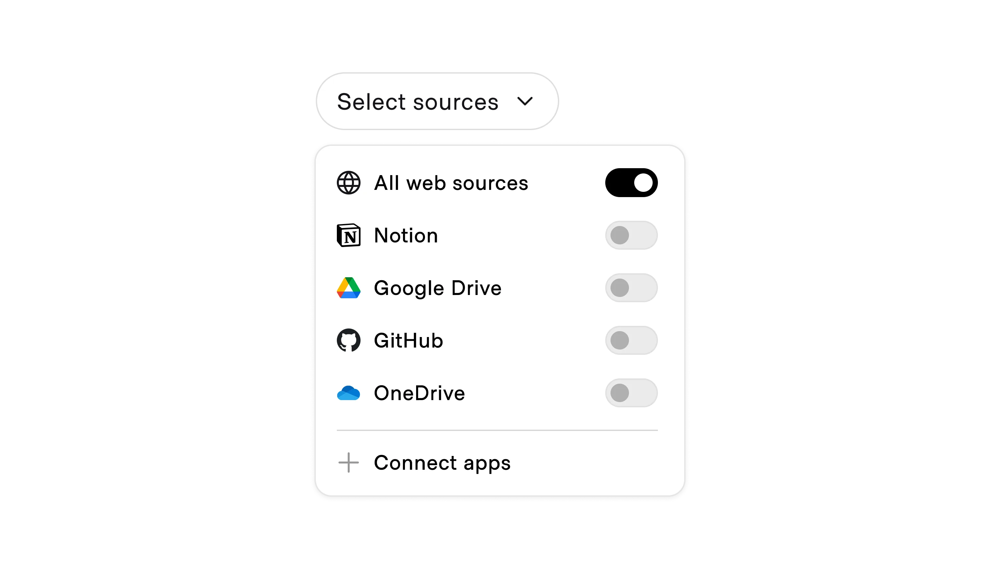

# Filters

**ID:** `filters`  
**Shape of AI:** [filters](https://www.shapeof.ai/patterns/filters) · Tuners  
**Related:** parameters, connectors

---

<!-- shapeof-captures:start -->
**Shape of AI captures** · [source](https://www.shapeof.ai/patterns/filters)

<!-- shapeof-captures:end -->

## Purpose

Constrain inputs/outputs by source, type, modality.

## When to use

See [Shape of AI — filters](https://www.shapeof.ai/patterns/filters) and related kit patterns above.

## When not to use

When a denser kit composition already covers the job — prefer the Related IDs.

## Anatomy

Follow source examples in the captures above; adapt to kit tokens (dense Linear/Raycast).

## Do / Don't

**Do:** Keep density; cite sources in product UI when claims matter.  
**Don't:** Soft SaaS / purple AI chrome; lone spinners for agent work.
