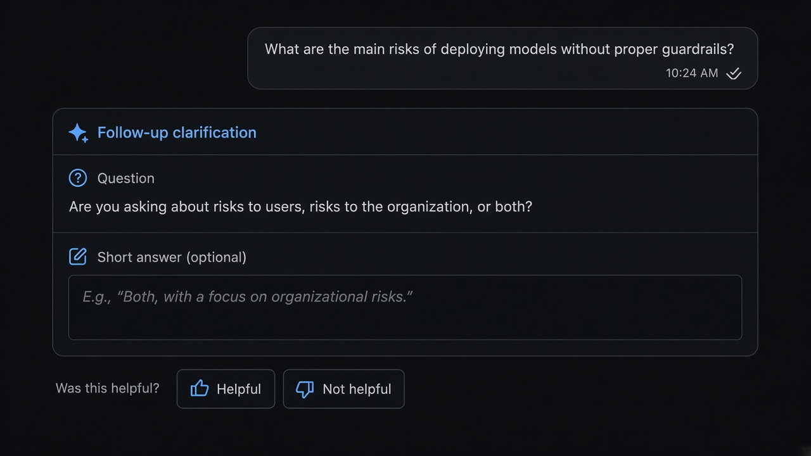

# Follow Up

**ID:** `follow-up`  
**Shape of AI:** https://www.shapeof.ai/pattern-types/wayfinders  **Related:** clarify-before-act, suggestions

---



## Purpose

Ask for missing info when the initial prompt is insufficient (Shape of AI Wayfinder).

## When to use

Initial prompt is underspecified; missing audience, constraints, or required fields.

## When not to use

User already gave a complete brief; or a full clarify-before-act questionnaire is needed for side effects.

## Anatomy

1) One clear question 2) Compact input / chips 3) Continue continues the same turn

## Do / Don't

**Do:** Ask the smallest question that unblocks generation; keep answers editable.  
**Don't:** Stack five interrogations; restart the thread for one missing slot.

## Snippet

```tsx
export function FollowUpPrompt({ question, onAnswer }: { question: string; onAnswer: (v: string) => void }) {
  return (
    <div className="rounded-panel border border-hairline p-panel">
      <p className="text-xs text-ink">{question}</p>
      <input onKeyDown={(e) => e.key === "Enter" && onAnswer((e.target as HTMLInputElement).value)} className="mt-control h-8 w-full rounded-control border border-hairline bg-canvas px-control text-xs" placeholder="Your answer…" />
    </div>
  );
}
```
