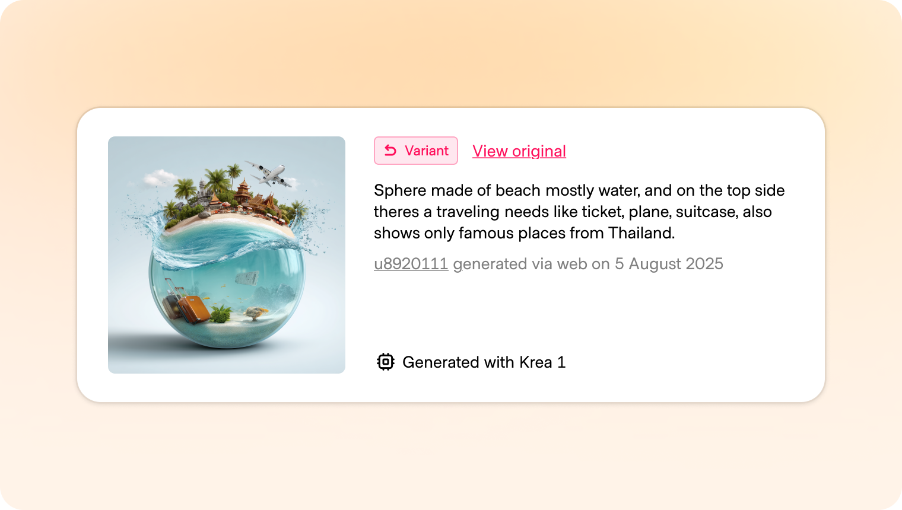
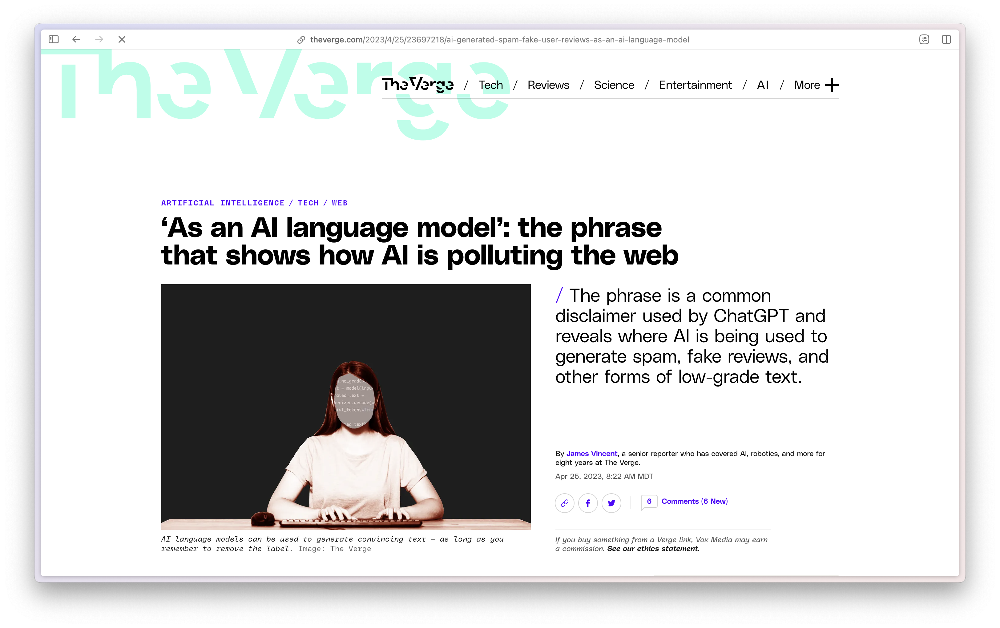
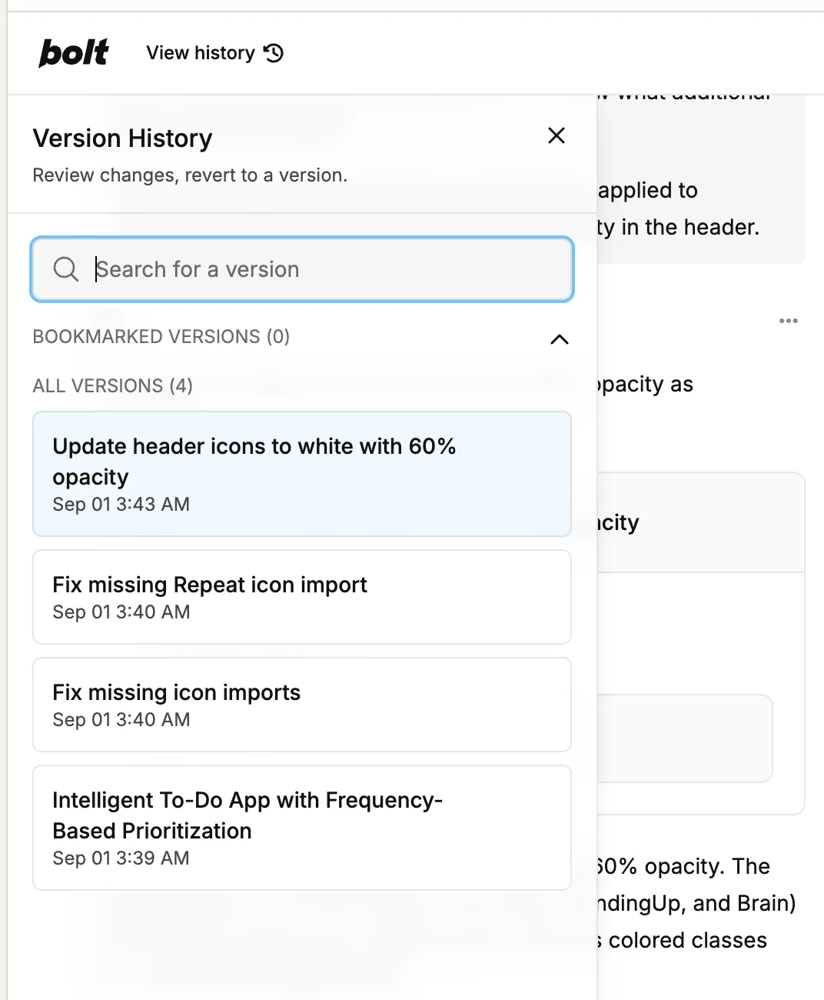
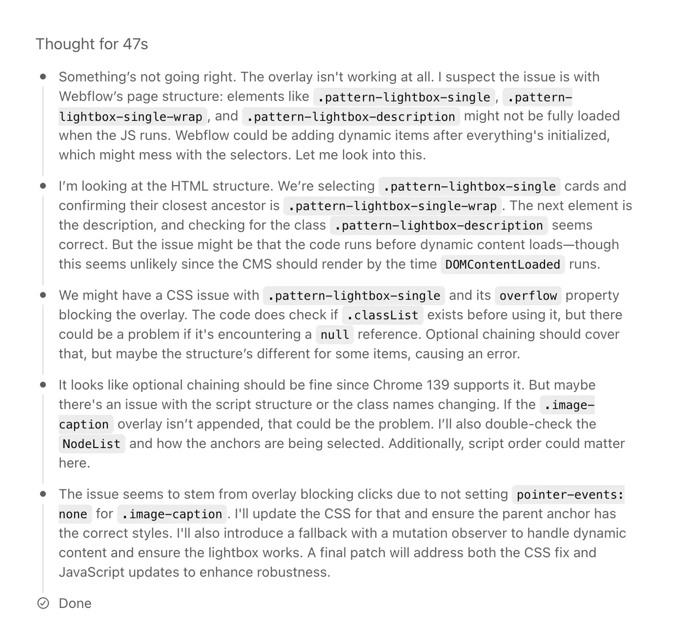
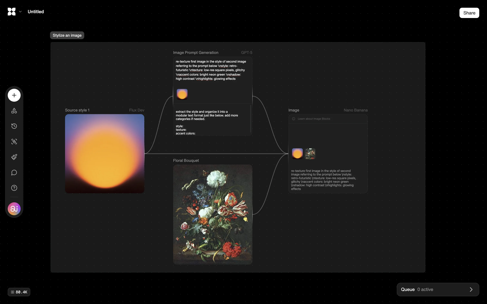
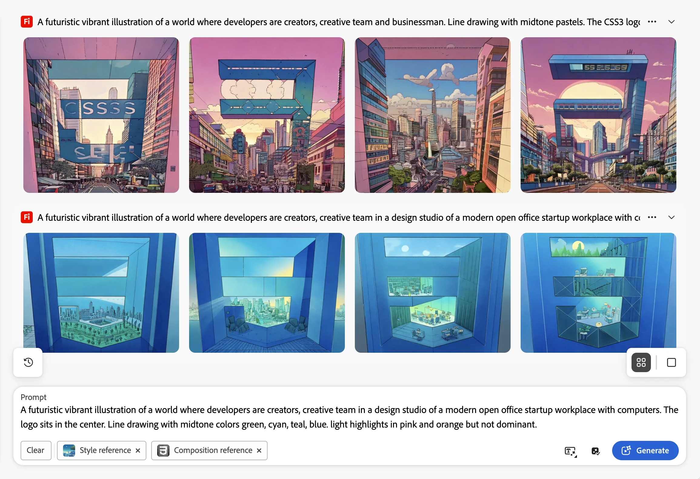
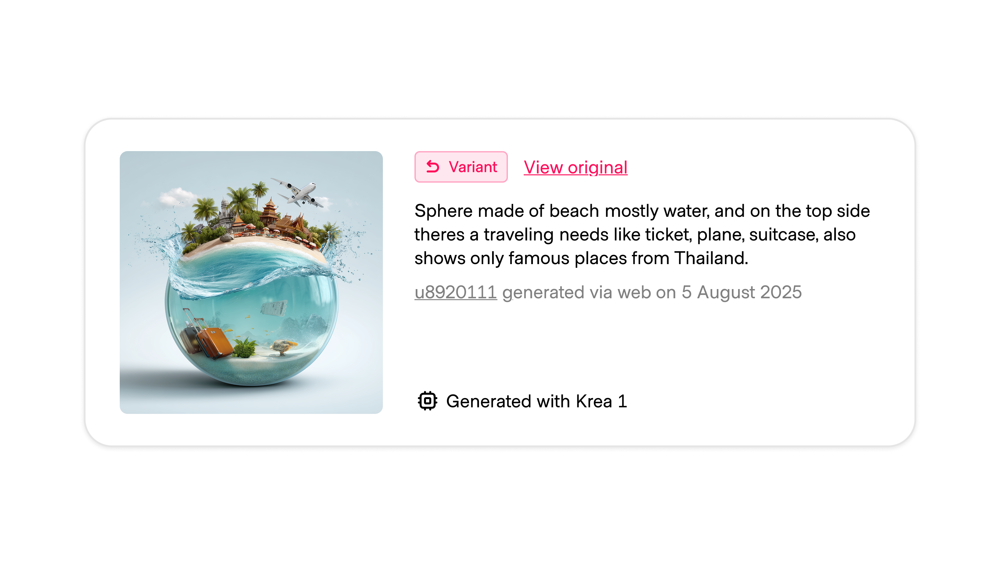

# Footprints

**ID:** `footprints` · **Shape of AI:** Trust builders · [source](https://www.shapeof.ai/patterns/footprints)  
**Related:** `streaming-thought-state`, `citations`, `action-plan`, `disclosure`



---

<!-- shapeof-captures:start -->
**Shape of AI captures** · [source](https://www.shapeof.ai/patterns/footprints)
















<!-- shapeof-captures:end -->

## Purpose

Visible + machine-readable trail of how AI participated: prompts, params, tools, sources, approvals, model version. Enables **branch / replay** (generative) and **audit** (verifying).

## Layers

| Layer | Examples |
|-------|----------|
| Interface | Badges, expandable panels, “reuse prompt” |
| System | Logs: model, safety mode, cost, latency, approvals |
| Media | Content credentials / watermarks on export |

## Do / Don't

**Do:** one-click replay into composer; consistent affordances; retention controls.  
**Don't:** strip provenance on export without notice; leak sensitive metadata publicly.

## When to use

Visible + machine-readable trail of how AI participated: prompts, params, tools, sources, approvals, model version.

## When not to use

Skip when a denser core kit pattern already covers the job (see Related).

## Anatomy

1) Trigger 2) Dense primary surface 3) Confirm / dismiss

## Do / Don't

**Do:** Keep Linear/Raycast density; keyboard where actions exist; reuse kit tokens.  
**Don't:** Don't invent parallel chrome; don't hide irreversible effects.

## Snippet

```tsx
type Footprint = {
  id: string;
  at: string;
  summary: string;
  prompt?: string;
};

export function FootprintRow({
  item,
  onReplay,
}: {
  item: Footprint;
  onReplay: (prompt: string) => void;
}) {
  return (
    <div className="flex items-center gap-control border-b border-hairline py-control text-xs">
      <time className="w-16 shrink-0 font-mono text-2xs text-ink-faint">{item.at}</time>
      <span className="min-w-0 flex-1 truncate text-ink-muted">{item.summary}</span>
      {item.prompt && (
        <button
          type="button"
          onClick={() => onReplay(item.prompt!)}
          className="shrink-0 text-2xs text-accent-ink hover:underline"
        >
          Replay
        </button>
      )}
    </div>
  );
}
```
