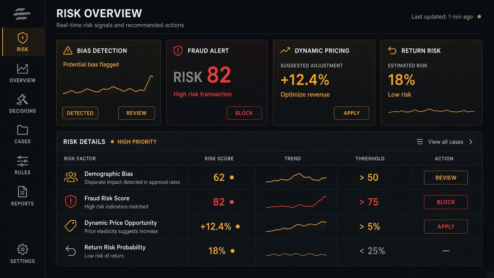

# Fraud Detection

**ID:** `fraud-detection`  
**Playground:** [fraud-detection](https://aiuxplayground.com/pattern/fraud-detection)  **Related:** agent-payment, bias-detection, mandate-approval-card

---



## Purpose

Flag risky AI-assisted transactions/actions with score, reasons, and block/allow.

## When to use

Flag risky AI-assisted transactions/actions with score, reasons, and block/allow.

## When not to use

Skip when a denser core kit pattern already covers the job (see Related).

## Anatomy

1) Trigger 2) Dense primary surface 3) Confirm / dismiss

## Do / Don't

**Do:** Keep Linear/Raycast density; keyboard where actions exist; reuse kit tokens.  
**Don't:** Don't invent parallel chrome; don't hide irreversible effects.

## Snippet

```tsx
export function FraudAlert({ score, reasons, onBlock }: { score: number; reasons: string[]; onBlock: () => void }) {
  return (
    <div className="rounded-panel border border-danger/40 bg-danger-muted p-panel text-xs text-danger">
      <p className="font-medium">Risk {score}</p>
      <ul className="mt-dense list-disc pl-panel text-2xs">{reasons.map((r) => <li key={r}>{r}</li>)}</ul>
      <button type="button" onClick={onBlock} className="mt-control underline">Block</button>
    </div>
  );
}
```
