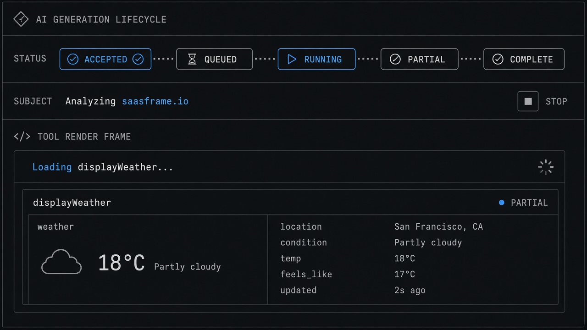
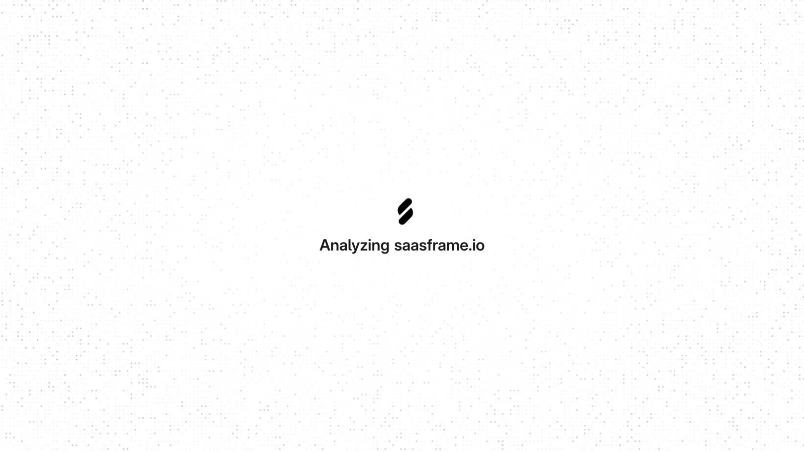
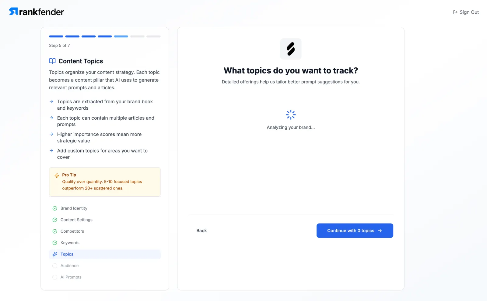
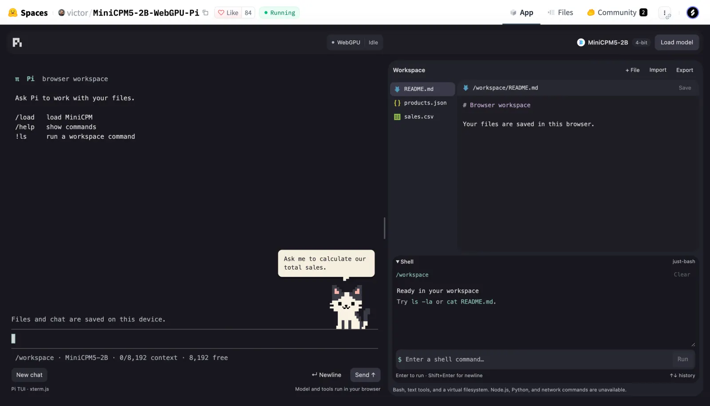

# Generation Lifecycle

**ID:** `generation-lifecycle`  
**Sources:** [SaaSFrame AI Generation State](https://www.saasframe.io/patterns/ai-generation-state) · AI SDK tool part states  
**Related:** `streaming-thought-state`, `controls`, `failure-disclosure`, `tool-render-states`



---


## Source references (external)





### Source notes (SaaSFrame AI Generation State)

- Map labels to real ops (accepted / running / partial / complete / failed).
- Keep task context visible during wait (Rankfender); don’t invent percentages.
- Separate explanatory illustrations from live progress (Profound).

## Purpose

Name the **real job lifecycle** between submit and usable output: accepted → queued → running → partial → complete / failed / cancelled — without fake progress or theatrical “thinking” copy.

## States

| State | Meaning |
|-------|---------|
| `accepted` | Request received |
| `queued` | Waiting for capacity |
| `running` | Work in flight |
| `partial` | Usable mid-stream (marked incomplete) |
| `complete` | Stable result |
| `failed` | Error + recovery |
| `cancelled` | User/system stop |

## Do / Don't

**Do:** map labels to real ops; keep input identity; measurable % only when true.  
**Don't:** timer-driven fake stages; treat partial as approved; spinner-only waits.

## Snippet

```tsx
type GenPhase =
  | "accepted"
  | "queued"
  | "running"
  | "partial"
  | "complete"
  | "failed"
  | "cancelled";

export function GenerationLifecycleBar({
  phase,
  subject,
  onStop,
}: {
  phase: GenPhase;
  subject: string;
  onStop?: () => void;
}) {
  const live = phase === "queued" || phase === "running" || phase === "partial";
  return (
    <div className="flex h-8 items-center gap-control rounded-control border border-hairline bg-surface px-panel text-2xs">
      <span className="font-mono uppercase text-ink-faint">{phase}</span>
      <span className="min-w-0 flex-1 truncate text-ink-muted">{subject}</span>
      {live && onStop && (
        <button type="button" onClick={onStop} className="text-danger">
          Stop
        </button>
      )}
    </div>
  );
}
```
