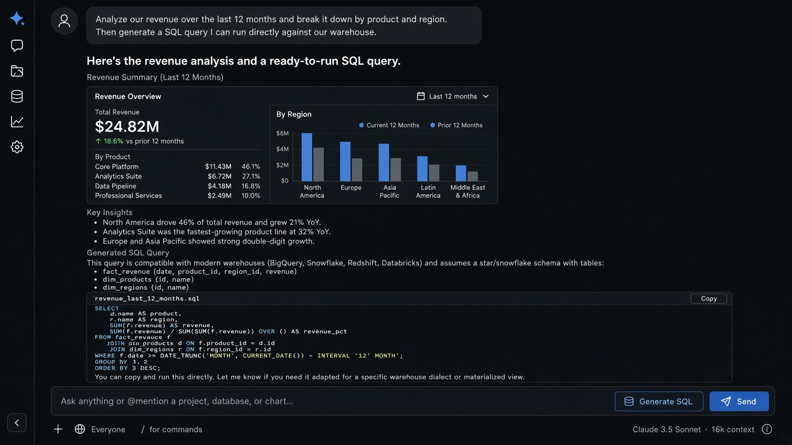

# Generative UI

**ID:** `generative-ui`  
**Playground:** [gen-ui](https://aiuxplayground.com/pattern/gen-ui) · gen-chart · prompt-ui · ChatGPT Intelligent UI  
**Related:** `artifact-pane`, `inline-action`, `mandate-approval-card`

---



## Purpose

Render **interactive components** (tables, calculators, forms, charts) inside the answer — not only markdown. Prefer promoting rich UIs into `artifact-pane` when users will edit/reuse them.

## Do / Don't

**Do:** typed component registry; edit affordance; sandbox untrusted UI.  
**Don't:** free-form HTML from the model without a allowlist.

## When to use

Render **interactive components** (tables, calculators, forms, charts) inside the answer — not only markdown.

## When not to use

Skip when a denser core kit pattern already covers the job (see Related).

## Anatomy

1) Trigger 2) Dense primary surface 3) Confirm / dismiss

## Do / Don't

**Do:** Keep Linear/Raycast density; keyboard where actions exist; reuse kit tokens.  
**Don't:** Don't invent parallel chrome; don't hide irreversible effects.

## Snippet

```tsx
type GenBlock =
  | { type: "metric"; label: string; value: string }
  | { type: "actions"; items: { id: string; label: string }[] };

export function GenerativeUiBlock({
  blocks,
  onAction,
}: {
  blocks: GenBlock[];
  onAction?: (id: string) => void;
}) {
  return (
    <div className="space-y-control rounded-panel border border-hairline bg-surface p-panel">
      {blocks.map((b, i) =>
        b.type === "metric" ? (
          <div key={i} className="flex items-baseline justify-between text-xs">
            <span className="text-ink-muted">{b.label}</span>
            <span className="font-mono text-ink">{b.value}</span>
          </div>
        ) : (
          <div key={i} className="flex flex-wrap gap-dense">
            {b.items.map((it) => (
              <button
                key={it.id}
                type="button"
                onClick={() => onAction?.(it.id)}
                className="rounded-control bg-accent-muted px-control py-dense text-2xs text-accent-ink"
              >
                {it.label}
              </button>
            ))}
          </div>
        )
      )}
    </div>
  );
}
```
