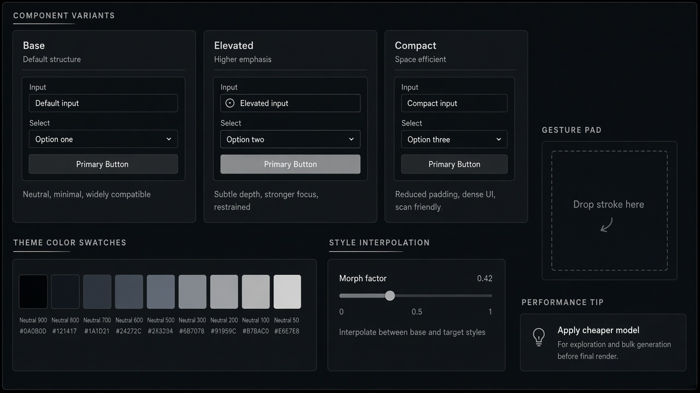

# Gesture Input

**ID:** `gesture-input`  
**Playground:** [gesture-input](https://aiuxplayground.com/pattern/gesture-input)  **Related:** copilot-input, multimodal

---



## Purpose

Capture gestures/strokes as AI input (canvas, AR, mobile) with clear recognition feedback.

## Snippet

```tsx
export function GesturePad({ hint }: { hint: string }) {
  return <div className="flex h-32 items-center justify-center rounded-panel border border-dashed border-hairline text-2xs text-ink-faint">{hint}</div>;
}
```
