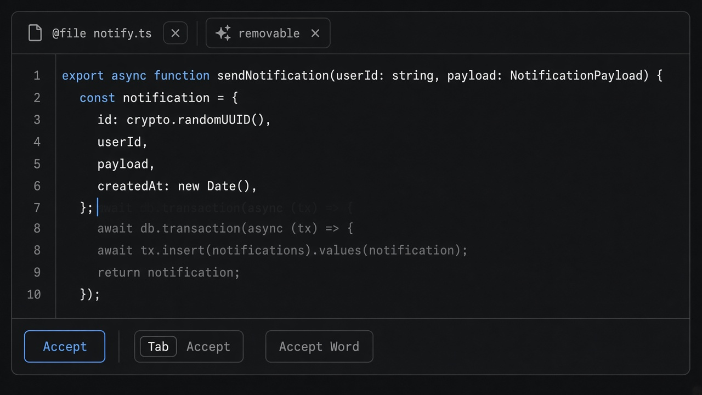

# Ghost Text

**ID:** `ghost-text`  
**Sources:** AI Design Guide · GitHub Copilot / Cursor Tab · AI SDK `useCompletion`  
**Related:** `inline-action`, `smart-diff`



---

## Purpose

Inline **suggested continuation** (ghost) accepted with Tab / word-by-word — distinct color token so it never looks like committed text.

## Snippet

```tsx
export function GhostTextField({
  value,
  suggestion,
  onChange,
  onAccept,
  onAcceptWord,
}: {
  value: string;
  suggestion?: string;
  onChange: (v: string) => void;
  onAccept: () => void;
  onAcceptWord: () => void;
}) {
  return (
    <div className="relative rounded-control border border-hairline bg-canvas px-panel py-control font-mono text-xs">
      <textarea
        value={value}
        onChange={(e) => onChange(e.target.value)}
        className="w-full resize-none bg-transparent text-ink outline-none"
        rows={3}
      />
      {suggestion && (
        <div className="mt-dense flex items-center gap-control text-2xs text-ink-faint">
          <span className="text-ink-muted/70">{suggestion}</span>
          <button type="button" onClick={onAcceptWord} className="text-accent-ink">
            Word
          </button>
          <button type="button" onClick={onAccept} className="text-accent-ink">
            Tab accept
          </button>
        </div>
      )}
    </div>
  );
}
```
