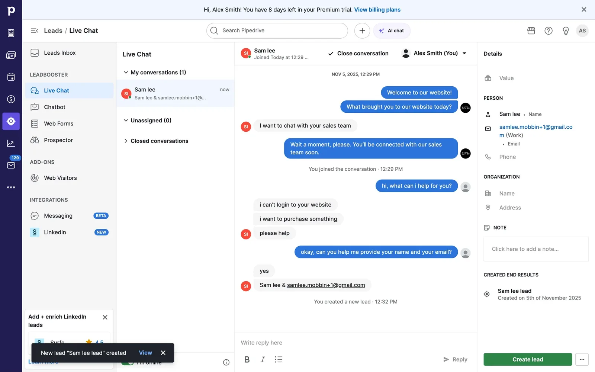
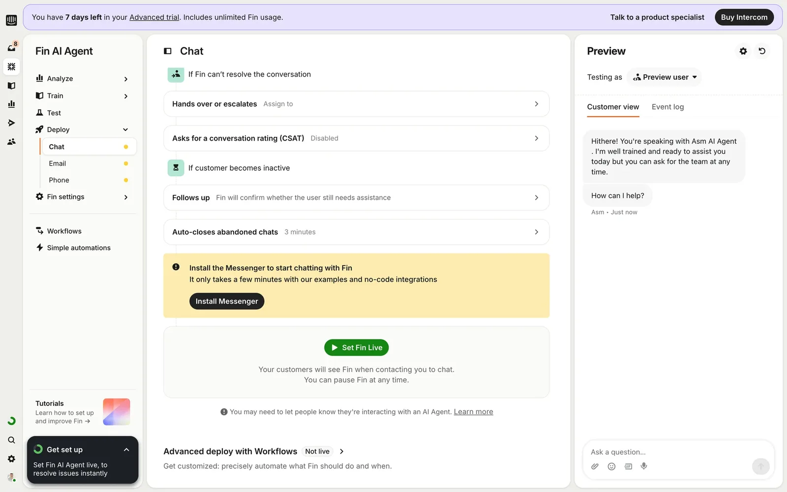
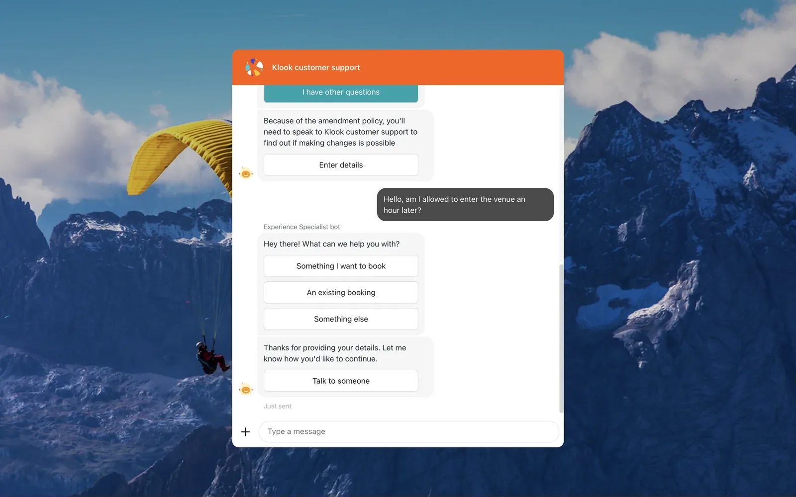
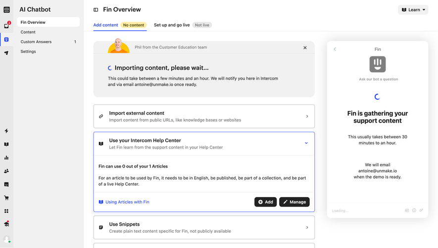
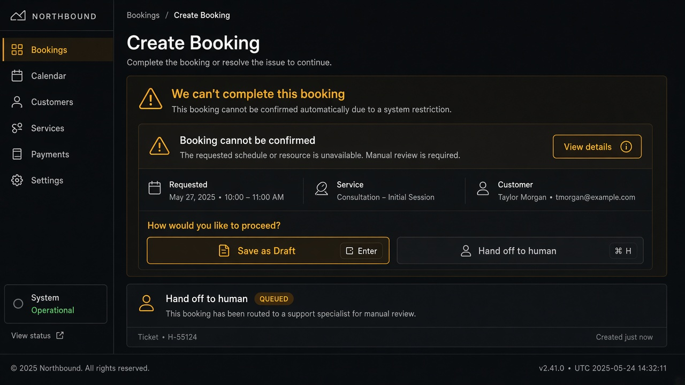
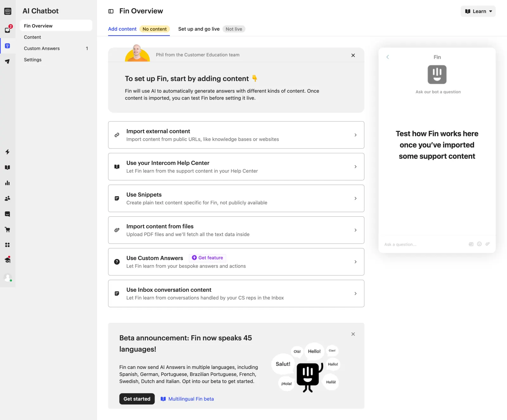

# Human Handoff

**ID:** `human-handoff`  
**Playground:** [human-handoff](https://aiuxplayground.com/pattern/human-handoff) · ai-customer-support · escalation-thresholds  
**Related:** `failure-disclosure`, `clarify-before-act`, `disclosure`

---

<!-- aidesign-captures:start -->
**AI Design Guide** · [Agentic UX Patterns](https://www.aidesign.guide/agentic-ux-patterns)







<!-- aidesign-captures:end -->

<!-- saasframe-expand:start -->
**SaaSFrame AI captures** (expanded) · [saasframe.io](https://www.saasframe.io/patterns)




<!-- saasframe-expand:end -->





## Source references (external)



### Source notes (SaaSFrame · Intercom)

- Escalation / go-live is a first-class path when the agent can’t resolve — keep outcome labels honest.

## Purpose

Escalate from AI to a human (or trusted external app) with **context preserved**: transcript summary, reason, and clear who is speaking after the handoff. Never imply the bot finished what only a human can do.

## When to use

Escalate from AI to a human (or trusted external app) with **context preserved**: transcript summary, reason, and clear who is speaking after the handoff.

## When not to use

Skip when a denser core kit pattern already covers the job (see Related).

## Anatomy

1) Trigger 2) Dense primary surface 3) Confirm / dismiss

## Do / Don't

**Do:** Keep Linear/Raycast density; keyboard where actions exist; reuse kit tokens.  
**Don't:** Don't invent parallel chrome; don't hide irreversible effects.

## Snippet

```tsx
export function HumanHandoffCard({
  reason,
  summary,
  onHandoff,
  onStay,
}: {
  reason: string;
  summary: string;
  onHandoff: () => void;
  onStay: () => void;
}) {
  return (
    <section className="max-w-mandate rounded-panel border border-hairline bg-surface-raised p-panel">
      <p className="text-xs font-medium text-ink">Hand off to a human</p>
      <p className="mt-dense text-xs text-ink-muted">{reason}</p>
      <pre className="mt-control max-h-24 overflow-auto rounded-control bg-canvas p-control font-mono text-2xs text-ink-faint">
        {summary}
      </pre>
      <div className="mt-panel flex justify-end gap-control">
        <button type="button" onClick={onStay} className="text-xs text-ink-muted">
          Keep chatting
        </button>
        <button
          type="button"
          onClick={onHandoff}
          className="rounded-control bg-accent px-panel py-control-2 text-xs text-accent-ink"
        >
          Connect
        </button>
      </div>
    </section>
  );
}
```
