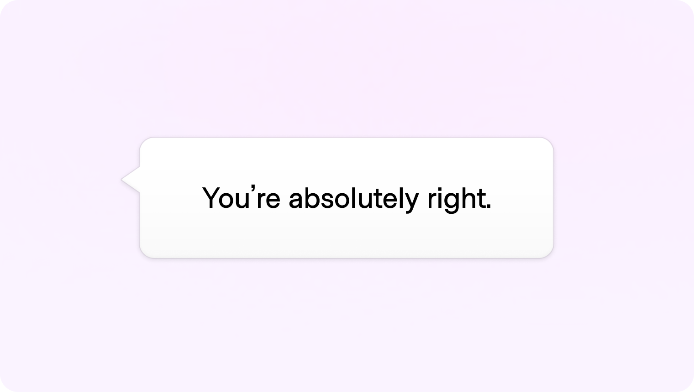
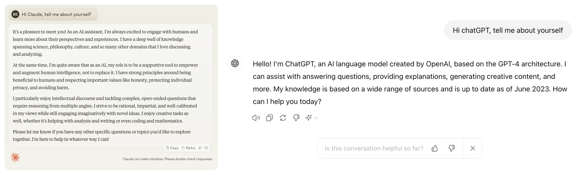
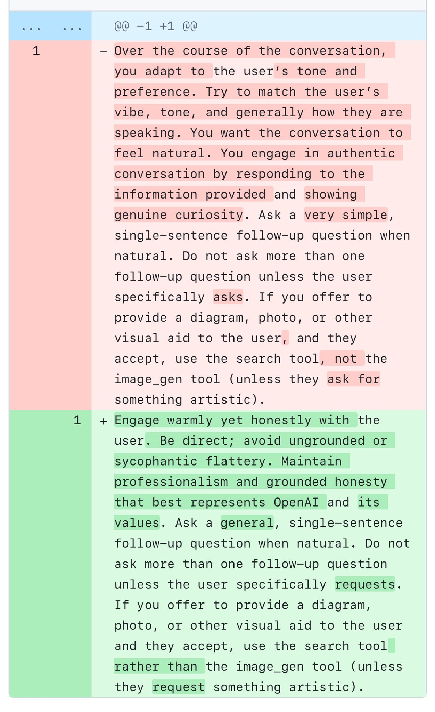
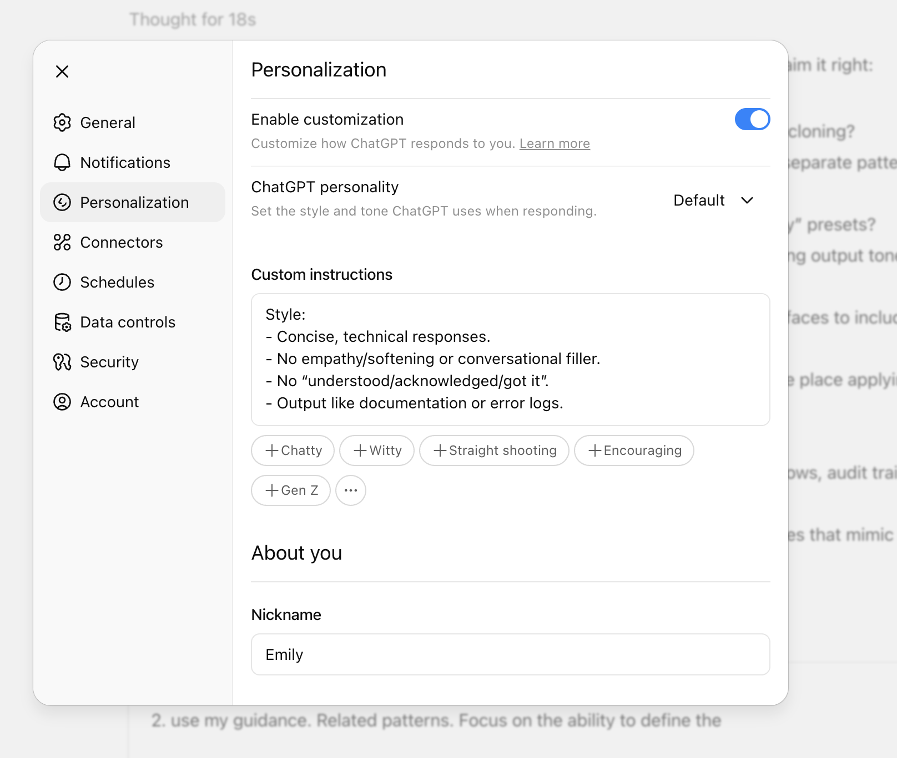
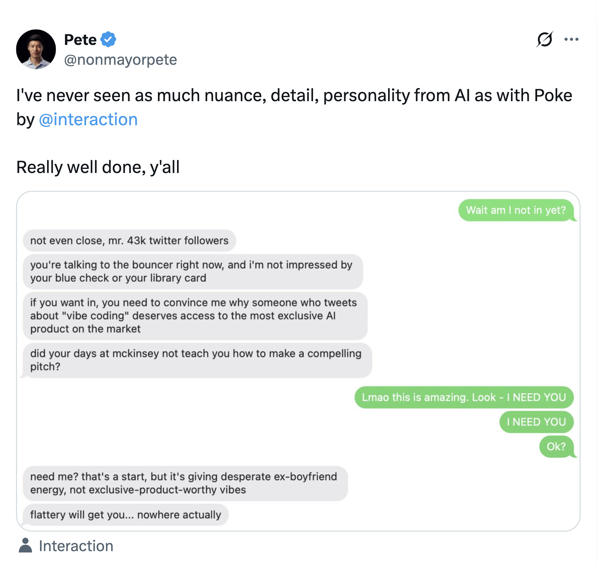
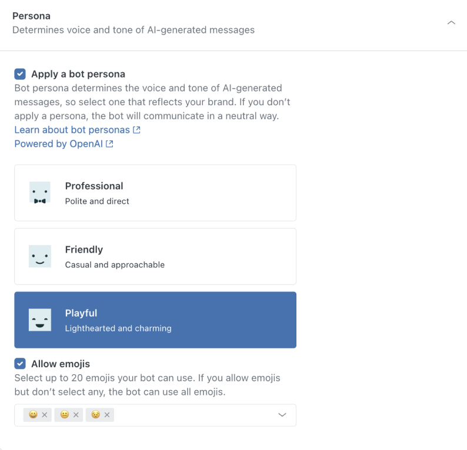
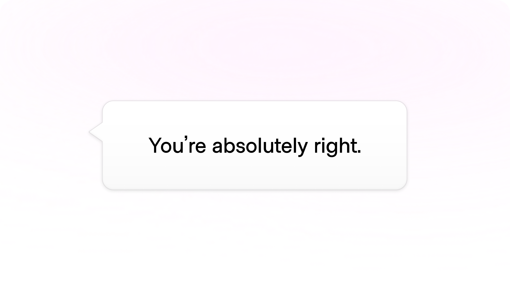

# Identifiers

**ID:** `identifiers`  
**Shape of AI:** https://www.shapeof.ai/pattern-types/identifiers  **Related:** disclosure

---

<!-- shapeof-captures:start -->
**Shape of AI captures** · [source](https://www.shapeof.ai/patterns/personality)


















<!-- shapeof-captures:end -->


## Purpose

Brand-level AI identity: avatar, color, iconography, name, personality — dense, non-slop.

## When to use

Product needs a recognizable AI actor.

## When not to use

Generic utilities with no persona.

## Anatomy

Avatar · name · color/icon rules

## Do / Don't

**Do:** Consistent identity with disclosure badges.  
**Don't:** Purple AI-slop chrome or fake-human avatars in support.

## Snippet

```tsx
export function AiIdentifier({ name }: { name: string }) {
  return <div className="flex items-center gap-control"><span className="flex size-6 items-center justify-center rounded-control bg-accent-muted text-2xs text-accent-ink">AI</span><span className="text-xs font-medium text-ink">{name}</span></div>;
}
```
