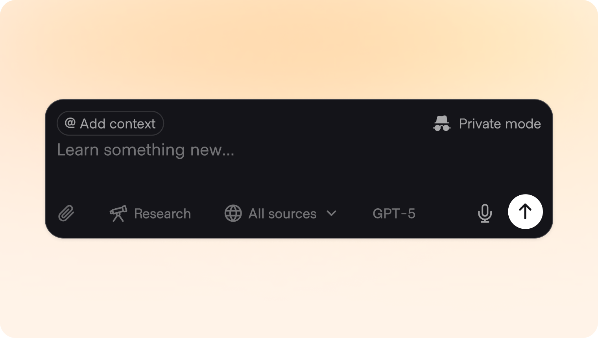
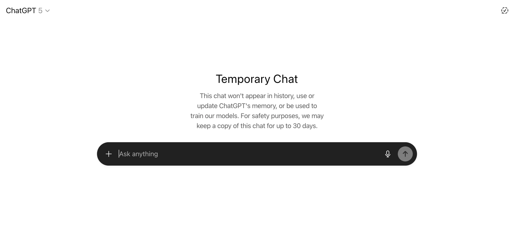
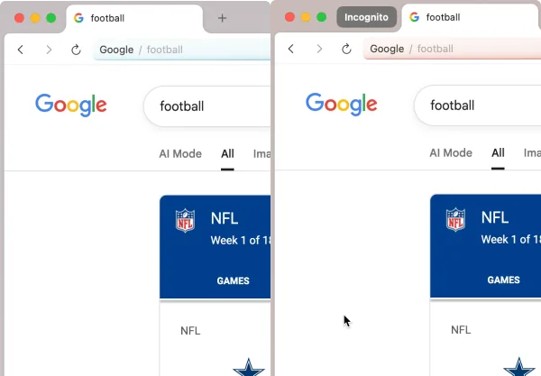
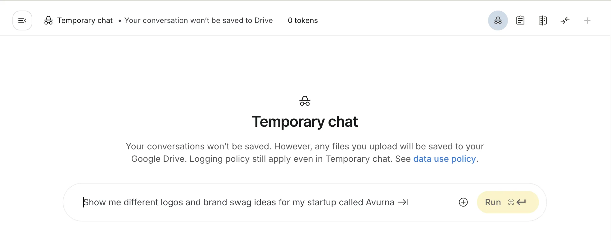
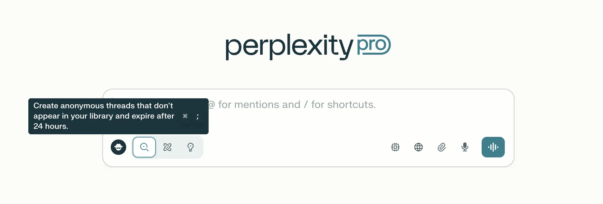
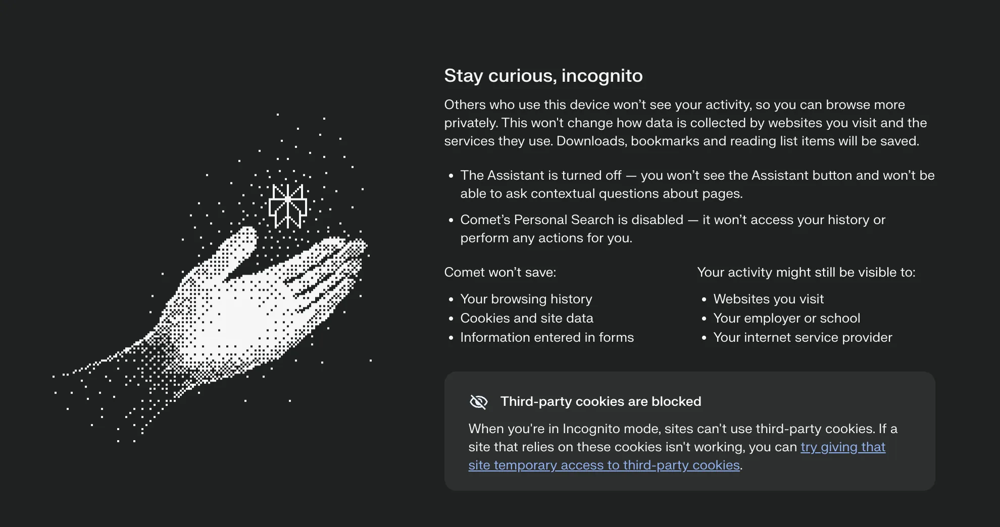
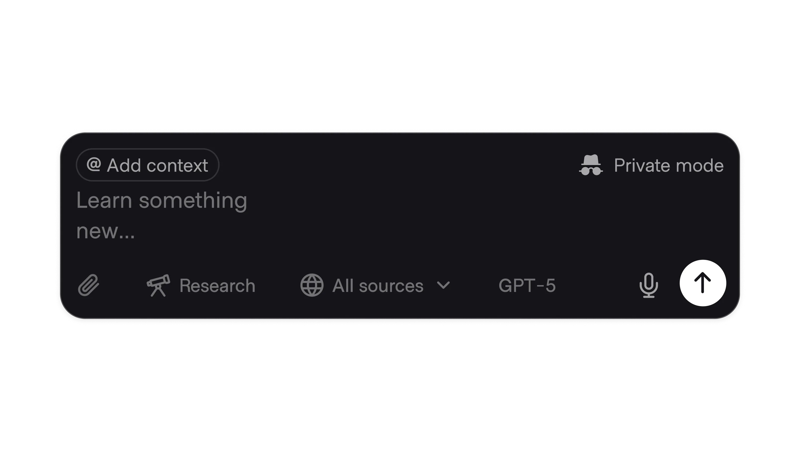

# Incognito Mode

**ID:** `incognito-mode`  
**Shape of AI:** https://www.shapeof.ai/pattern-types/trust-builders  **Related:** memory-personalization, disclosure

---

<!-- shapeof-captures:start -->
**Shape of AI captures** · [source](https://www.shapeof.ai/patterns/incognito-mode)
















<!-- shapeof-captures:end -->


## Purpose

Interact with AI outside of memory — clear toggle and session badge.

## When to use

User needs a turn outside memory.

## When not to use

Default for all enterprise threads without policy.

## Anatomy

Toggle · session badge · what is excluded

## Do / Don't

**Do:** Visible badge while on; clear what still logs.  
**Don't:** Silent memory writes in incognito.

## Snippet

```tsx
export function IncognitoToggle({ on, onToggle }: { on: boolean; onToggle: () => void }) {
  return <button type="button" onClick={onToggle} className={`rounded-control px-control py-dense text-2xs ${on ? "bg-warn-muted text-warn" : "text-ink-muted"}`}>{on ? "Incognito on" : "Incognito"}</button>;
}
```
