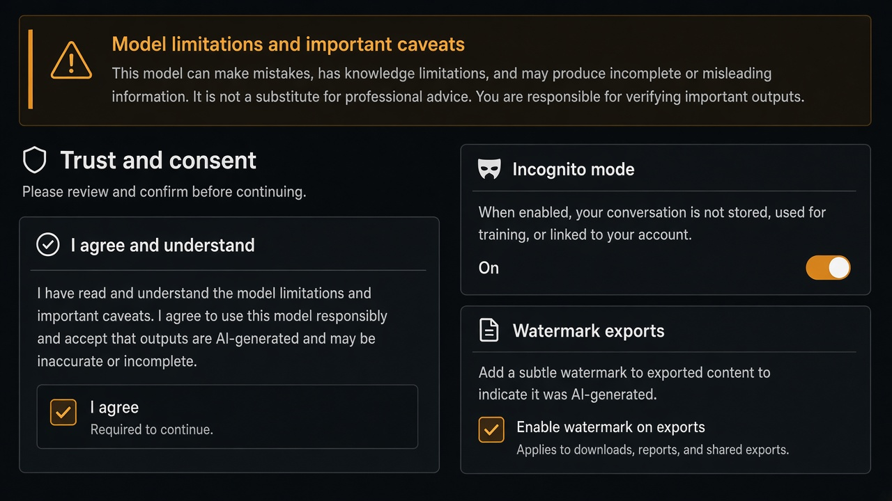

# Incognito Mode

**ID:** `incognito-mode`  
**Shape of AI:** https://www.shapeof.ai/pattern-types/trust-builders  **Related:** memory-personalization, disclosure

---



## Purpose

Interact with AI outside of memory — clear toggle and session badge.

## Snippet

```tsx
export function IncognitoToggle({ on, onToggle }: { on: boolean; onToggle: () => void }) {
  return <button type="button" onClick={onToggle} className={`rounded-control px-control py-dense text-2xs ${on ? "bg-warn-muted text-warn" : "text-ink-muted"}`}>{on ? "Incognito on" : "Incognito"}</button>;
}
```
