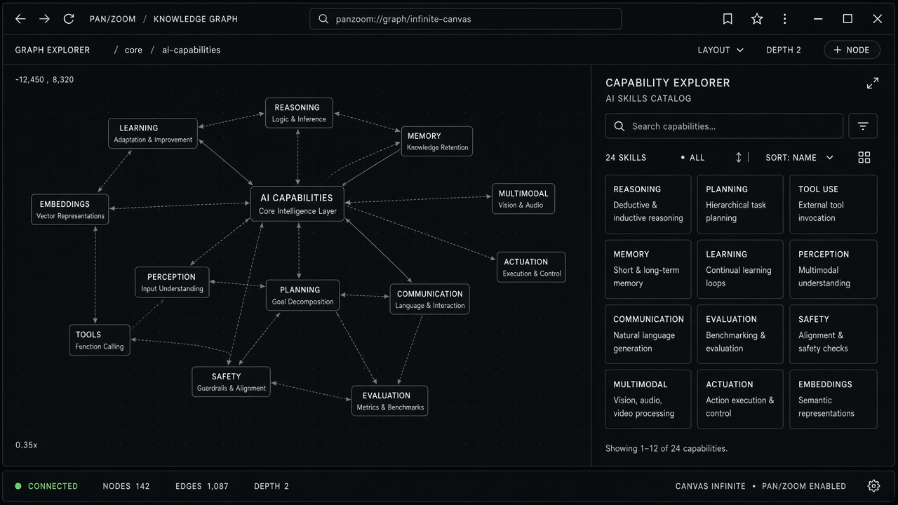

# Infinite Canvas

**ID:** `infinite-canvas`  
**Playground:** [infinite-canvas](https://aiuxplayground.com/pattern/infinite-canvas)  **Related:** dual-speed-layout, artifact-pane, generative-ui

---



## Purpose

Pan/zoom workspace for AI artifacts, nodes, and spatial agent work beyond a linear chat.

## When to use

Spatial work across many artifacts.

## When not to use

Short Q&A threads.

## Anatomy

Pan/zoom chrome · nodes · minimap optional

## Do / Don't

**Do:** Keyboard pan; clear selection; link to chat.  
**Don't:** Lose objects off-canvas with no finder.

## Snippet

```tsx
export function CanvasChrome({ children }: { children: React.ReactNode }) {
  return <div className="relative h-full min-h-[320px] overflow-hidden bg-canvas"><div className="absolute left-panel top-panel z-10 rounded-control border border-hairline bg-surface px-control py-dense text-2xs text-ink-muted">Pan · Scroll zoom</div>{children}</div>;
}
```
